# 三代报警定位卡 端侧功能与交互规格

> 副标题：框架约定 + 功能时序图 + 功能交互详述
> 版本：V0.7（基于 PRD V0.12 与软件技术文档 basic 基线、协议 V1.3；在 V0.6 基础上按 2026-10-15 二次调整同步：① SOS 取位改为"LBS/WIFI/GPS 各自扫描各自、扫描完成一路就传输一路"（每路独立 sosLocationMsg，对齐协议 V1.3 PositionType）② WiFi 扫描与传输时分：联调确认影响传输则扫描时可暂停数据传输 ③ 协议 V1.3 对齐：paraSet 新增 CallType（0=voip 默认/1=volte）；百度LBS临时文档已删除、内容以协议 V1.3 为准）
> 读者：设备端固件开发

---

## 第 0 章 文档说明

### 0.1 目的
本文档面向**设备端固件开发**，回答"每个功能发生时，设备一步步做什么、与平台如何收发消息"。它处在 PRD（要什么）与软件技术文档（架构 / 协议）之间，是开发的实现参照。

### 0.2 与另两份文档的关系
- **PRD（产品需求文档）**：定义功能需求（`F-xxx`）。本文档**不重写需求**，仅展开"动作"。
- **软件技术文档（basic 基线）**：定义架构、状态机、协议字段。本文档"平台交互"字段锚定其第 5 章，"状态迁移"锚定其第 3 章。

### 0.3 编号约定
- 每个功能条目锚定 PRD 的 `F-xxx`。
- 字段卡（第 3 章）：触发条件 / 前置条件 / 动作序列（标注 BLE 侧·Cat.1 侧）/ 平台交互 / 状态迁移 / 异常与回退 / 约束 / 验收标准 / 待确认。
- 时序图编号：`SEQ-xxx`，对应功能组；整体状态机见 `2.0`。

### 0.4 文档结构
- **第 1 章** 全局框架（约定，一次写清、后续引用）
- **第 2 章** 整体状态机 + 功能时序图（设备 ↔ 平台，Mermaid；只画有平台交互的功能，纯本地功能见第 3 章条目）
- **第 3 章** 功能交互详述（按 `F-xxx` 逐条，覆盖 F-001 ~ F-032）

---

## 第 1 章 全局框架

### 1.1 术语速查

| 术语 | 含义 |
|------|------|
| BLE SoC（GR5512） | 应用主控，常驻低功耗，负责 Cat.1 供电（GPIO→MOSFET）、状态机、外设（三轴 / 墨水屏 / 双键 / 无源 NFC） |
| Cat.1 模组 | 受控从机；GPIO→MOSFET 真断电，大部分时间 0 电流；仅作 4G 数据通道 + 串口管道 |
| 活动态 | 三轴**有数据**或**按键事件**（设备可能正被使用 / 用户操作），Cat.1 保持供电，运行于低功耗模式（已注册、可收发） |
| 静止态 | 三轴**无数据**、按业务休眠（无人使用），Cat.1 **真断电 0 电流**、蓝牙低功耗，仅三轴/按键唤醒 |
| 低功耗模式 | Cat.1 工作状态之一：已注册网络、eDRX 下行可达、可收发，功耗低 |
| 常规模式 | Cat.1 工作状态之一：需传输数据（上报 / VoIP / OTA 下载）时自动切入，传完回低功耗模式 |
| NV | BLE 侧 Flash 持久化（如 OTA 目标版本），跨 Cat.1 硬断电保留 |
| 预置 / 提交 | OTA 两阶段：蓝牙固件预置 = 活动态后台下载写 A/B 非活跃分区；Cat.1 固件仅常规升级（单分区，重启生效，无 A/B）；提交 = 安全静止窗"翻转重启"生效 |
| 平台 Topic | 下行 `down_raw`；上行报警类 `sos`、非报警类 `notsos` |

### 1.2 状态机速查（提炼自技术文档 3.2 / 3.3）

| 迁移 | 触发 | 动作 | 回迁 |
|------|------|------|------|
| 静止 → 活动 | 三轴中断（检测到运动）**或按键事件（双键报警 / IMEI 查询等）** | Cat.1 上电注册入**低功耗模式**；取位（顺序：**Beacon → WIFI → LBS → GPS → 空位置**）；发布 `onlineMsg` → 平台 `paraSetMsg(查)` → 决策参数/OTA（见 2.9）；恢复活动态 | — |
| 活动 → 静止 | 无运动 ≥ 5 min | **先清缓存 beacon**（`periodicMsg`）；取位（顺序同上）；`offlineMsg` 上报（电量+位置）；Cat.1 硬断电 0 电流 | 三轴唤醒 |
| 静止 → 报警（SOS 睡眠） | 双键同按 ≥ 3 s（静止态） | Cat.1 上电 → **切常规模式** → **优先** `sosMsg`+VoIP（单次拨打，不重拨）+`sosLocationMsg` → 再走上线流程（2.9）→ 活动态 | 用户长按取消 / 平台取消（不因通话未接结束） |
| 活动 → 报警（子流程） | 双键同按 ≥ 3 s | **切常规模式**，发 `sosMsg` + `sosLocationMsg`，发起 VoIP（单次拨打，不重拨） | 用户长按取消 / 平台取消（不因通话未接结束） |
| 活动 → OTA 预置（子流程） | 收到 `otaMsg` | 写 NV，活动态空闲后台预置（A/B 非活跃分区） | 静止态提交 |
| OTA 提交 | 稳定静止 + 充电中 + 电量 ≥ 70%（端侧固定阈值） + 无报警 | 翻转重启数秒，新固件生效，清 NV | 回正常态 |

### 1.3 端侧拓扑与角色

- **蓝牙 SoC 常驻主控**：管 Cat.1 供电、状态机、外设；升级时仍为主控，Cat.1 仅作 4G 下载通道与串口管道（无主从角色翻转）。
- **外设归属**：三轴加速度、墨水屏、双按键均挂载蓝牙侧；NFC 无源，刷卡不耗设备电，**且与 BLE/Cat.1 无任何事件关联**（刷卡不触发设备软件逻辑）。
- **Cat.1 从机**：常规 / 低功耗两模式由蓝牙编排；VoIP 媒体面由模组内置完成，设备仅配地址 / 账号 / 密码。

### 1.4 通用约束

- **续航**：≥ 7 天（每日 8h 工作 + 16h 休眠）；500mAh 电池；双状态机为核心落地方式。
- **加密**：仅 **mqtts（MQTT over TLS 8883）**，传输层已加密（无需应用层加密）。
- **上报节奏**：蓝牙扫描累计 **60 次（≈60 min）** 上报一次，或**休眠前**上报（均带电量）；时间周期兜底 60 min。
- **电量 / 充电**：低电量 **25%** 提醒并上报；OTA 提交需 **充电中 + 电量 ≥ 70%（端侧固定阈值，非平台可配）**。
- **三轴语义**：运动（三轴有数据）= 可能被使用，关键期不可中断；静止（三轴无数据、休眠）= 无人使用，是 OTA 提交等维护的**天然安全窗**。
- **定位顺序（上下线 / 寻人）**：上线、下线、一键寻人的取位顺序为 **蓝牙Beacon → WIFI → LBS → GPS → 空位置**（依次尝试，取到即用；均无则上报空位置）。
- **SOS 取位（逐路传输）**：报警时**有蓝牙Beacon 即只报 Beacon**；无 Beacon 则 LBS、WIFI、GPS **各自扫描各自，扫描完成一路就传输一路**（不等待汇聚，抢时间）；三路均无结果则只上报**空位置**。
- **WiFi 扫描与传输时分**：联调时若确认 WiFi 扫描影响数据传输，扫描时可考虑暂停数据传输，避免数据上传丢失（以联调结论为准）。
- **语音通道（默认 VoIP，VoLTE 保留）**：Cat.1 模组可同时具备 VoIP 与 VoLTE 两种语音能力，但二者**互斥**——同一时刻仅一种语音通道生效，不可同时使用；**默认启用 VoIP**，VoLTE 作为保留能力并存，运行时仅启用其一；报警 / 通话统一经当前生效的语音通道（默认 VoIP）。

### 1.5 参数表速查（锚定技术文档 5.6）

| 参数 | 设备默认 | 说明 |
|------|---------|------|
| BleScanInterval | 1 min | 运动时扫描间隔（失锁时递增，见 1.2 / 6.1） |
| BleScanPeriod | 2 s | 单次扫描窗口 |
| RestTime | 5 min | 静止判定时长 |
| PeriodicPara | 60 min | 周期上报兜底上限（主触发为 60 次扫描） |
| PowerThreshold | 10 % | <10% 停止周期上报 |
| SosTime | 3 s | 报警双键时长 |
| SosReplyTimeout | 15 s | 报警消息重报超时 |
| SosLocationReplyTimeout | 30 s | 报警位置重报超时 |
| AutoOta | 1（平台主动推送） | 0 = 平台不主动推送 |
| CallType | 0（voip） | **协议 V1.3 新增**：语音通话类型，0=voip、1=volte，默认 0；平台可经 `paraSetMsg` 下发切换 |
| OtaBatteryThreshold | 70 % | 端侧固定常量（非平台可下发参数）；安全阈值 70% |
| MqttAddr / User / Passwd / KeepAlive | 平台下发 | MQTT 连接信息 |
| BeaconUploadMethod / Addr | 暂留 | 暂时保留（本代不启用）；对应的 HTTP 历史轨迹上传接口本代保留为协议兼容占位，蓝牙 beacon 统一由 `periodicMsg` 携带 Beacon[] 取代 |

### 1.6 通用异常与可靠性原则

- **A/B 双分区（蓝牙固件）**：蓝牙固件支持 A/B 双分区回滚；Cat.1 固件仅常规升级（单分区，重启生效，失败可重推），不采用 A/B；签名校验；升级失败 / 断电可回旧分区，拒绝成砖。
- **重报（报警类 / 找人类）**：`sosMsg`/`sosLocationMsg` 与 `personSearchMsg` 定位响应发出后 **60s 内未收到平台确认则重发，最多重发 3 次**（含首报共 4 次），仍失败本地记录、下次上线补报。
- **消息确认策略（详见 PRD F-033）**：**仅报警类（`sosMsg`/`sosLocationMsg`）与找人类（`personSearchMsg` 定位响应）需平台应用层确认**（60s / 最多 3 次重发）；**其余消息（paraSet/phoneBind/ota/reboot 等下行指令及其回执、onlineMsg/offlineMsg/periodicMsg/lowBatteryMsg 等纯上行通知）均无需平台确认**，纯上行通知依赖 MQTT QoS1，断连缓存、恢复后补报。
- **断连重连补报**：网络异常自动重连，关键数据（报警 / 低电量 / 最后位置）下次上线补报。
- **超时 / 失败**：VoIP 单次拨打，不主动重拨；无论对端是否接听，报警保持“进行中”至用户长按取消或平台取消。

---

## 第 2 章 整体状态机 + 功能时序图（设备 ↔ 平台）

> 说明：下图均为**设备 ↔ 平台**消息流（Mermaid `sequenceDiagram`）。图中标注每条消息的**方向（→ 下行 / ← 上行）**、MsgType、关键字段。BLE ↔ Cat.1 串口交互不在此层绘制，详见第 3 章各功能条目。

### 2.0 整体设备状态机（全覆盖）

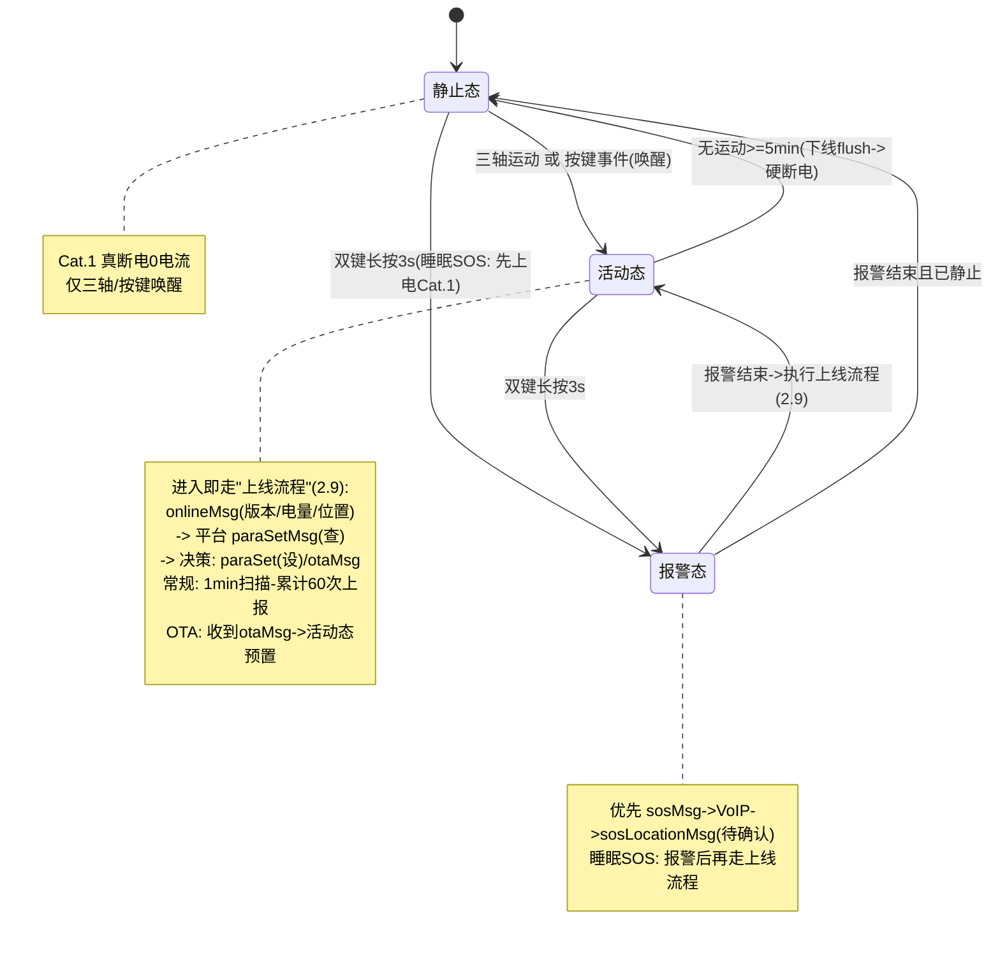

### 2.1 SEQ-ALARM 报警与位置上报（F-001 ~ F-004）

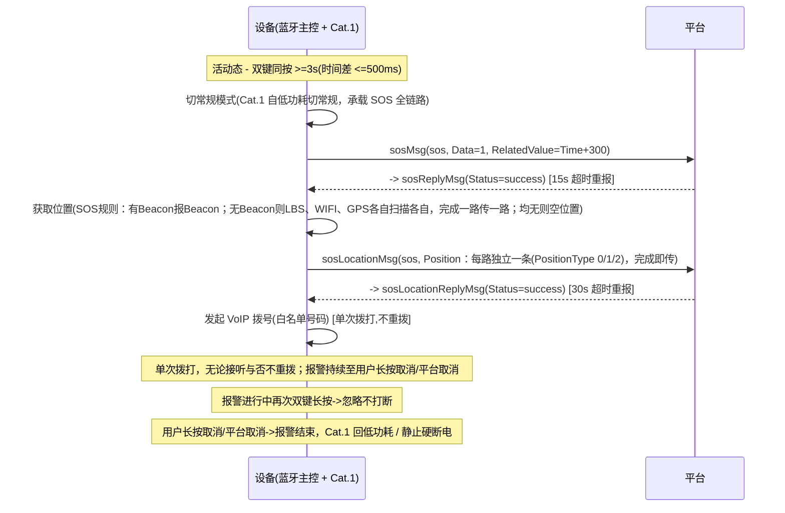

### 2.2 SEQ-LOCATE 日常定位与关机前上报（F-005 ~ F-010, F-013）

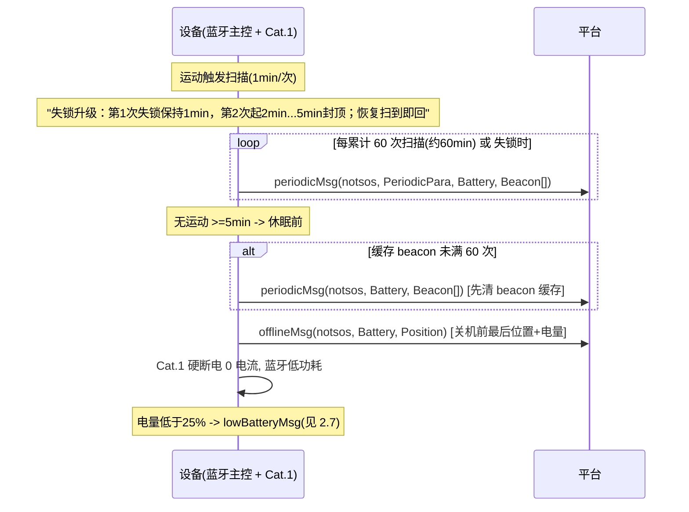

### 2.3 SEQ-VOIP VoIP 绑定与通话（F-002, F-025）

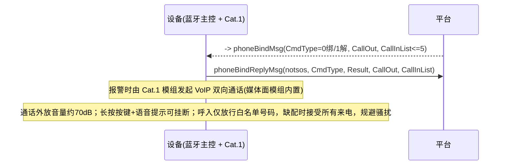

### 2.4 SEQ-OTA OTA 全流程（F-029 ~ F-032）

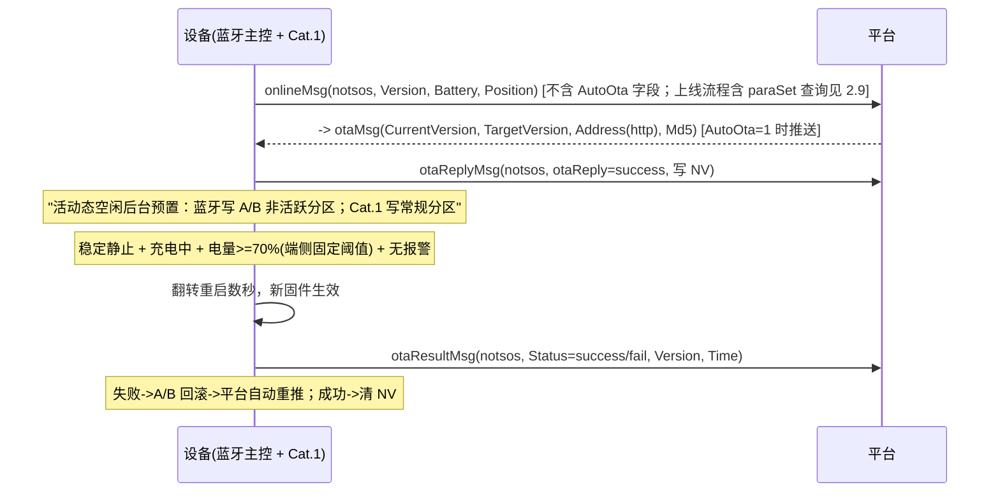

### 2.5 SEQ-CONFIG 远程配置（F-019）

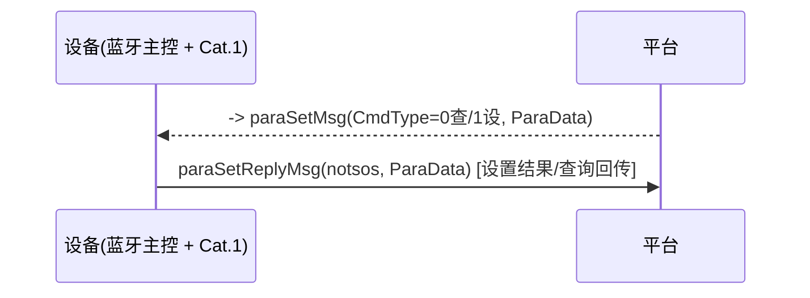

### 2.6 SEQ-SEARCH 一键寻人（F-018）

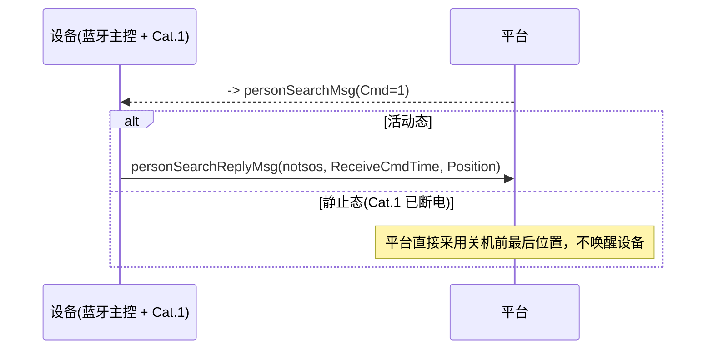

### 2.7 SEQ-LOWBAT 低电量预警（F-013）

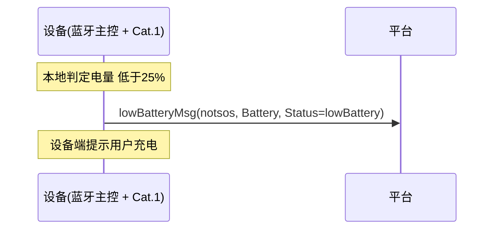

### 2.8 SEQ-OFFLINE 下线 / 休眠前上报（F-010）

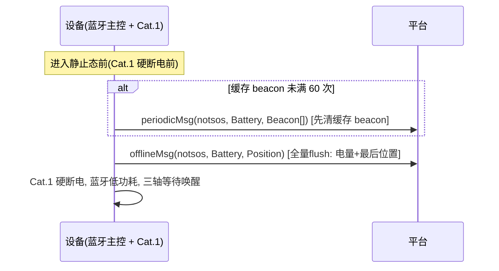

### 2.9 SEQ-ONLINE 上线流程（F-012, F-029, F-030）

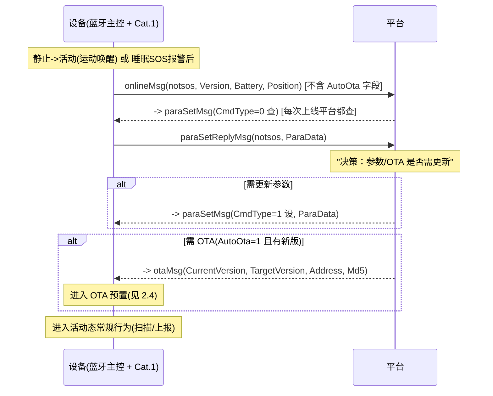

### 2.10 SEQ-SLEEPSOS 休眠中触发 SOS（F-001, F-002, F-003）

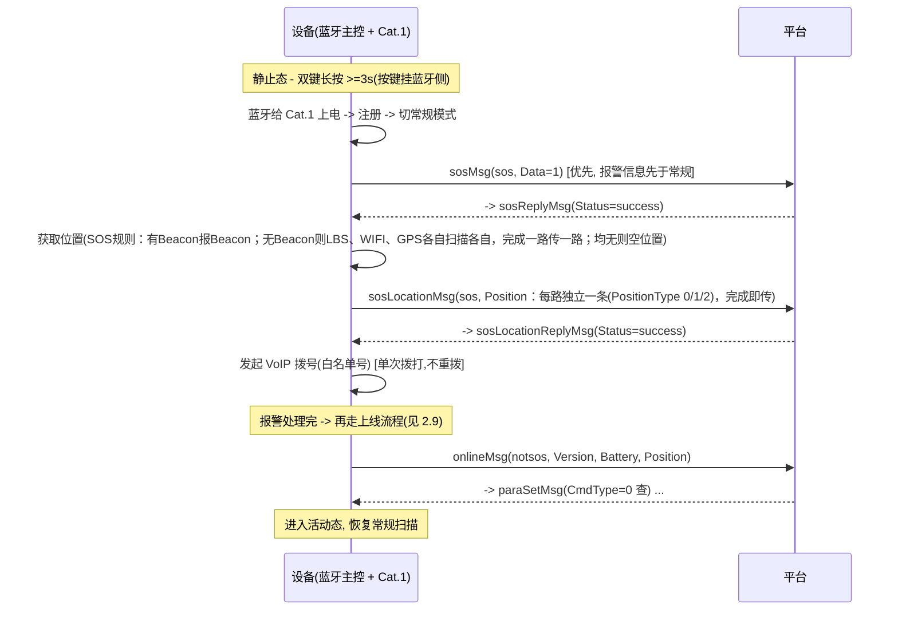

---

## 第 3 章 功能交互详述

> 字段卡说明：触发条件 / 前置条件 / 动作序列（标注 BLE 侧·Cat.1 侧）/ 平台交互（MsgType + 方向 + 字段，锚定第 2 章 SEQ）/ 状态迁移（锚定 1.2）/ 异常与回退 / 约束（锚定 1.4/1.5）/ 验收标准 / 待确认。纯本地功能省略平台交互。动作粒度：模块级。

### 3.1 紧急报警（F-001 ~ F-004）

**F-001 双键报警**
- 触发：左、右键**同时长按 ≥ 3 s**，两键按下时刻差 ≤ 500 ms 判定为同按
- 前置：
  - 活动态（Cat.1 已上电入低功耗模式）→ 直接进报警子流程
  - **静止态（睡眠 SOS）**：按键挂蓝牙侧，蓝牙检测后**先给 Cat.1 上电联网**，再进入报警流程（见 SEQ-SLEEPSOS）；报警信息**优先**于常规上线消息
- 动作序列（BLE 侧）：三轴中断→唤醒→检测双键 GPIO 长按计时；计时达 3 s 且时间差 ≤ 500 ms→置"报警中"标志，触发 F-002 / F-003 / F-004
- 状态迁移：活动 → 报警 / 静止 → 报警（SOS 睡眠）（1.2）
- 异常与回退：单键长按忽略；报警进行中再次双键长按 → **忽略不打断**（不重拨）
- 约束：SosTime = 3 s；双键防误报
- 验收：双键同按 3 s 内触发；单键 / 先后超 500 ms 不触发；报警中再按不重触发；睡眠态按键能先上电再报警

**F-002 VoIP 急救呼叫**
- 触发：F-001 命中
- 前置：Cat.1 切常规模式（联网）；白名单号码已由 `phoneBindMsg` 绑定
- 动作序列（Cat.1 侧）：经 VoIP 模组发起双向通话（**默认 VoIP 通道**）→ 拨打**呼出白名单单号（`CallOut`）**；**单次拨打即完成，不主动重拨**（无论对端是否接听）；报警保持进行中至用户长按取消或平台取消；通话外放约 70 dB；**呼入白名单（`CallInList`，最多 5 个）建议配置以规避骚扰电话；`CallInList` 为空（缺配）时接受所有来电**
- 平台交互：通话信令由 Cat.1 模组 VoIP 媒体面完成，**不经 MQTT**；绑定见 SEQ-VOIP
- 异常与回退：Cat.1 注册失败有限次重试；拨号不通不重拨（单次拨打即止，不进入重拨循环）；仍失败则本地记录，下次 `onlineMsg` 补报
- 约束：仅拨打呼出白名单单号（`CallOut`）；呼入白名单（`CallInList`≤5）建议配置、仅放行白名单号码（缺配时接受所有来电）；VoIP 双向 + 双向挂断；默认 VoIP 通道（VoLTE 保留、运行时互斥）
- 验收：触发后 ≤ 15 s 内起呼；单次拨打不重拨；报警持续至用户长按取消/平台取消；长按按键语音提示后可挂断

**F-003 位置上报（报警）**
- 触发：F-001 命中，与 F-002 并发
- 动作序列（BLE 侧 / Cat.1 侧）：切常规模式 → 获取位置（**SOS 取位规则**：有蓝牙Beacon 即只报 Beacon；无 Beacon 则 LBS、WIFI、GPS **各自扫描各自，扫描完成一路就传输一路**；三路均无则**空位置**）
- 平台交互：← `sosLocationMsg`(sos, Position：每路独立一条，PositionType 分别 Bluetooth / 0=LBS / 1=WIFI / 2=GPS / 3=空位置)；→ `sosLocationReplyMsg`(60 s 超时重报)（SEQ-ALARM / SEQ-SLEEPSOS）
- 约束：SOS 取位 = Beacon 短路；无 Beacon 则三路各自扫描、完成一路传一路；均无则空位置
- 验收：报警位置随通话上报、类型正确；30 s 未回重报

**F-004 报警指示**
- 触发：F-001 命中（触发与取消）
- 动作序列（BLE 侧）：屏显"报警中 / 已取消"；经串口指令让 Cat.1 侧喇叭播报语音（**不含蜂鸣器 / 指示灯 / 马达**）
- 约束：指示仅语音 + 屏幕
- 验收：报警 / 取消均有语音 + 屏显；无蜂鸣 / 灯 / 震动

### 3.2 日常蓝牙定位与监测（F-005 ~ F-008）

**F-005 运动触发扫描**
- 触发：三轴检测到运动（活动态）
- 动作序列（BLE 侧）：启动蓝牙 beacon 扫描，对象 Seekcy iBeacon UUID `1918FC80-B111-3441-A9AC-B1001C2FE510`
- 约束：BleScanInterval = 1 min，BleScanPeriod = 2 s
- 验收：运动时按 1 min 扫描目标 iBeacon

**F-006 扫描频率策略**
- 触发：扫描结果变化
- 动作序列（BLE 侧）：默认 1 min/次；**失锁升级**：第 1 次扫描不到保持间隔 1 min（基线），第 2 次失锁起间隔依次递增 1 min（2 / 3 / 4 / 5 min），**最长 5 min 1 次**；**恢复规则**：在 5 min 间隔下再次扫描到 beacon，立即恢复 1 min 扫描 1 次（详见技术文档 6.1 算法）
- 约束：递增上限 5 min；恢复即回 1 min
- 验收：第 1 次失锁保持 1 min；第 2 次起递增；恢复扫描即回 1 min

**F-007 日常定位源**
- 触发：日常（非报警）
- 动作序列：仅蓝牙定位，不用 WIFI / LBS / GPS
- 约束：日常禁 WIFI / LBS / GPS（定位链仅上线 / 下线 / 寻人 / SOS 使用）
- 验收：日常上报 PositionType = Bluetooth

**F-008 位置上报（日常）**
- 触发：蓝牙扫描累计达 60 次（≈60 min）；或休眠前
- 取位顺序（2026-10-15 调整，offlineMsg 取位时适用）：**蓝牙Beacon → WIFI → LBS → GPS → 空位置**（依次尝试，取到即用；均无则报空位置）
- 平台交互：← `periodicMsg`(notsos, PeriodicPara, Battery, Beacon[])（SEQ-LOCATE）；休眠前见 `offlineMsg`（SEQ-OFFLINE）；**注：HTTP 历史轨迹文件上传接口本代保留为协议兼容占位、未启用，beacon 统一由此 `periodicMsg` 携带 Beacon[] 上报**
- 约束：每次上报带电量；< 10% 停止周期上报；时间兜底 60 min；**休眠前若缓存 beacon 未满 60 次，先用 `periodicMsg` 清缓存再发 `offlineMsg`**
- 验收：每 60 次扫描上报 1 次（计数清零）；休眠前必报（先清 beacon 再 offlineMsg）；带电量；取位顺序按 Beacon→WIFI→LBS→GPS→空位置

### 3.3 电源与休眠管理（F-009 ~ F-013）

**F-009 静止判定**
- 触发：无运动持续达 RestTime = 5 min
- 动作序列（BLE 侧）：置静止态标志，触发 F-010 / F-011
- 验收：静止 5 min 进入静止态

**F-010 关机前位置上报**
- 触发：进入静止态前（Cat.1 硬断电前）
- 取位顺序（2026-10-15 调整）：**蓝牙Beacon → WIFI → LBS → GPS → 空位置**（依次尝试，取到即用；均无则报空位置）
- 平台交互：← `offlineMsg`(notsos, Battery, Position)（SEQ-OFFLINE）；**若缓存 beacon 未满 60 次，先发 `periodicMsg` 清缓存**
- 约束：离线消息仅携带电量 + 最后位置（协议定义）；beacon 已在离线前由 periodicMsg 清掉；**本代不启用该 HTTP 历史轨迹接口（保留为协议兼容占位，统一由 `periodicMsg` 携带 Beacon[]）**
- 验收：每次硬断电前离线消息送达；beacon 缓存已先清空；取位顺序按 Beacon→WIFI→LBS→GPS→空位置

**F-011 静止态休眠**
- 触发：F-010 完成
- 动作序列（BLE 侧）：Cat.1 GPIO→MOSFET 真断电（0 电流）；蓝牙入低功耗；三轴/按键等待唤醒
- 约束：静止态 Cat.1 真断电
- 验收：静止态 Cat.1 0 电流；三轴/按键可唤醒

**F-012 运动唤醒**
- 触发：三轴中断**或按键事件（双键报警 / IMEI 查询 / 通话中长按挂断等）**
- 动作序列（BLE 侧）：给 Cat.1 上电；Cat.1 注册入低功耗模式；恢复活动态 → 走上线流程（SEQ-ONLINE）
- 状态迁移：静止 → 活动（1.2）
- 验收：运动即唤醒；Cat.1 入低功耗（非常规常开）；上线即报版本+电量+位置并响应平台参数查询

**F-013 低电量提醒**
- 触发：电量 < 25%（本地判定）
- 平台交互：← `lowBatteryMsg`(notsos, Battery, Status=lowBattery)（SEQ-LOWBAT）
- 动作序列（BLE 侧）：屏显 / 语音提示用户充电
- 约束：25% 阈值（产品需求，非协议字段）
- 验收：< 25% 提示并上报；周期 / 关机前上报均带电量

### 3.4 无源 NFC（F-014 ~ F-016）

**F-014 餐饮消费 / F-015 门禁通行 / F-016 刷卡灵敏度**
- 触发：NFC 区域贴近读卡器
- 动作序列（NFC 无源）：无源 NFC（复旦微 1208-10）为被动元件，由外部读卡器供能交互，设备不耗电；**与 BLE/Cat.1 无任何事件关联**，刷卡不触发设备软件逻辑（不联动状态机/上报）
- 约束：复旦微 1208-10；刷卡区域避开天线；成功率 ≥ 99%
- 验收：贴近即识别；餐饮 / 门禁可用；成功率 ≥ 99%
- 待确认：刷卡成功后的本地反馈（屏显 / 无）由结构 / UI 定

### 3.5 平台通信（F-017 ~ F-019）

**F-017 事件上报**
- 平台交互：锚定 SEQ-ALARM / LOCATE / LOWBAT / OFFLINE / ONLINE，经 mqtts 上报报警 / 位置 / 低电量等（见各功能平台交互）
- 约束：仅 mqtts（TLS 8883），传输层已加密（无需应用层加密）

**F-018 一键寻人**
- 触发：平台 `personSearchMsg`(Cmd=1)
- 取位顺序（2026-10-15 调整，活动态即时取位时适用）：**蓝牙Beacon → WIFI → LBS → GPS → 空位置**（依次尝试，取到即用）
- 平台交互：活动态 → ← `personSearchReplyMsg`(notsos, ReceiveCmdTime, Position)；静止态 → 平台用最后位置、**不唤醒设备**（SEQ-SEARCH）
- 验收：活动态即时回位置（取位顺序 Beacon→WIFI→LBS→GPS→空位置）；静止态不唤醒、平台用历史位置

**F-019 远程配置**
- 触发：平台 `paraSetMsg`(CmdType=0 查 / 1 设, ParaData)
- 平台交互：← `paraSetReplyMsg`(notsos, ParaData)（SEQ-CONFIG）
- 约束：白名单 / 扫描 / 休眠 / AutoOta / CallType（0=voip 默认，1=volte，协议 V1.3 新增）等可配（OtaBatteryThreshold 为端侧固定常量，非平台可配）
- 验收：查询回传当前值；设置生效并回执

### 3.6 屏幕显示与交互（F-020 ~ F-025）

**F-020 屏幕尺寸**：27 × 27 mm 墨水屏（BLE 侧驱动）
**F-021 居民信息显示**：屏显姓名 + 房间号（平台下发，经 `paraSetMsg` 配置）；BLE 侧刷新
**F-022 必选状态显示**：电量 / 信号 / 欠费 / 通话呼出 / 通话挂断（BLE 侧实时刷新）
**F-023 可选状态显示**：日期 / 时间（可关闭保续航）
**F-024 IMEI 查询**：连续按左键或右键 → 屏显本机 IMEI（BLE 侧本地读取）；IMEI 同时丝印卡身（F-026）
**F-025 通话音量**：Cat.1 侧外放约 70 dB（VoIP 通话时）
- 约束：墨水屏字大清晰；音量约 70 dB
- 待确认：屏显刷新节奏（事件驱动 vs 定时）；墨水屏字库 / 图片**建议优先本地固化**，网络下发可行性待评估（见 PRD 待确认事项 7）

### 3.7 卡身标识与配件（F-026 ~ F-028）

**F-026 IMEI 丝印**：卡身后小字体不易抹掉（结构 / 生产，非固件）
**F-027 安全挂绳**：主孔 + 居中副孔双孔（副孔结构评估）
**F-028 刷卡区域标注**：机身标 NFC 区域（避开天线）
- 注：3.7 多为结构 / 生产项，固件侧仅 F-024 IMEI 读取联动

### 3.8 OTA 远程升级（F-029 ~ F-032）

**F-029 版本与参数上报**
- 触发：每次上线（静止 → 活动，或睡眠 SOS 报警后）（见 SEQ-ONLINE）
- 平台交互：← `onlineMsg`(notsos, Version, Battery, Position)（SEQ-ONLINE / SEQ-OTA；**不携带 AutoOta 字段**，auto-OTA 为平台经 `paraSetMsg` 下发的设备参数）；平台随后 `paraSetMsg(查)` 决策
- 验收：上线即报版本 + 电量 + 位置；响应平台参数查询

**F-030 平台主动推送**
- 触发：平台侧（每次上线经 `paraSetMsg(查)` 后，AutoOta = 1 时检查版本）
- 平台交互：→ `otaMsg`(CurrentVersion, TargetVersion, Address, Md5)（SEQ-OTA）；AutoOta = 0 不推送
- 约束：命令**不指定时机**，设备自调度
- 验收：AutoOta = 1 有新版即推送；= 0 不推送

**F-031 无感自调度升级**
- 触发：收到 `otaMsg`
- 动作序列（BLE 侧编排 / Cat.1 侧）：写 NV(TargetVersion) → 回 `otaReplyMsg`；活动态空闲后台预置（蓝牙镜像写 A/B 非活跃分区、Cat.1 镜像写常规分区，支持断点续传，报警 / VoIP / 定位可用）；稳定静止 + **充电中** + 电量 ≥ 70%（端侧固定阈值）+ 无报警 → 翻转重启数秒提交
- 平台交互：← `otaReplyMsg`(otaReply=success, 已写 NV)；← `otaResultMsg`(Status, Version, Time)
- 状态迁移：活动 → OTA 预置；静止态提交（1.2）
- 异常与回退：预置失败续传；提交失败 A/B 回滚；回滚后平台自动重推
- 约束：**无强制升级**；提交需充电中 + 电量 ≥ 70%（端侧固定阈值，非平台可配）；提交窗为静止态（三轴无数据、无人使用、天然安全，无需主动避开）
- 验收：活动态预置不阻塞用户；仅静止 + 充电达阈值提交；失败回滚不成砖

**F-032 版本校验与回执**
- 触发：`otaMsg` 到达 / 升级完成
- 动作序列：TargetVersion ≤ 当前 → 清 NV 不升；成功 → 上报新版本 + 清 NV；失败 → `otaResultMsg`(fail)
- 平台交互：← `otaResultMsg`(Status=success/fail, Version)
- 验收：版本 ≤ 当前清 NV；成功上报；失败平台重推
