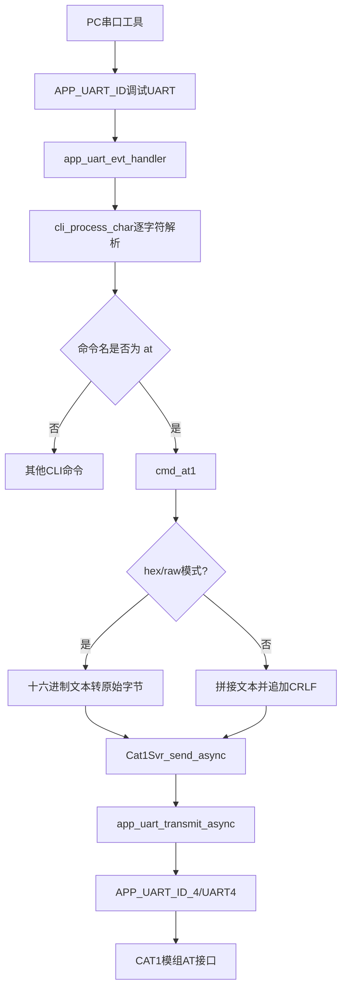
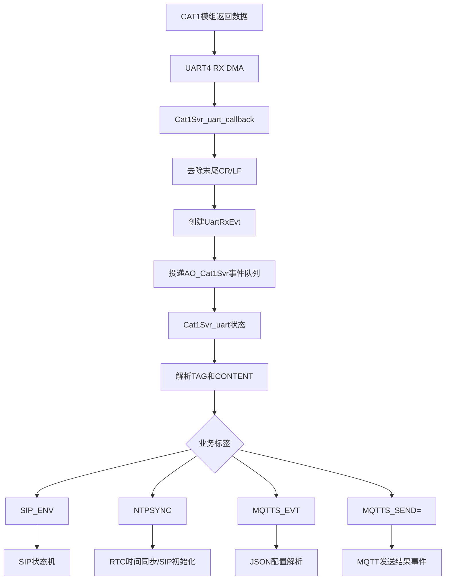

# CAT1 AT 指令下发与响应流程

> 分析对象：`D:\CODEX\sos-card\ble_app_uart_c` GCC 工程。  
> 重点文件：`Src\user\at_cmds.c`、`Src\user\cat1svr.c`、`Src\platform\user_periph_setup.c`、`Src\platform\bsp.c`。  
> 重要边界：本文按源码分析当前状态，不等同于 CAT1 模组手册中的完整 AT 指令表。

## 1. 结论先行

本工程的 AT 指令不是直接从 CAT1 UART 终端输入，而是：

```text
PC/串口工具
  → GR5526 调试 UART（APP_UART_ID）
  → CLI 命令解析
  → 输入 `at ...`
  → at_cmds.c 组包
  → Cat1Svr_send_async()
  → UART4（APP_UART_ID_4）
  → CAT1 模组
```

普通文本 AT 指令会自动追加 `\r\n`；二进制模式不会追加 `\r\n`。

但是，当前 GCC 工程存在一个必须先处理的启用问题：

1. `at_cmds.c` 的 `at` 命令调用 `Cat1Svr_send_async(&AO_Cat1Svr, ...)`。
2. `BSP_start()` 中 `Cat1Svr_ctor()`、`Cat1Svr_init_hw()` 和 `QACTIVE_START()` 被 `#if 0` 禁用。
3. `user_periph_setup.c` 中的 `uart4_init()` 是 `static`，且 `app_periph_init()` 当前没有调用它。

因此，从当前源码状态看，`at ...` 命令虽然注册进 CLI，但 CAT1 UART4 发送链路没有得到完整启动，不能直接宣称“当前固件已经可以稳定下发 AT 指令”。需要先启用并初始化 CAT1 UART 服务，再进行实机验证。

## 2. 用户实际怎样下 AT 指令

### 2.1 连接方式

使用调试串口连接 GR5526 的 `APP_UART_ID`，打开 CLI。波特率、TX/RX 引脚和 MUX 由 `board_SK.h` 中的 `APP_UART_*` 宏决定，不能仅依据本文件猜测物理引脚。

CLI 初始化路径为：

```text
app_periph_init()
  → uart_init()
  → app_log_assert_init()
  → cli_init()
```

### 2.2 普通文本 AT 指令格式

在调试串口输入：

```text
at <AT指令及参数>
```

例如：

```text
at AT
at CC_INIT
at SIP_INIT
at SIP_DIAL
at SIP_ACCEPT
at SIP_HANGUP
at TTSPLAY=报警成功,1,5
at NTPSYNC
```

CLI 会把 `at` 后的所有参数按空格重新拼接，并在末尾追加：

```text
\r\n
```

例如输入：

```text
at CC_INIT
```

实际发送给 CAT1 UART 的字节为：

```text
C C _ I N I T \r \n
```

注意：代码中的 `at` 是 GR5526 本地 CLI 前缀，不是发送给 CAT1 的内容。CAT1 实际收到的是 `CC_INIT\r\n`，不会收到前面的 `at `。

### 2.3 二进制/十六进制发送

格式：

```text
at hex 55 AA 01
```

或：

```text
at raw 55 AA 01
```

规则：

- 每个字节必须是两个十六进制字符。
- 发送原始字节，不自动添加 `\r\n`。
- 输入非法字节会返回 `invalid hex byte`。
- 缓冲区上限由 `CLI_MAX_CMD_LEN` 决定。

## 3. 软件下发流程



### 3.1 `at_cmds.c` 的关键行为

普通文本分支：

```c
for (i = 1; i < argc; i++) {
    // 拼接 at 后面的所有参数
}
send_buf += "\r\n";
Cat1Svr_send_async(&AO_Cat1Svr, send_buf, send_len);
```

发送结果主要有：

| 返回值 | 含义 |
|---|---|
| `APP_DRV_SUCCESS` | 已提交到 UART 异步发送接口 |
| `APP_DRV_BUSY` | UART 忙，发送失败 |
| 其他值 | 驱动发送错误 |

当前 `cmd_at1()` 中用于打印 `Sent:` 或错误信息的 `switch` 被 `#if 0` 包住，因此该命令执行后可能没有发送结果回显。这不代表 CAT1 没有响应，只代表本地 CLI 反馈代码被禁用。

## 4. CAT1 UART 接收和响应流程

### 4.1 预期的 QP/CAT1 AO 路径

如果启用 `Cat1Svr`，预期路径为：



### 4.2 当前直接 UART4 回调路径

`user_periph_setup.c` 另有一个较简单的 `uart4_evt_handler()`：

1. 接收 UART4 数据。
2. 添加字符串结束符。
3. 去除结尾 `\r`、`\n`。
4. 按格式 `[TAG] content` 解析。
5. 目前明确处理 `NTPSYNC`。
6. 重新开启 UART4 异步接收。

但当前 `uart4_init()` 没有在 `app_periph_init()` 中调用，所以这条路径也不能视为已经启动。

## 5. 源码中出现的 CAT1 AT 指令

下表是从当前工程源码中提取的指令，不是 CAT1 模组完整指令手册：

| 指令 | 出现位置 | 用途/触发场景 | 当前状态 |
|---|---|---|---|
| `AT` | 可由 CLI 手工输入 | 基础模组响应测试 | 可通过 `at AT` 发送，CAT1链路需先启用 |
| `CC_INIT` | `cat1svr.c` | CC/SIP 初始化 | 状态机调用，Cat1Svr 当前未启动 |
| `SIP_INIT` | `cat1svr.c` | SIP 初始化分支 | 条件分支，当前未启动 |
| `SIP_DIAL` | `cat1svr.c` | 发起呼叫 | SOS/业务状态机调用 |
| `SIP_ACCEPT` | `cat1svr.c` | 接听呼叫 | 按键事件调用 |
| `SIP_HANGUP` | `cat1svr.c` | 挂断呼叫 | 按键/状态机调用 |
| `CC_ACCEPT` | `cat1svr.c` | CC 接听 | `CC_CALL` 配置下的业务调用 |
| `CC_HANGUP` | `cat1svr.c` | CC 挂断 | `CC_CALL` 配置下的业务调用 |
| `TTSPLAY=报警成功,1,5` | `cat1svr.c` | 播放语音提示 | SOS 流程调用 |
| `NTPSYNC` | `cat1svr.c` | 请求/触发时间同步 | 与 `[NTPSYNC] OK <timestamp>` 响应配合 |
| `MQTTS_SEND=<topic>,<json>` | `cat1svr.c` | 向 MQTT 主题发送 JSON | MQTT 配置业务调用 |

## 6. CAT1 电源控制命令

这是 GR5526 本地 CLI 命令，不是 CAT1 模组 AT 指令：

```text
cat1_power on
cat1_power off
cat1_power reset
```

注册位置：`cat1svr.c` 的：

```c
CLI_CMD_REGISTER("cat1_power", "cat1_power [on|off|reset]", Cat1Svr_power);
```

电源控制通过 `Pwr_Jkb()` 相关 GPIO 完成。非 PAD 板型默认定义为：

| 信号 | 软件定义 |
|---|---|
| LDO2 | GPIOB Pin0 |
| LDO3 | GPIOB Pin1 |
| CAT1 供电 | GPIOB Pin2 |

PAD 板型切换为 GPIOA Pin9、GPIOA Pin7、GPIOA Pin6。实际使用哪组由板型宏决定。

## 7. 建议的实机下发顺序

在确认 UART4 初始化和 `Cat1Svr AO` 已启用后，建议使用以下顺序：

```text
1. cat1_power reset
2. at AT
3. at CC_INIT        或按模组协议执行对应初始化指令
4. at NTPSYNC        （需要时间同步时）
5. at CSQ            （若模组支持，用于信号质量验证）
6. at CEREG?         （若模组支持，用于注册状态验证）
7. at SIP_DIAL       （仅在号码/业务参数已配置时）
```

其中 `CSQ`、`CEREG?` 是常见 CAT1 模组指令，当前工程没有注册或硬编码它们；是否支持、参数格式和返回值必须以实际 CAT1 模组 AT 手册为准。

## 8. 验收记录格式

建议每条指令记录三层证据：

```text
时间：2026-xx-xx xx:xx:xx
GR5526 CLI输入：at AT
GR5526本地日志：确认发送/返回值
CAT1 UART4 TX：AT\r\n
CAT1 UART4 RX：实际原始返回
结论：通过/失败/未验证
```

不能仅凭 CLI 回显 `Sent` 判定 CAT1 执行成功；必须同时看到 CAT1 UART4 的实际响应，例如 `OK`、`ERROR` 或模组协议定义的业务响应。

## 9. 当前需要修正或确认的项目

| 项目 | 当前源码证据 | 影响 |
|---|---|---|
| Cat1Svr AO 启动 | `BSP_start()` 中相关代码为 `#if 0` | `at` 命令依赖的 `AO_Cat1Svr` 未完成构造/启动 |
| UART4 初始化 | `uart4_init()` 未见 `app_periph_init()` 调用 | 直接 UART4 回调路径可能未启用 |
| AT 发送回显 | `cmd_at1()` 的结果打印代码在 `#if 0` | 本地看不到明确发送结果 |
| UART4 物理引脚 | 由 `APP_UART4_*` 宏决定 | 需对照 `board_SK.h` 和原理图 |
| 模组 AT 指令合法性 | 工程仅使用少量字符串 | 必须对照 CAT1 模组手册 |

因此，当前最准确的结论是：工程已经设计了 AT 指令 CLI 和 CAT1 服务状态机，但当前 GCC 代码仍处于“AT 通道代码存在、完整运行链路尚需启用/确认”的状态。

