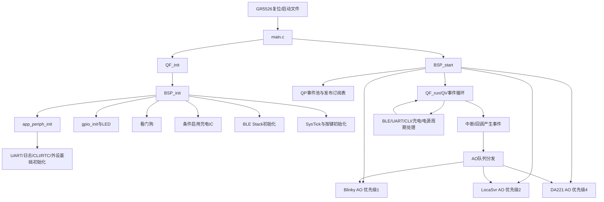
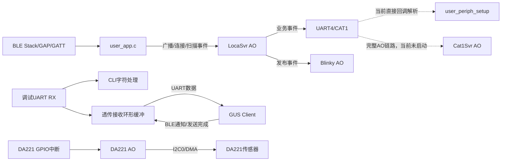
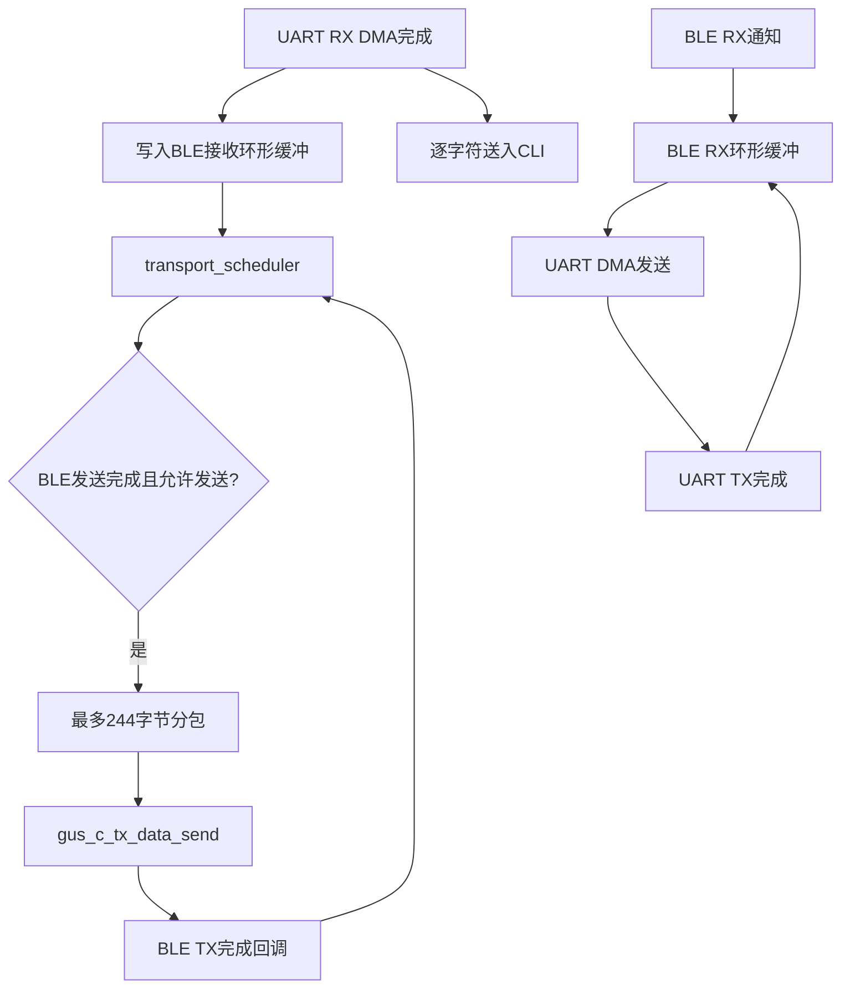
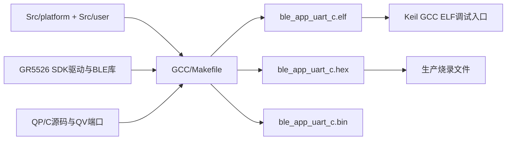

# ble_app_uart_c GCC 工程软件流程与功能方块图

> 分析对象：`D:\CODEX\sos-card\ble_app_uart_c` 的 GCC 构建路径。  
> 依据：`GCC\Makefile`、`Src\user`、`Src\platform` 及已生成的 GCC 对象文件。  
> 结论边界：本文描述源码中已接入 GCC 编译的功能；硬件实际连线、外设电平和现场功能仍需实机验证。

## 1. 总体结论

本工程是基于 Goodix GR5526 的 BLE UART Client 应用，采用 QP/C（QV 内核）事件驱动架构，核心功能包括：

1. GR5526 上电初始化、时基、中断和低功耗管理。
2. BLE 扫描、按目标设备过滤、建立连接、GUS UART Client 服务发现。
3. UART 与 BLE GUS 服务之间的双向透传，带环形缓冲区、分包和流控。
4. DA221 三轴加速度传感器的 I2C/DMA 初始化、寄存器配置、运动中断和低功耗运动检测。
5. ETA69631 充电管理芯片的 I2C 配置、状态读取、充电电压/电流/输入限流、电池电压 ADC 读取。
6. CAT1 外部通信链路的供电控制、UART4 接收、命令解析、RTC/NTP 时间同步以及预留的 SIP/MQTT 状态机。
7. CLI 命令、日志输出、LED 状态显示、按键事件、看门狗。
8. LocaSvr、Blinky、DA221 三个当前启动的 QActive；Cat1Svr 的 QActive 启动代码当前被 `#if 0` 禁用。

## 2. GCC 当前有效总流程



### 2.1 启动顺序

当前 GCC 由于 `Src\user\main.c` 中 `TK_USE_QP` 固定为 `1`，实际入口只有：

```c
QF_init();
BSP_init();
BSP_start();
return QF_run();
```

`main.c` 中 `#else` 的裸机 `while(1)` 版本包含 UART、充电、按键和 `transport_schedule()` 等旧流程，但当前不会编译执行。不能将该分支当成当前运行时流程。

## 3. QP/C 活动对象和连接关系

| 活动对象 | 优先级 | 队列 | 当前状态/职责 |
|---|---:|---:|---|
| `AO_Blinky` | 1 | 40 | LED 闪烁、状态显示 |
| `app_state_machine` / `LocaSvr_inst` | 2 | 20 | 定位/信标/SOS/业务状态机，接收 BLE 广播和业务事件 |
| `AO_Cat1Svr` | 3 | 40 | 源码有完整 CAT1 串口服务，但 `BSP_start()` 内 `#if 0`，当前未启动 |
| `DA221_inst` | 4 | 20 | 加速度传感器初始化、I2C 读写、运动中断和采样状态机 |



## 4. 功能模块说明

### 4.1 BSP、QP 内核和系统时基

- `main.c`：仅负责进入 QP 生命周期。
- `bsp.c`：初始化外设、看门狗、BLE、SysTick、按键，并创建活动对象。
- `qpc_7.3.4`：提供 QEP 状态机、QF 事件框架、QV 非抢占式事件循环和时间事件。
- `QF_onStartup()`：配置 SysTick、I2C0 中断优先级以及相关 NVIC。
- 事件池分为通用 `QEvt` 池和 `BeaconDataEvt` 池，避免高频信标事件耗尽小事件池。

### 4.2 BLE 扫描与 UART Client

`user_app.c` 的流程为：BLE 协议栈初始化完成后调用 `ble_app_init()`，配置主动扫描、通用发现模式和重复过滤；扫描报告进入过滤逻辑，匹配后建立连接，随后执行 GUS 服务发现。

连接成功后：

1. GUS TX Notification 开启，设置 `BLE_TX_FLOW_ON`。
2. GUS Flow Control 开启，设置 `BLE_FLOW_CTRL_ENABLE`。
3. UART 收到的数据进入 BLE 发送调度器。
4. BLE 接收的数据进入 BLE RX 环形缓冲，再由 UART DMA 发出。
5. 连接断开后清理流控、重置传输状态并重新扫描。

### 4.3 UART/BLE 透传调度

`user_periph_setup.c` 使用 `APP_UART_ID` 作为调试/数据 UART：RX 缓冲 244 字节，TX 缓冲 0x2000 字节，启用 DMA 和接收超时。UART RX 回调同时进入两条路径：



调度标志包括 `BLE_TX_CPLT`、`BLE_FLOW_CTRL_ENABLE`、`BLE_TX_FLOW_ON`、`BLE_RX_FLOW_ON` 和 `BLE_SCHEDULE_ON`。其作用是防止 BLE 未准备好时继续发送，也防止 UART 接收端未打开时丢失数据。

### 4.4 DA221 三轴加速度传感器

- 总线：I2C0。
- SCL：GPIOA Pin2，`APP_IO_MUX_0`。
- SDA：GPIOA Pin3，`APP_IO_MUX_0`。
- 器件地址：`0x27`。
- 供电：GPIOB Pin0，高有效，给 DA221 提供 1.8 V 控制。
- 中断：GPIOB Pin7，下降沿，进入 `DA221_gpio_int_callback()`。
- 软件模型：`DA221_inst` QActive，启动模式为 `DA221_MODE_LOW_POWER_MOTION`。

初始化后通过 I2C/DMA 读取芯片 ID，写入低功耗运动配置表；成功后由 GPIO 中断或定时事件触发采样，读取 XYZ 数据并生成运动相关事件。I2C 完成和错误均转换为 QP 事件，由传感器状态机统一处理。

### 4.5 ETA69631 充电和电池检测

源码存在两套相关定义，必须以实际编译调用和硬件版本为准：

- `charge_ic.c` 当前定义：SDA 为 GPIOB Pin12，SCL 为 AON Pin4，I2C0，器件地址 `0x6B`，芯片 ID `0x3F`。
- `eta69631.h` 还保留 GPIO28/AON GPIO4/AON GPIO5 的另一套测试定义。

当前 `BSP_init()` 只有在 `TK_Board_UART_DBG == 1` 时调用 `charge_ic_init()`。充电模块包括：

1. GPIOB Pin4 控制 `GPIO20_NQON`。
2. MSIO5 控制电池检测 MOS，默认关闭。
3. MSIO1 作为电池分压 ADC 输入。
4. 读取芯片 ID、VLDO、Power Good、HIZ、输入限流、充电电流和充电电压。
5. ADC 读取 4 次取平均，按参考电压和分压比计算电池电压。
6. CLI 提供状态、使能、充电电流、电压、输入限流和电池信息查询/设置。

### 4.6 CAT1 外部通信

UART4 在 `user_periph_setup.c` 中初始化，接收数据以 `[TAG] content` 格式解析，已实现 `NTPSYNC` 标签识别。`cat1svr.c` 还包含较完整的 CAT1 服务状态机，涉及 UART4、SIP、MQTT 配置、JSON 配置池、RTC 同步和 CAT1 电源超时管理。

但当前 `BSP_start()` 中：

```c
#if 0
Cat1Svr_ctor(...);
Cat1Svr_init_hw(...);
QACTIVE_START(...);
#endif
```

因此应区分：UART4 的直接回调路径是当前可用路径；`Cat1Svr AO` 是编译进镜像但未启动的预留/未启用路径。

### 4.7 LED、按键、CLI、日志和看门狗

| 资源 | 定义 | 逻辑 |
|---|---|---|
| 红色 LED | MSIO2 | 低电平有效 |
| 绿色 LED | 调试板 MSIO4；1.1/PAD 板 MSIO0 | 低电平有效 |
| 蓝色 LED | MSIO3 | 低电平有效 |
| 按键0 | AON Pin1，下降沿，上拉 | 单击/长按回调，发布业务事件或打印 |
| 按键1 | AON Pin4，下降沿，上拉 | 仅 1.1/PAD 配置启用 |
| LDO2 | 非 PAD：GPIOB Pin0；PAD：GPIOA Pin9 | `Pwr_Jkb()` 控制 |
| LDO3 | 非 PAD：GPIOB Pin1；PAD：GPIOA Pin7 | `Pwr_Jkb()` 控制 |
| CAT1 供电 | 非 PAD：GPIOB Pin2；PAD：GPIOA Pin6 | `Pwr_Jkb()` 控制 |

注意：GPIOB Pin0 同时出现在非 PAD 的 LDO2 定义和 DA221 供电定义中；这属于板级复用风险，必须根据选中的板型宏和原理图确认，不能只依据软件名称判断。

看门狗计数器为 5000、报警计数器为 2500，异常回调点亮红色 LED。日志通过调试 UART 异步发送，CLI 输入与 UART RX 共用接收通道。

## 5. IO 和总线定义汇总

| 类别 | 接口/引脚 | 用途 | 软件入口 |
|---|---|---|---|
| 调试/数据串口 | `APP_UART_ID`，引脚由 `board_SK.h` 宏决定 | CLI、日志、BLE 透传 | `user_periph_setup.c` |
| CAT1 串口 | `APP_UART4_ID`，引脚由 `APP_UART4_*` 宏决定 | 外部 CAT1 通信 | `user_periph_setup.c` / `cat1svr.c` |
| DA221 I2C | GPIOA2/GPIOA3 | 加速度计 | `da221_config.h`、`sensor.c` |
| ETA69631 I2C | GPIOB12/AON4 | 充电 IC | `charge_ic.c` |
| DA221 INT | GPIOB7 | 运动中断 | `sensor.c` |
| 电池 ADC | MSIO1 | 电池分压采样 | `charge_ic.c` |
| 电池检测使能 | MSIO5 | 控制检测 MOS | `charge_ic.c` |
| DA221 电源 | GPIOB0 | 传感器 1.8 V | `da221_config.h` |
| LED RGB | MSIO2/MSIO4或MSIO0/MSIO3 | 状态显示 | `user_periph_setup.h` |
| 按键 | AON1，另可选 AON4 | 用户输入/SOS | `bsp.c` |
| 外部模块电源 | GPIOB0/GPIOB1/GPIOB2 或 PAD 对应 GPIOA | LDO2/LDO3/CAT1 | `user_periph_setup.h` |

其中 UART 的最终物理 TX/RX pin、MUX、波特率由 `board_SK.h` 及对应板型宏展开决定；本文不把未展开的宏猜成固定物理脚。

## 6. GCC 构建与软件连接层



GCC 使用 `startup_gr55xx.s`、`libble_sdk.a` 和 `gcc_linker.lds`；源码基线由 `GCC\Makefile` 的 `PRJ_C_SRC_FILES` 明确列出。生产/调试判断应以完整 GCC 构建、ELF/HEX/BIN 时间戳和哈希为依据，不能只看旧输出文件。

## 7. 当前有效、条件有效和未启用功能边界

| 状态 | 功能 |
|---|---|
| 当前主流程 | QP/QV、BSP、LED、LocaSvr、DA221 AO、BLE 扫描/连接/GUS Client、UART 透传、CLI/日志 |
| 条件启用 | ETA69631 初始化，取决于 `TK_Board_UART_DBG`；第二按键取决于板型宏 |
| 代码存在且可调用 | UART4 直接回调、充电 CLI、CAT1 电源命令、RTC/NTP 辅助函数 |
| 编译但当前未启动 | `Cat1Svr AO`，因 `BSP_start()` 中 `#if 0` |
| 测试/辅助代码 | `adc_test.c`、`gpio28_test.c`、部分 `gpio_test.c` 路径 |
| 不能仅由源码确认 | 实际 PCB 连接、按键电平、LED颜色对应、UART物理引脚、DA221/ETA69631实机应答、CAT1现场通信 |

## 8. 从总流程回到验证闭环

系统运行闭环可以归纳为：

```text
上电
 → QP/QV和BSP初始化
 → 基础IO/UART/日志/看门狗/时基
 → BLE栈初始化并扫描
 → 启动Blinky、LocaSvr、DA221活动对象
 → 中断和BLE/UART回调产生事件
 → QP队列分发到对应状态机
 → 传感器、定位、透传、充电和CAT1逻辑执行
 → LED/CLI/UART/BLE输出结果
 → 持续回到事件循环
```

建议现场验收按以下顺序进行：先验证 GCC 完整构建产物，再逐项验证 RGB LED、按键、UART CLI、BLE 扫描/连接/透传、DA221 ID 与运动中断、ETA69631 ID 与 ADC、最后验证 CAT1 UART4 和电源控制。每一项都应记录实际板型宏、实测引脚、电平和串口证据。

