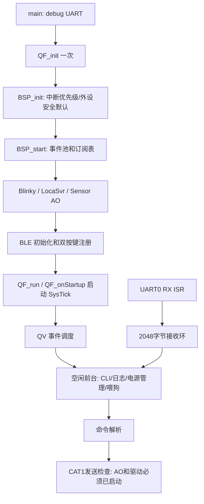

# YP001 软硬件与框架总体复核

日期：2026-09-30。对象：YP001_MB_SCH_A1_20260909、GR5526RGNIP/QFN68 与当前 `Keil_6/YP001_GR5526.uvprojx`。

## 1. 结论与交付边界

本轮重新核对原理图三页、GR5526 QFN68 Pin MUX 表、SDK GPIO/AON GPIO 复用定义和当前有效代码路径，并修改确定性问题。当前版本是整板调试候选，尚不能认定 LCD、CAT1、蓝牙、音频、充电和马达已全部联通。

本轮没有启动 Keil 编译、下载或烧录。没有新固件、编译耗时或实机结果。此前 Objects 中日志、AXF、HEX 均不能证明本轮修改有效；由用户重新编译后验收。

### 更正此前分析

- CAT1 的 AON_GPIO2/3 **支持 UART4 MUX0**，证据是 `SDK/drivers/inc/hal/gr55xx_hal_aon_gpio_ex.h`，不能只查普通 GPIO 文件。
- G-sensor 是 **GPIO2/3、I2C0 MUX0**；马达是 **GPIO11/12、I2C3 MUX2**。原先“传感器与马达共用 I2C3”的结论错误。
- GPIO6 经 NMOS/PMOS 控制 CAT1 电源，MCU 端**高有效**；AON_GPIO0 经 Q4 反相控制 PWRKEY，MCU 端也**高有效**。
- 原图显示区虽标题为 AMOLED，但 EPD 网名、GDR/RESE、升压网络和 FPC 有电子纸特征。不能据标题判定屏种或否定现有 EPD 驱动；精确屏型号仍待 BOM/屏规格书确认。

## 2. 资料与可追溯证据

- 原理图：`D:/work/公司/泰康报警器/三代卡/工厂资料电路图/YP001_MB_SCH_A1_20260909(2)(1)/YP001_MB_SCH_A1_20260909(2).pdf`。
- 同目录上级资料：GR5526 Pin MUX Excel、GR5526 硬件设计指南、Air780 系列手册、ES8311、AW8623X 和 ETA69631 手册。不同 IC 的具体寄存器/时序适配并未在本轮全部验证。
- 原理图提取和渲染：项目根目录 `doc/yp001_review_evidence/`，包含逐页文本、PNG 及 MCU、电源、PWRKEY、传感器放大图。
- 复用依据：`SDK/drivers/inc/hal/gr55xx_hal_gpio_ex.h` 与 `gr55xx_hal_aon_gpio_ex.h`；项目集中定义 `Src/user/yp001_board_config.h`。
- 当前启动路径：`Src/user/main.c`、`Src/platform/bsp.c`；CLI：`cli.c`、`at_cmds.c`、`user_periph_setup.c`；传感器：`sensor.c`、`da221_config.h`。

## 3. 硬件分工与软件状态

| 模块 | 硬件/功能 | 当前软件状态与下一步 |
|---|---|---|
| GR5526 | BLE、板级控制、传感器采集、调试入口 | QP/QV 主循环；需新编译及启动日志验证 |
| Air780 CAT1 | 蜂窝通信及模块固件业务，连接 UART4 | 引脚支持已确认；业务 AO 仍未启用；AT 明确返回未初始化 |
| ES8311 | 音频编解码，MIC/模拟输出 | I2S/I2C 主控在 Air780 一侧；应核对模块固件与音频配置 |
| HAA9209 U5 | ES8311 输出后的扬声器功放 | Air780 的音频电源/PA使能参与控制；需示波器及听音验证 |
| U901 功放图块 | 原图另有 K-QFN-20 图块 | 器件具体料号/是否装配查 BOM，不能等同 U5 |
| 三轴 U1104 | I2C0，AON7 中断，GPIO7 电源 | 软件按 DA221；图纸未明确 DA221，需读ID和BOM确认 |
| AW86233 | 振动马达驱动，I2C3、复位、中断和供电 | 补齐板级 I2C 定义；未新增已验证的完整驱动 |
| ETA69631 | 充电/电源管理，I2C4、INT、NQON、STAT | 寄存器和充电参数须按实际器件逐项核对；不自动启用配置 |
| 显示 | EPD类接口、供电、BUSY、RESET | 现有 DEPG0150 驱动与实屏型号/LUT未匹配确认，保持默认不启动 |
| 电池 ADC | GPIO23 控制分压开关、MSIO_A1输入 | 需按电阻值、ADC参考和负载实测校准 |
| 按键/LED | 两个AON键、三路MSIO灯 | QP启动后统一注册两键，去掉重复GPIOTE注册 |

### 电源注意点

GPIO6 拉低只是撤销 MCU 的电源请求。原理图 VBUS 经 Q10 也能控制电源通路，因此插 USB 时不能承诺 `cat1_power off/reset` 会使 CAT1 电源真正归零。必须测模块供电，不能把 PWRKEY 脉冲等同硬复位。

已按反相关系修改 PWRKEY 为默认低、拉高1600ms、再拉低；1600ms继承原调试流程，仍须按具体 Air780 固件/手册和实测确认。当前电源命令仍有200/500/1600ms等待，虽已移出ISR，仍会阻塞QV前台调度；后续宜改为定时事件序列。

## 4. 当前框架与修改

### 已修改

| 文件 | 修改及理由 |
|---|---|
| `yp001_board_config.h`、`da221_config.h` | 修正传感器I2C0；补马达I2C3；恢复AON UART4支持；显式定义CAT1电源/PWRKEY极性 |
| `gpio_test.c`、`user_periph_setup.h`、`cat1svr.c` | 电源控制调用统一使用正确极性；启动释放PWRKEY；QP双键交由APP_KEY注册 |
| `bsp.c` | 去掉重复QF_init和提前SysTick；AO/事件池后再启动BLE及按键；阻止给未启动CAT1对象投递；BLE重复初始化保护 |
| `bsp.c` | 外设初始化前配置QP相关I2C0/DMA1/AON/SLPTIMER优先级；外设IRQ由SDK管理；移除开发板UART3/未初始化UART4强制使能 |
| `bsp.c` | QV空闲先解锁再执行CLI与日志，移除解锁后无保护的WFI；此阶段不宣称低功耗达标 |
| `user_periph_setup.c`、`main.c` | RX中断只写接收环并重启接收，前台每次最多处理244字节；溢出丢弃残缺输入；非QP旧循环也补poll入口 |
| `cli.c/.h` | 输入位置由8位改16位；输出长度裁剪；超长行/过多参数拒绝；执行字符串不破坏当前输入行 |
| `at_cmds.c` | 合并重复解析，修复合法FF字节被拒绝；拼接前检查容量；发送失败返回真实错误 |
| `user_periph_setup.c` | UART4字符串终止预留字节；限定sscanf宽度；解析参数判空；未初始化UART4不发送，避免误用零值UART0 |
| `cat1svr.c` | 发送前检查参数、AO启动和UART句柄，当前未启动时安全返回 |
| `sensor.c/.h` | 定时器只在构造时建立一次；重复中断不重复arm；DMA状态移到源文件，初始化成功和采集完成/错误时释放忙标志 |
| `qp_port.h`、Keil工程 | AC6选择armclang移植层，Keil include移除GNU端口，GCC分支保留 |
| `YP001_GR5526.uvoptx` | JLink Flash长度统一为0x01000000，与工程16MB算法配置一致；不表示目标Flash容量/下载已验证 |

### 未直接启用的业务与后续改进

1. **CAT1缓存所有权**：`Cat1Svr_init_hw`用RX数组作为TX环形缓冲，RX事件又携带原接收数组指针后立即重收。必须拆分TX/RX，并让事件持有独立副本或管理缓冲归还，补事件池尺寸和队列背压，再启用AO。当前保留 `#if 0`，不会因引脚可用而自动开业务。
2. **传感器适配**：器件型号/ID、寄存器表、中断有效极性需确认。DMA完成门控已修，但寄存器配置状态机、I2C超时恢复、采集数据到上层消费仍需联调；初始化失败不能视为传感器可用。
3. **BLE身份**：发现固定地址设置；多机可能冲突。生产应制定唯一身份来源，未自行更改现有地址。扫描/连接/服务和业务事件必须在新固件实测。
4. **阻塞与日志**：CLI电源延时和传感器回调printf仍可能影响时延。应逐步转为定时事件、ISR计数/状态、前台批量打印，并记录队列高水位和掉包数。
5. **RTOS宏**：工程仍有 `ENV_USE_FREERTOS`，而应用运行QP。SDK头文件会因此改变部分API签名；未在缺少预编译库ABI证据时直接删除。
6. **模型源**：bsp、sensor、cat1svr含QM生成标记，未找到业务fsm.qm/sensor.qm源。需取得模型并回写本轮修复，避免再生成覆盖。
7. **应用参数**：CAT1协议中硬编码主题/身份、JSON/格式化边界须在启用业务时清理；未改网络服务地址与设备身份。

## 5. 工程、编译时间与路径

请从 `D:/CODEX/sos-card/ble_app_uart_c/Keil_6/YP001_GR5526.uvprojx` 打开，选择 `YP001_GR5526_AC6`。工程 `uAC6=1`，QP使用armclang。µVision IDE版本/安装目录与Arm Compiler 6版本是不同概念；安装在C盘不代表源码在C盘。

当前静态检查：uvprojx、uvoptx XML可解析；71个文件项、73个IncludePath条目全部存在，文件和include无C盘绝对路径；scatter使用工程目录下 `YP001_GR5526.sct`。文件项含库，不等于71个C文件。

沿用前轮对warning级别和scatter头部包含路径的修正。构建后fromelf命令本来已禁用，不能宣称关闭它带来了本轮提速。避免每次Rebuild；日常修改用Build增量构建。首次编译、头文件变化和切换端口仍会重编译较多文件。本轮没有实测耗时，不能承诺缩短到几秒。

关闭并重新打开工程以加载外部修改。产物应留在该工程的Objects目录。旧build_log里的成功或错误都属于旧配置，不作为本轮结论。

## 6. 静态核对与整板验收顺序

已做：原图视觉核对、HAL/Excel复用交叉核对、XML解析、路径存在性检查、关键调用链检查。未做：AC6编译/链接、下载、示波器/串口抓取、功耗或音频实测。

建议用户按以下顺序验收并保存每步证据：

1. Keil重新打开新工程，Build，保留完整日志、警告数量、耗时及AXF时间。出现错误先处理首个错误；不要反复打开旧工程。
2. JLink确认供电/SWD/器件与算法，再下载并保存明确完成日志。此前CoreSight识别错误不能用本轮静态配置证明已解决。
3. UART0 GPIO28/29、115200 8N1：启动banner、help、长输入/溢出、双键；确认不HardFault、不重启。
4. BLE用单板和两板分别验证扫描、连接、收发和身份唯一性；核对SDK运行版本日志。
5. 读取U1104芯片ID、确认I2C0 ACK/上拉电压及中断，再验证持续采集，确认不只完成第一次DMA。
6. 先测GPIO6/PWRKEY/模块供电波形，分别插USB和电池供电；解决CAT1缓存后再启用UART业务并验证AT回包。
7. 确认屏料号、FPC、控制器和LUT后逐步验证电源/RESET/BUSY/SPI/全屏显示，不以下载成功代替显示成功。
8. 按ETA69631手册核对输入限流、充电电压/电流、NTC与故障；马达确认AW86233配置及额定参数后单独调试。
9. Air780音频固件配置、ES8311时钟/I2C、电源/PA时序、MIC和扬声器逐项验证，检查开关机POP、底噪及最大音量电源跌落。

## 7. 配套文档

- `YP001_GR5526管脚配置清单.md`：当前板级管脚与默认行为。
- `YP001_GR5526整板硬件分析与改善建议.md`：硬件责任划分和改善建议。

上述两份MD已更正旧结论；同名旧PDF未同步更新，不能作为本轮最新依据。既有用户修改保留，本轮没有提交Git。
