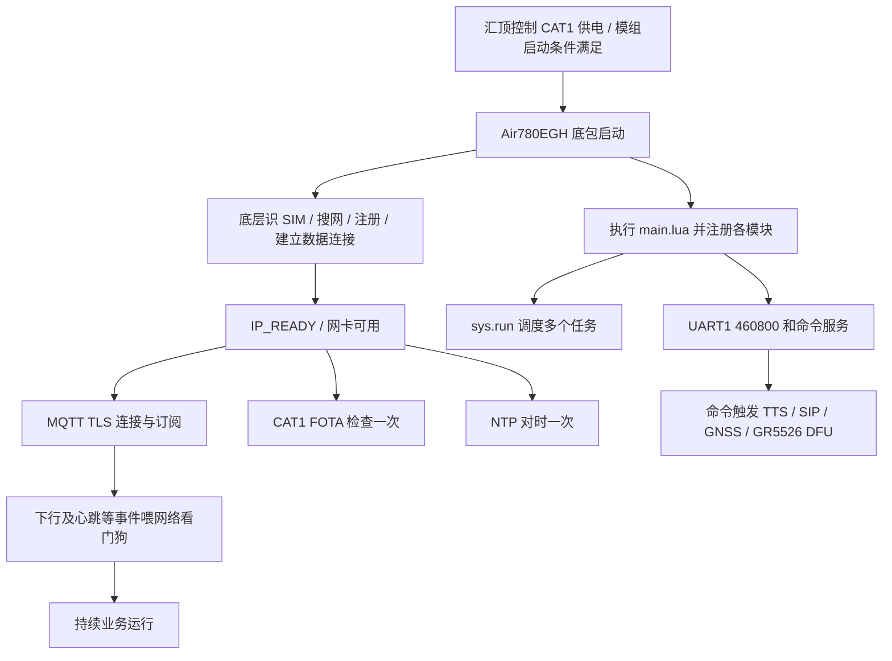
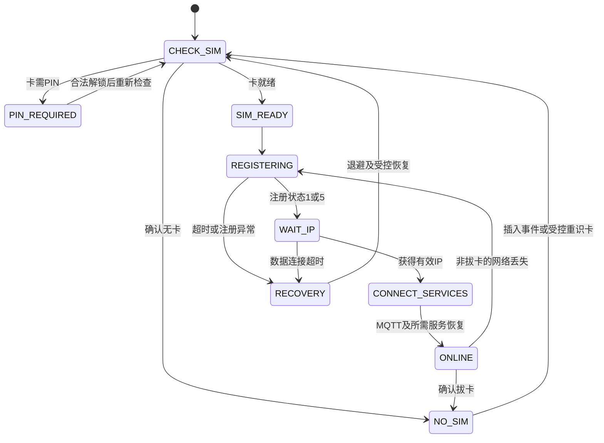

# Air780EGH CAT1 完整工作流程与 OTA、SIM 热插拔分析

分析日期：2026-10-11（北京时间）。分析人：SAM。

唯一 CAT1 项目入口：`D:\CODEX\sos-card\Air780EGH`。本次未使用旧 `cat_1` 项目，也未修改固件源码、编译、下载或执行设备指令。以下“现有”均指本次读取的源码；“建议”表示未来需要实现和验证的设计。

## 1. 结论与能力边界

当前是一套 **LuatOS 应用 + 自定义串口命令 + MQTT 数据通信 + 音频/SIP + 两类升级入口**。它已经有大量业务代码，但还不是具备完整故障恢复和升级闭环的产品版本。

| 目标 | 当前源码状态 | 尚缺的关键环节 |
|---|---|---|
| 上电联网 | Lua 应用等待底层蜂窝网络获得 IP，然后启动 MQTT、FOTA、一次 NTP | 统一的 SIM/注册/IP/业务状态和恢复策略 |
| SIM 检测 | 有 `SIM_IND` 处理代码，但所在模块未由主入口启用 | 启用事件处理、启动主动查询、完整状态上报 |
| SIM 热插拔重新注册 | 未发现检测脚配置、插拔去抖、重识卡/重新注册控制状态机 | 板级 DET 接线确认、底包能力核对、恢复闭环和实卡验收 |
| 音频 | 有 ES8311 初始化、MP3、PCM 录放、TTS、SIP、CC 拨号入口 | 资源仲裁、错误回传、依赖检查、真实双向音频验证 |
| CAT1 自身 OTA | `update.lua → libfota2`，开机联网后检查一次，下载成功即重启 | 错误码分类、业务互斥、受控触发、重启后确认 |
| CAT1 给 GR5526 OTA | 有 HTTP 下载和 UART DFU Host 源码 | 当前汇顶接收端接入、协议可靠性、镜像认证/分区匹配、启动确认 |

**“文件存在”“Lua 语法通过”“UART 发出”“升级 ACK”“新固件启动并恢复业务”是不同层次的证据。** 本报告只完成源码与主机语法核对。

## 2. 全目录职责地图

本次目录清点：22 个 Lua 文件，共 9536 行；另有 README、引脚 JSON、MP3 和一个 `.soc` 文件。逐项职责如下。

| 文件 | 职责 | 启动方式 |
|---|---|---|
| `main.lua` | PROJECT/VERSION、命令表、加载模块、电源工作模式、内存监控、调度器 | 应用入口 |
| `uart_app.lua` | UART1 文本分帧、命令分发、发送队列、DFU 二进制接收切换 | 自动初始化 |
| `audio_drv.lua` | 音频供电、ES8311 配置、喇叭及录音回放测试 | 加载时注册命令，使用时初始化硬件 |
| `tts.lua` | TTS 任务、音色/音量/优先级、播放完成回调 | 命令或 SIP 调用后启动 |
| `sip.lua` | SIP 业务状态机、拨号/来电/接听/挂断 | `SIP_INIT` / `SIP_CALL` |
| `exaudio.lua` | 文件/TTS/PCM 播放、录音、音频框架适配和供电状态 | 由音频/SIP 应用调用 |
| `exsip.lua` | SIP 库包装、网络事件、VoIP 媒体启动停止 | `sip.lua` 调用 |
| `mqtts_main.lua` | MQTT 配置、连接、订阅、重连、统计、命令入口 | 自动启动任务 |
| `mqtts_sender.lua` | MQTT 发送队列、单条在途消息、回调 | 被主 MQTT 模块加载并启动 |
| `mqtts_receiver.lua` | MQTT 下行转内部事件、喂网络狗 | MQTT 收包调用 |
| `network_watchdog.lua` | 300 秒没有网络业务喂狗就重启 | 自动启动 |
| `netdrv_device.lua` | 加载 4G 事件模块，SIM/IP 串口上报 | **主入口的 require 已注释** |
| `netdrv_4g.lua` | IP_READY/IP_LOSE 日志、公共 DNS 配置 | 仅由未启用的 netdrv_device 加载 |
| `update.lua` | CAT1 联网后一次 FOTA 检查及重启回调 | 自动启动 |
| `libfota2.lua` | 组合升级请求、HTTP/FOTA 接口、结果映射 | update 调用 |
| `dfu_transfer.lua` | GR5526 镜像下载、检查、UART DFU Host | 加载时注册命令，命令触发实际操作 |
| `ntp.lua` | 启动后一次 SNTP；可手动启动周期同步 | 一次任务自动启动，循环按命令启动 |
| `timer_app.lua` | 5 秒 MQTT 演示发送 | 初始 timerStart 被注释，当前未自动发送 |
| `gnss_app.lua` | GNSS 初始化/查询/重启，额外 LBS HTTP 函数 | 命令触发 |
| `antenna_test.lua` | LTE/GNSS 定时观测、ACK、独立 GNSS tag | `AT+ANTSTART` |
| `exgnss.lua` | GNSS tag/工作模式、NMEA、AGPS/辅助定位 | GNSS 业务调用 |
| `lbsLoc2.lua` | 合宙 LBS 服务协议客户端 | exgnss 的 AGPS 流程按需 require |
| `pins_air780egh.json` | 模组引脚名称清单 | 不是本板实际连线证明 |
| `sample-6s.mp3` | 喇叭测试资源 | 设备端路径 `/luadb/sample-6s.mp3` |
| `soc/LuatOS-SoC_V2052_Air780EGH_113.soc` | 本项目指定底包文件 | 文件名不代表当前设备运行版本 |

### 底包依赖必须单独确认

Lua 通过底包使用 `sys/uart/mobile/socket/http/mqtt/audio/i2s/cc/libgnss/voip` 等 API。

尤其是 `exsip.lua:108` **直接 require `exsipproto`**，`exsip.lua:925` 启动 SIP 时 require `exsipclient`，这两个 Lua 文件不在当前目录。需要确认指定底包是否内置、以及实际打包清单是否包含适配版本；不能凭目录里的 `exsip.lua` 推断 SIP 可运行。前者若运行时缺失，主入口加载 `sip` 时就可能失败，无法正常进入后续调度流程。

`main.lua` 虽有“pcall 加载所有模块”的注释和 modules 表，但实际采用一串直接 require；pcall 循环整段被注释。部分模块自己的降级桩不构成整个应用启动容错保证。README 关于系统库来源的表述也不能代替设备端加载检查。

## 3. 从上电到业务上线



这些流程是并发任务，不是“FOTA 完成后才允许 MQTT”这样的串行流程。

### 3.1 汇顶负责的上电与串口

只读交叉核对当前主工程：

- `ble_app_uart_c/Src/user/yp001_board_config.h:17`：CAT1 供电控制 GPIO6，高电平请求供电；PWRKEY 使用 AON_GPIO0，经反相后断言；UART4 为 AON_GPIO2/3，配置波特率 460800。
- `ble_app_uart_c/Src/platform/bsp.c:347` 附近：启动调用 `Pwr_Jkb(1,1,1)`，日志明确为供电后 USB 烧写、AT 手动操作。
- 同文件 `BSP_start` 的 Cat1Svr 创建/启动块在 `#if 0` 中。
- `user_periph_setup.c:463` 附近明确保留“只供电，不自动发 AT、不自动按 PWRKEY”的策略。

因此应先确认设备已经安装本目录底包和 Lua、模块真正启动、双方串口初始化且同为 460800。不能把供电 GPIO 置位当成 Lua 已启动。详细电源波形/PWRKEY 时序不由这些 Lua 实现，本轮也没有实测。

### 3.2 main.lua 实际加载顺序

`audio_drv → gnss_app → uart_app（内部先加载 dfu_transfer）→ antenna_test → timer_app → network_watchdog → update → ntp → mqtts_main（内部先加载 receiver/sender）→ mqtts_sender → mqtts_receiver → sip（内部加载 tts）→ tts → dfu_transfer`。

重复 require 在正常 Lua 模块缓存机制下不会重新执行模块。`netdrv_device` 被跳过。随后设置 `pm.WORK_MODE=0`、`mcu.hardfault(0)`，注册 `ATREBOOT` 和 `HELP`，启动 10 秒内存监控，再调用 `sys.run()`。

PROJECT 为 `TK_PROJECT_OTA`，VERSION 为 `001.000.000`。这是源码声明，设备版本仍须实际读取。

### 3.3 网络注册有多个不同阶段

| 阶段 | 应观察的证据 | 不能推导什么 |
|---|---|---|
| SIM 可用 | `SIM_IND=RDY`，必要时查询卡信息 | 不能证明运营商注册 |
| 蜂窝注册 | `mobile.status()` 为 1 或 5 | 不能证明 IP 或服务器可达 |
| 数据网络可用 | 对应 4G 网卡 IP_READY、有效本地 IP | 不能证明 MQTT/SIP 已认证 |
| MQTT 上线 | CONNACK、SUBACK、收发消息成功 | 不能证明 SIP 语音可用 |
| SIP 上线 | SIP register ok / ready | 不能证明 RTP 双向声音正常 |

当前 Lua 没有显式配置 APN、搜网、运营商选择或注册重试流程；这些主要依赖底包及 SIM/网络配置。未启用 netdrv_device 不等于底层无法自动联网，只是应用侧事件处理和状态上报缺席。

API 状态值参考本地保存的官方系统库源码 `logs/cat1_antenna_20261010/mobile-official.c:1068`：0 未注册，1 注册，2 搜网，3 拒绝，4 未知，5 漫游注册，6/7 仅短信，8 紧急服务。该快照是 API 参考，并非指定 V2052 底包内部实现或实机功能证明。

## 4. SIM 检测现状与热插拔恢复目标

### 4.1 当前实际缺什么

`netdrv_device.lua:43` 订阅 `SIM_IND`，识别 RDY/NORDY/SIM_PIN 等事件；但 `main.lua:36` 没有启用该模块。即使启用，它也只是：RDY 不上报，其它状态通过 `[SIM_ENV]` 发出；没有管理注册、重试、IP、MQTT/SIP 恢复的状态机。

当前目录没有找到 SIM_DET 配置/去抖、卡拔出业务清理、插入后重识卡、受控飞行模式恢复或失败退避流程。`pins_air780egh.json` 列出模组第 79 脚 `USIM_DET`，**不能据此断言本板卡座 DET 已连接或极性正确**。必须核对实际原理图/卡座型号及该脚波形；若没有有效 DET，轮询状态也不保证底包自动重新识卡。

`AT_INFO` 使用 `mobile.getStatus/getCsq`，而本地官方 API 快照和当前 antenna 模块使用 `mobile.status/csq`。API 缺失时 safe_call 会把结果退成“未注册/99”，容易形成假离线；其 `net_info.registered` 还依赖返回类型是表。应先核对目标底包 API，未知状态应明确报告 UNKNOWN/API_UNAVAILABLE。

### 4.2 建议实现的恢复状态机（尚未实现）



建议行为：

1. 启动时先订阅事件，再主动查询当前卡状态，避免错过开机早期 RDY。检测事件和主动查询共同维护状态，且区分无卡、PIN、搜网、拒绝注册。
2. 拔卡去抖后清除旧 SIM/注册/IP 状态；停止或使网络会话失效，结束 SIP 通话，暂停联网下载，向汇顶报明确状态。已经完整下载并校验的汇顶镜像，在稳定供电和独立策略允许时可以继续本地串口传输，不必无条件中断。
3. 插卡稳定后确认底包重新识卡；读取新卡信息，等待注册 1/5，再等 IP，最后重建 MQTT 连接/订阅和需要维持的 SIP 注册。
4. 超时先区分卡/注册/IP/服务器故障，再做有限次数重试和退避。底包允许时才采用受控飞行模式或重识卡 API；重启作为最后一级，不把不断重启当成热插拔方案。
5. 重新注册成功的结束条件是“新卡就绪 + 注册成功 + 有 IP + 业务链路实际收发成功”。状态上报带事件序号、当前阶段、失败原因和持续时间。

目前 `network_watchdog.lua:51` 等待 300000 ms，超时再等 3000 ms 后重启；无卡或长期无网络时也可能约 303 秒重启一次。它没有按 NO_SIM/PIN_REQUIRED/OTA 阶段区分策略。未来应保留故障监控，但使用状态和阶段进度决定恢复，不能简单长期停狗。

## 5. 串口命令与数据流

`uart_app.lua:178`：UART1 460800，8 数据位、1 停止位，使用 CRLF 分帧。实际是应用自定义命令服务，不能将它当作通用 AT 固件命令集。

```text
GR5526 UART4 TX → CAT1 UART1 RX
  → 读取最多1024字节一批 → 按CRLF重组 → 最长匹配命令名称
  → handler(完整命令行, 回包函数)
  → 内部事件/任务 → 回包队列 → UART1 TX → GR5526 UART4 RX
```

RX 单行限制 4096 字节；发送队列最多 64 条、总量 32768 字节、单条最长 4096。超限写日志并拒绝。普通回包加 `[命令名]` 前缀，raw 事件不会加该命令前缀。未识别命令目前仅记录日志，没有统一 ERROR 响应。

独立分支处理 `ATD<数字>[;]`、`ATH`、`ATA` 和 `GNSS`。`AT_INFO` 是下划线形式，注释中的 `AT INFO` 不是同一个注册键；`HELP` 可列出运行时已加载命令。

DFU 进入二进制接收模式后，所有 UART RX 都交给 DFU 解析，普通 CRLF 文本命令不再分发。DFU 发送期间业务文本过滤，只允许以 `+DFU:` 起始的行通过。

## 6. MQTT、时间与位置业务

### MQTT

`mqtts_main.lua:186`：等待 IP → 创建 TLS MQTT client → auth → 设置 keepalive=60 秒 → connect → CONNACK 后发起订阅 → 事件循环。默认目标端口 8883，用户名/密码写在源码中，本文不复制凭据。仅从 TLS=true 不能断言完成了服务器证书身份验证。

默认订阅为 `/iotplat/render3/WARNCARD3/<IMEI派生值>_TEST/down_raw`；客户端 ID 含任务名、派生值和时间。异常后关闭客户端，等待 5 秒重新进入联网/连接循环。配置命令改内存，不是持久化配置；服务器/认证等更改通常还需重连。

下行：`mqtt event recv → mqtts_receiver.proc → RECV_DATA_FROM_SERVER → uart_app → [MQTTS_EVT] topic,payload`。同时 uart_app 将该 payload 再以 QoS1 发到 `<IMEI>/timer/up`。这只是转发/回显，**没有把云端升级消息解析成 DFU_DL/DFU_START 或 CAT1 升级任务**。

上行：`MQTT_SEND=<topic>,<payload> → SEND_DATA_REQ → mqtts_sender队列 → publish → sent事件 → 结果回调`。正常入口使用 QoS2；即时 OK 只是请求进入流程，应等异步结果。sender 的 `is_ready()` 恒为 true，不表示在线；队列无显式长度上限，断线事件清空待发项并回调失败。`at_send_cache` 引用没有本目录定义，但当前恒 true 的分支通常使它不可达。

网络喂狗来自 MQTT 收包、PONG、发送完成；不是 SIM 插拔检测，也不是完整业务响应校验。

### NTP

开机任务等待 IP，按列表尝试三个服务器，每次等 NTP_UPDATE 5 秒，失败间隔 500 ms，成功只向 UART 发时间戳；循环同步由 NTPSTART 开启，成功默认 1 小时、失败默认 10 秒再试。NTPSTATUS 以 RTC 年份>2020 判断，不能证明刚刚对时成功。

NTPSYNC 虽在文件头文档中声明，当前未发现对应 handler。NTPSERVER 直接从完整命令行取服务器，可能把 `NTPSERVER=` 前缀带进域名。NTPSTOP 在命令处理回调直接 sys.wait，需要核对回调是否可 yield。

### GNSS 与天线

GNSS 默认不随 main 自动开定位。GNSSINIT 启动 45 秒 TIMERORSUC 会话；GPSTEST 使用 UART2、115200、GPIO21 的测试配置；GNSSRST 只重启 main_gnss tag。antenna_test 独立使用 antenna_test tag，支持 LTE/GNSS/ALL、1–60 秒报告周期，并在 DFU 接管时停止自身会话。

exgnss 在需要 AGPS 时等待网络、对时、下载星历，并经 lbsLoc2 请求粗定位；这条辅助流程依赖网络，卫星定位本身与 SIM 注册仍是两个独立结果。`gnss_app.getLbsloc()` 的额外 HTTP 定位函数没有发现当前启动调用。GNSSINFO 只看 RMC 经纬度字段，没有像 antenna_test 一样明确用 is_fix 判定，可能需要防止把旧坐标当当前定位。

## 7. 声音处理全过程

### 7.1 硬件和公共初始化

源码中音频由 CAT1 控制，汇顶通过命令请求业务。

```text
播放：MP3解码/TTS合成/RTP解码 → CAT1数字音频 → I2S0 → ES8311 → 功放 → 喇叭
采集：MIC → ES8311 ADC → I2S0 → CAT1 → PCM文件或VoIP编码/RTP发送
控制：CAT1 I2C1 → ES8311配置；GPIO20/24/1 → 编解码/PA供电及使能
```

`audio_drv.lua:32`：GPIO20 是 CODEC 供电，GPIO24 是 PA 供电，`pa_ctrl=1` 为 PA 使能。以上都是 **CAT1 侧 GPIO 编号**，不能套成汇顶 GPIO。实际电源/总线波形和模拟声音仍需实测。

`initAudioDevice()` 幂等检查 → GPIO20/24 置高 → `exaudio.setup(model=es8311,i2c_id=1,...)` → 音量73、MIC增益80。失败会将供电置低。V2026 及以上 dac_delay 配为6（代码按100 ms单位），旧版600；pa_delay=100。

exaudio 根据型号和可用 API 选择 audio/audio_v2。Air780E 系列在两者同时存在时偏好 legacy audio；不能仅看到新库文件就说当前使用 audio_v2。legacy 分支配置 I2S0、audio.config、ES8311 BUS_I2S，检查芯片通信后订阅音频事件，初始进入 SHUTDOWN，播放/录音再唤醒。

### 7.2 MP3 喇叭测试

`AUDIO_TEST_SPEAKER → audio_power_on → play_audio_test → exaudio.play_start(type=0, /luadb/sample-6s.mp3)`。

实际必须确保资源已打进 luadb。命令先回 OK，未检查初始化和播放返回值；因此 OK 不能当成声音成功。`play_audio_test` 在局部 `play_end` 声明之前定义，引用落到同名全局而非后面的局部回调，完成通知也有缺口。

### 7.3 录音回放

`AUDIO_TEST_MIC → audio_rec任务 → REC → exaudio.record_start(PCM_16000,5秒,/record.pcm)`。

收到 RECORD_DONE 后发 PLAY 消息 → type=2 流式回放，16 kHz/16 bit，有符号 PCM；读取流缓冲区大小逐块喂入，尾包补0，每轮让出20 ms；文件读完调用 finish，PLAY_DONE 后删除录音文件。单声道5秒理论 PCM 数据量160000字节，不含文件封装。

当前测试任务回放后仍留在消息等待，重复执行命令需要验证不会重复创建同名任务；错误路径、暂停/断电与流式背压也需要单独测试。

### 7.4 TTS

`TTSPLAY=文本,优先级,音色索引,语言 → 自动启动tts_task → 初始化音频 → MSG_PLAY → 补音色/语言标签 → exaudio.play_start(type=1) → PLAY_DONE → UART +TTS: PLAY_DONE`。

音色表[m51]–[m55]，默认音色1，音量73，优先级1；语言可为cn/en/auto等。文本按英文逗号分字段，没有转义协议，正文含英文逗号会被截断/分错参数。

当前 TTSVOL、TTSVOICE、TTSPRIORITY 把完整命令传给 tonumber，例如 `tonumber("TTSVOL=60")` 为 nil，因而正常带命令名前缀的设置会失败。TTSLANG 仅回 OK，未实际设置语言。play_tts 没有检查底层 play_start 返回值。

### 7.5 SIP 网络通话

SIP_INIT/SIP_CALL → 等 IP → 初始化公共音频 → exsip.init/config → exsip.start → 注册认证 → ready → STATE_READY → dial/来电 → STATE_DIALING/INCOMING → connected → STATE_CONNECTED → ended → STATE_READY。

来电时提取号码，转中文数字用 TTS 播报。exsip 媒体启动前会尝试停止普通播放，再启 VoIP；实际默认配置是 UDP SIP、PCMU/PCMA、20 ms ptime、媒体加密none、AEC=false、自动接听=false、自动录音=false、CC-SIP桥接=false。它并不是自动开启的电话中继。

链路分两层：exsipclient 处理 SIP 信令/会话与协商；voip 处理媒体，legacy 通常走 I2S，audio_v2 在支持条件下用 exaudio PCM bridge。库有 IP_LOSE 处理，会向 sip.lua 报 network_changed，业务任务清理后5秒重试。因此 SIP 有掉网后的重建路径，但仍不负责 SIM 重识卡。

当前 BUSY 实际周期30000 ms（注释写10秒）；SIP_CALL 新启动时等 READY 最多10秒，然后等通话结束最多60秒，超时回 ERROR **没有主动调用 hangUp**；自动销毁 SIP 的代码也被注释。不要将“call timeout”视为对端已经挂断。

音频资源仍缺统一所有权：TTSDEINIT、SIP_DEINIT、AUDIO_POWER_OFF 都可能关闭共享硬件；TTS 自己的 initialized 标志可能与 audio_drv 不一致。exsip 虽做了部分播放停止，仍不足以覆盖其它命令随时关电的冲突。建议统一管理 IDLE/TTS/PLAYBACK/RECORD/SIP/CC，由最后一个使用者释放硬件，接通通话时结束来电播报。

### 7.6 蜂窝电话 CC

UART 特殊分支 `ATD/ATA/ATH` 直接调用 `cc.dial/accept/hangUp`。没有完整的应用层 CC 状态、统一音频初始化和错误回传流程。exaudio.setup 仅在特定 cc 类型条件下订阅 CC_IND/PLAY 自动唤醒，这不等于呼叫业务闭环，更不证明当前卡和运营商支持 VoLTE。

## 8. CAT1 自身 OTA

现有流程：

```text
开机加载 update.lua
 → 等待网卡可用
 → libfota2.request(fota_cb,{})
 → 根据PRODUCT_KEY/IMEI/PROJECT/底包版本/VERSION组合请求
 → 默认HTTP合宙升级接口
 → 有fota能力时 opts.fota=true，否则写/update.bin
 → ret=0：排队发送UPDATE_START，然后立即rtos.reboot
 → ret=4：被应用显示为“已是最新版本/UPDATE_DONE”
 → 其它ret：仅日志告警
```

问题与边界：

- **ret=4 不只代表最新版本。** `libfota2.lua:85` 起将多种HTTP/响应/平台错误归入4，包括无权限、无效项目、无效固件、禁止升级、差分包尚未就绪等；update.lua 的“已最新”判断不可靠。
- `VERSION=xxx.yyy.zzz` 被组合为 `底包版本.xxx.zzz`，中间 y 段未用于请求版本；发布时不能只改中间段。
- 下载成功是安装前状态，立即重启前排队的串口通知未保证发完。重启后没有持久化升级任务、前后版本比对和服务恢复上报。
- 没有手动检查/取消/任务查询命令，也没有周期重试；重新插卡后不一定再次检查已经失败过的本次开机任务。
- FOTA 与 GR5526 DFU、SIP、录音没有全局互斥，下载成功的重启可能中断其它流程。网络看门狗也没有升级阶段进度感知。
- 此链路用于 CAT1 脚本或底包的具体升级类型取决于平台生成的适配包；不能把 USB `.soc` 或 GR5526 `.bin` 直接当同类 OTA 包。底包签名校验、断电恢复等能力不在这些 Lua 中，本轮未验证。

未来建议增加 CHECK → DOWNLOAD → VERIFY → WAIT_SAFE_REBOOT → REBOOT → CONFIRM，明确 NO_UPDATE/FAILED/VERIFIED/INSTALLED 的不同结果。CAT1 和汇顶升级排队执行，先完成一端重启确认，再开始另一端；顺序应根据两端协议兼容关系决定。

## 9. CAT1 给 GR5526 OTA

### 9.1 当前发送流程

`DFU_DL=<url>`：HTTP GET，60秒超时，直接落 `/gr5526_fw.bin`；要求HTTP200、文件至少48字节。

`DFU_INFO`：读取尾部48字节作为镜像信息，检查pattern（不匹配只警告），计算**整个文件**的32位累加和。

`DFU_START`：读取镜像 → 设置 UART 独占 → 检查静态分区边界 → 二进制接收 → 等200 ms → 以下协议：

| 步骤 | 命令 | 当前行为 |
|---|---|---|
| 1 | 0x01 GET_INFO | 等成功ACK，但未用返回信息完成硬件/版本匹配 |
| 2 | 0x41 MODE_SET | 发送0x01双区模式，不等ACK，等100 ms |
| 3 | 0x23 PROGRAM_START | 0x00升级类型 + 40字节Image Info，改load_addr为Bank B |
| 4 | 0x24 PROGRAM_FLASH | program_type + 地址 + 长度 + 最大1000字节镜像块 |
| 5 | 0x25 PROGRAM_END | reset_flag=1 + 全文件32位累加和，等ACK后报告DONE |

帧实际头字节为 **44 47**（little-endian 0x4744），并不是某些注释写的47 44；后接2字节类型、2字节长度、数据、2字节累加和。满数据块帧长1015字节。这里代码名叫 CRC，但算法是加和，不是多项式CRC或密码学签名。

硬编码布局：Flash 0x00200000–0x00300000，Bank B起点0x002C0000，允许总文件最大0x40000=262144字节。这只是 CAT1 发送端假设，必须和实际 GR5526 型号、链接布局、NVDS/配置保留区、Boot/DFU 实现重新对齐。不能为了让包通过就随意扩大该常量。

### 9.2 阻止当前链路直接当成可用 OTA 的问题

| 问题 | 位置 | 影响 |
|---|---|---|
| 当前汇顶应用没接入对应DFU路径 | 主工程 Src/user/platform/config 搜索及 bsp 的禁用块 | CAT1 Host存在，不代表汇顶能接收、安装、复位 |
| STARTED回包会带命令前缀 | uart_app:67；dfu_transfer:615 | 实际排队文本为 `[DFU_START] +DFU: STARTED`，独占过滤只允许行首+DFU；若取队前已锁通道，该切换通知会被丢弃 |
| 先等sent、再等ACK | dfu_transfer:181–197 | ACK若在等待sent期间先到，事件可能未被后续waitUntil捕获，形成假超时和重复发帧；需缓存并关联事务 |
| 文本ABORT/STATUS在二进制期不可达 | uart_app:137；DFU_ABORT handler | 注册了命令也无法经当前UART文本解析进入；应提供协议内中止/独立控制通道 |
| 异常不能保证释放独占 | dfu_transfer:514 | 包装函数只有正常return后解锁，无异常保护；运行时错误可能遗留状态 |
| 二进制错误帧重同步有缺口 | dfu_transfer:107、529 | CRC错时parse返回新的remaining，但调用者看到frame=nil立即break，未更新buffer；且无显式接收缓存上限 |
| 下载与启动/删除并发保护不完整 | dfu_transfer:564–645 | 只拦transfer，不拦dl；重复下载、下载中START或ERASE可碰同一文件 |
| 文件检查不足 | dfu_transfer:248、277、439 | pattern只警告；无签名/目标型号/版本强验证；意外EOF会break后继续PROGRAM_END |
| 完成语义不闭环 | dfu_transfer:503 | DONE只表示收到结束ACK，没有读回汇顶新版本和业务健康状态 |

代码会继续发送 raw `+DFU: PROGRESS` 等文本，与二进制共用线。接收端必须明确支持混合流，或者在二进制会话中完全禁止文本；现有“过滤其它业务文本”并未让通道成为纯二进制。

当前 `MAX_RETRY=3` 是每帧最多3次发送，每次ACK等待5秒，并额外等sent最多200 ms。重发是否安全还取决于接收端是否按事务/地址实现幂等。UART sent回调超时日志本身也不能证明物理线上没有发送，仍需对端或波形证据。

### 9.3 未来完整流程（建议）

云端带任务ID/目标/版本/大小/hash/签名的升级通知 → CAT1验证任务和条件 → 下载到临时文件 → 完整性与真实性校验 → 原子标记镜像可用 → 与汇顶协商进入DFU并收到确认 → 独占UART → 可靠传输/校验 → 汇顶安装及重启 → 查询新版本与自检 → CAT1向服务器报告结果。

退出分为：正常安装退出、中止退出、失败恢复退出。每种都要恢复串口模式、音频/网络状态，并明确汇顶当前运行的还是旧版本还是已升级版本。掉电恢复/回退能力须由汇顶Boot/DFU实际实现保证，不能由CAT1单方声称支持。普通AXF/HEX/裸bin也不能代替匹配的DFU镜像封装。

## 10. 建议落地顺序与验收

1. **固定启动基线与依赖**：记录真实底包版本、Lua版本、加载清单；确认exsipproto/exsipclient等依赖和双方UART。不因库注释而换底包。
2. **统一状态可观测性**：补齐SIM/注册/IP/MQTT/SIP/OTA状态及错误原因，修正AT_INFO和命令参数接口，让汇顶能区别“未知”和“失败”。
3. **先完成SIM热插拔闭环**：确认DET硬件与底包支持；实现拔卡清理、插卡重识别、注册/IP/服务恢复和有限退避。
4. **收敛声音资源管理**：先验证MP3和录放，再TTS，再SIP/CC；修正假OK与通话结束、共享硬件关闭问题。
5. **完成CAT1自OTA闭环**：正确错误分类、任务互斥、重启后版本确认。
6. **接入并验证GR5526 OTA**：先核定接收端/镜像/分区，再修传输和校验，最后联网下载与故障注入验收。

| 验收场景 | 必须保留的证据 | 当前结果 |
|---|---|---|
| 冷启动有卡 | SIM就绪→注册1/5→IP→MQTT订阅收发 | 未实测 |
| 冷启动无卡、之后插卡 | 无卡状态、插入后完整恢复，无无限重启依赖 | 未实测 |
| 在线拔出再插入同卡 | 清理时序、注册恢复时间、MQTT/SIP恢复 | 未实测 |
| 换不同卡/不同运营商 | 新卡识别及APN/注册/IP/服务结果 | 未实测 |
| PIN锁卡/拒绝注册/弱信号/仅服务器失效 | 原因分类及有限恢复策略 | 未实测 |
| 快速插拔和连续循环 | 去抖、无任务/内存泄漏、恢复次数和最长耗时 | 未实测 |
| MP3/TTS/录放 | 命令与完成事件、实际声音、录音长度/清晰度 | 未实测 |
| SIP双向通话及异常掉网 | 注册/接通/RTP、双方听音、结束后资源释放 | 未实测 |
| 通话/TTS期间发起OTA | 互斥/排队策略符合预期，不能中途失控重启 | 未实测 |
| CAT1版本N→N+1 | 下载结果、新版本启动、业务恢复、结果上报 | 未实测 |
| 汇顶版本N→N+1 | 镜像来源、传输ACK、安装、新版本和业务恢复 | 未实测 |
| OTA中拔卡/断网/断电/丢ACK/损坏包 | 不误报成功、可恢复启动、不破坏旧程序/保留数据 | 未实测 |

SIM插拔检测时间、注册/IP/MQTT恢复时限和重试上限需要结合实际运营商与产品要求确定；不能承诺插卡后无条件“必定注册成功”。

## 11. 本轮验证与未执行项

- 完成当前目录26个文件的清点、SHA-256快照；22个Lua文件使用本地Lua5.4 `load()`全部通过语法解析。只编译Lua片段，不执行硬件或网络API。
- Python默认环境没有lupa；随后使用已存在的 `logs/cat1_antenna_20261010/python_deps` 本地依赖完成检查，没有联网安装。
- 使用最小系统API桩运行当前 `tts.lua`，复现 TTSINIT 返回OK、TTSVOL=60/TTSVOICE=3/TTSPRIORITY=2均返回ERROR；使用当前 `uart_app.lua` 的实际发送协程，复现先排队的 `[DFU_START] +DFU: STARTED` 在DFU锁定后被过滤，而raw `+DFU: PROGRESS` 允许发送。此为主机条件复现，不代表已测得设备调度时序。
- 分析结束重新核对26个输入文件SHA-256，全部与本轮初始快照一致。证据：[输入文件清单及哈希](../logs/cat1_workflow_20261011/source_inventory.json)、[主机验证记录](../logs/cat1_workflow_20261011/verification.txt)。
- 读取当前主工程少量配套文件，只用于核实供电、串口与DFU接入边界；未加载旧CAT1代码。
- 基于入口、事件订阅、命令分发、音频库关键路径、FOTA与DFU状态处理进行静态追踪。未反编译 `.soc`；底包内置库、蜂窝协议栈、服务端配置不在本轮可确认范围。
- 本轮只新增分析文档和取证记录，固件行为未变化。未同步或改动主工程/交付源码，代码修改注释和双Keil重编译要求不触发；现有AXF/HEX不作为本轮证据。
- 未连接服务器、串口或J-Link，未做SIM拔插、通话、烧写、FOTA/DFU或实板验证。所有建议仍需下一轮实施及验收。

本报告的定位是后续开发依据：优先解决“能知道当前状态、能恢复业务、能确认升级结果”，再扩展远程控制。
