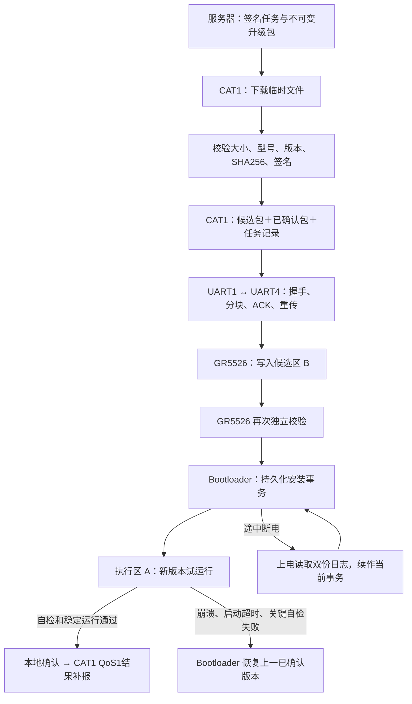
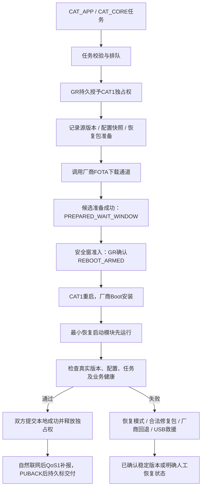

# CAT1 与 GR5526 双端 OTA 落地方案：备份、断电续作与失败回退

日期：2026-10-12（北京时间）｜方案整理：SAM｜状态：基于当前源码与芯片资料的设计方案，尚未实现或实板验收。

本次修订：依据四份客户软件要求补齐第1.1节、第12.5～12.9节和第15.6节，统一平台触发、活动态预置、安全静止窗、固定70%充电准入、QoS1结果交付与严格串行发布。两种OTA都必须有；下载、安装、确认不得同时执行；用户数据红线保持。SAM | 2026-10-12 +08:00 | 文档修订，未修改固件。

**用户数据红线（本次用户补充，优先于旧方案表述）：CAT1和GR5526的OTA均不得修改、清空或丢失用户现有数据。成功升级、失败回退、断电续作、首次布局调整和USB/SWD救援全部遵守；回退程序不回退用户数据。不满足保留条件的升级包或操作必须拒绝。**

CAT1 唯一项目：`D:\CODEX\sos-card\Air780EGH`。GR5526 主工程：`D:\CODEX\sos-card\ble_app_uart_c`；对应交付副本：`D:\CODEX\sos-card\SVN交付_YP001_GR5526_20261001\ble_app_uart_c`。

## 1. 建议采用的总体方案

本项目必须实现两条独立升级链路，由同一个整机升级仲裁器串行调度：

- **GR5526 OTA**：服务器 → CAT1完整下载并验证GR5526包 → UART1/UART4 → GR5526候选区 → Bootloader安装 → 新应用试运行 → 确认或回退。详见第3～10节。
- **CAT1自身OTA**：服务器/官方升级平台 → CAT1受控FOTA任务 → 厂商升级暂存/安装机制 → CAT1重启 → 真实版本和健康确认 → 结果补报；失败按恢复层级处理。详见第11节。

CAT1自身OTA是必做功能，不是“以后可选”。CAT1按客户要求采用厂商常规FOTA，不自行增加Lua A/B；GR5526保留独立A/B备份与回退。

采用以下原则：

1. GR5526 的备份、安装和回退由独立 Bootloader 掌握；应用程序损坏时，不能依赖该应用完成自己的恢复。
2. CAT1 保存经过验证的下载包，提供断点重传及辅助恢复；**CAT1 文件备份不能代替 GR5526 的可启动回退机制**。
3. 下载、串口传输、安装和运行确认分别记录状态；收到传输结束 ACK 不上报“升级成功”。
4. CAT1 自升级与 GR5526 升级串行执行；升级一端前，另一端必须处于已确认、可恢复的稳定状态。
5. 现板先验证内部双镜像方案的容量与 Bootloader；量产若需要持续增加功能，优先采用外部 NOR Flash，给新包、旧包和恢复包留足空间。
6. OTA仅更新程序和明确独立的OTA元数据/临时区，不写用户数据区；新旧程序均须兼容现存数据，不自动恢复默认值、不自动改schema、不用升级前快照覆盖当前数据。详见第5.1节。

**当前工程还不能直接执行安全的 GR5526 OTA。最先要解决的是 Flash 布局、独立启动入口和接收端，然后才是下载速度。**



## 1.1 客户软件要求基线与本次修正

本节依据用户指定的四份客户原件；来源指纹/章节定位见[客户要求来源索引](../.codex/skills/yp001-software-requirements/references/source-index.md)，完整功能及冲突见[软件业务要求](../.codex/skills/yp001-software-requirements/references/requirements.md)和[冲突清单](../.codex/skills/yp001-software-requirements/references/conflicts.md)。本节与第12.5～12.9节补齐业务合同，不把客户要求视为已实现能力。

| 需求 | 本方案采用的规则 | 对旧方案的修正 |
|---|---|---|
| F-029/030 | 平台每次上线查参数；AutoOta默认1控制平台主动推送 | 设备online不带AutoOta；开机不自主绕过平台检查/安装 |
| F-031 | 活动态空闲预置，运动/按键/SOS/通话优先；固定70%且充电、稳定静止、无报警才提交 | 删除40%初值；下载成功不能500ms后直接重启；不独占UART阻塞业务 |
| F-031、PRD4.3 | GR A/B；CAT1常规厂商FOTA、单分区业务语义，失败重推 | 不增加CAT1 Lua A/B设计，不承诺厂商未证实的回滚 |
| F-032/033 | 目标≤当前不升；本地成功/失败真实上报，QoS1投递与断连补报 | 不等待OTA平台应用层ACK；UART ACK与Broker PUBACK仍保留 |
| 用户追加 | 两端OTA全阶段串行；所有现有用户数据保留 | 复合发布需分组件串行，不能并行下载；清目标NV不等于擦用户NV |

文档中的GR5512映射为本项目GR5526主控角色，不更换现板硬件。平台协议V1.2样例有错误和旧字段；本方案不自行新增线上target/job/error字段，新增内部字段只用于设备事务与待协商签名清单。客户原件含凭据及带鉴权URL，未复制到方案或技能。

以下仍是发布门槛：双组件发布版本/分发契约、稳定静止时长、CAT1激活控制、GR短重启窗口、数据区保留、找人ACK/平台取消报警接口等。缺少证据时不能标“客户流程全满足”。


## 2. 当前工程核查结果与必须先修的问题

| 核查项 | 当前事实 | 落地影响 |
|---|---|---|
| GR5526RGNIP 存储 | 数据手册 Rev.1.3 表 1-1：1MiB SiP Flash、8MiB PSRAM | PSRAM 掉电丢失，不能当升级备份；SDK/下载算法名称中的 16MB 不代表芯片内置容量 |
| 当前映像 | 本轮解析已有 HEX，数据字节数 457,920，地址 `[0x00202000, 0x00271CC0)`，约 447.19KiB | 这是已有构建产物的容量参考，不是重新编译或实板版本证明；迁移后的正式 OTA 包必须重新测量 |
| CAT1 分区假设 | `dfu_transfer.lua` 写死 1MiB，Bank B 从 `0x002C0000` 开始 | 到 Flash 末尾仅 256KiB，放不下当前应用；还未扣除尾部 NVDS 保留空间 |
| 当前应用入口 | `custom_config.h` 与 `.sct` 使用 `0x00202000`，内嵌 APP_INFO 在 `0x00202200` | 当前程序不是本方案的“Boot＋应用”布局，不能直接套用新地址下载 |
| SDK 默认 DFU 元数据 | `dfu_port.h` 默认 APP_INFO=`0x00202000`、DFU_INFO=`0x00203000`；结束处理会擦写相应区 | 与当前应用重叠。直接接入默认 SDK DFU 会有擦除应用的风险 |
| GR5526 接收入口 | 当前 `uart4_evt_handler()` 将字节送入诊断环形缓冲；本轮未找到产品源码中 `dfu_port_init()` / `dfu_uart_receive_data_process()` 的接入 | CAT1 发出 DFU 帧不等于接收、落盘和重启链路存在；工程 include 路径包含 DFU 也不等于已编入 |
| 当前 SDK Boot 示例 | 提供验签、候选区复制、镜像信息更新与跳转；默认 UART DFU 关闭 | 可参考底层能力，但未见“应用试运行确认＋旧版本自动回退”的完整事务；不能直接声明 SDK Double Bank 已解决回退 |
| 文件下载 | CAT1 直接写 `/gr5526_fw.bin`，主要检查存在和长度 | 失败下载可能覆盖原包；没有已确认备份、可信任务清单与原子提交 |
| UART 可靠性 | 等 sent 后才等 ACK；文本和二进制仍混用；异常解锁、CRC 重同步、中止/删除边界仍有缺口 | 可能假超时、误重传、死锁或包损坏；上一轮互斥整合不等于这些问题已修复 |
| CAT1 自升级 | 有 FOTA 排队、重复请求保护和 DFU 互斥；下载后延迟重启 | 缺重启后版本确认、持久任务恢复及底层回滚能力的验证 |
| 无网络重启 | `network_watchdog.lua` 超时约 300秒后再等3秒重启 | 离线 UART 传输或恢复时不能因为蜂窝无网而反复重启 CAT1 |

## 3. 存储方案比较与选择规则

| 方案 | 备份和恢复方式 | 适用判断 |
|---|---|---|
| A：现板内部 A/B＋Scratch＋不可随业务 OTA 更新的 Bootloader | B 先存新包；Boot 按扇区可恢复地交换 A/B，交换后 B 是旧包；新程序失败再交换回去 | **现板优先验证路径**。无需假设新增硬件，但容量非常紧；必须通过第4节容量门槛和断电测试 |
| B：外部 NOR＋内部 Boot/执行区 | 外部 Flash 分别保存候选、已确认、恢复镜像；Boot 可重入地复制安装或恢复内部执行区 | **持续迭代/量产建议**。优先4MiB；2MiB仅在容量预算满足时采用。须确认板上是否已有可用 NOR，新增器件涉及硬件改版 |
| C：仅 CAT1 保存旧包，GR5526 用 Boot UART 重刷 | GR 应用坏后留在 Boot，由 CAT1 重传旧包 | 可作补救通道；CAT1 损坏、文件丢失或 UART 故障时无法自主恢复，不作为唯一量产备份 |

决策顺序：先做 A 的 Boot＋迁移应用试编，量出实际大小。若无法容纳完整签名镜像、接收代码和所需配置备份，则评估 B；**不能扩大地址到 1MiB 之外，也不能删掉日志/备份来使包勉强通过**。客户要求蓝牙A/B及数秒提交，B的外部备份复制只能算待评审替代，不自动等价于客户A/B翻转；C仅是维修补救，不满足独立回退，不能作为本需求的合格产品方案。A/B/C均需满足用户数据区不动及第12.6节窗口门槛。

## 4. 现板方案 A 的容量预算与候选布局

### 4.1 数量核算

当前已有 HEX 数据为 457,920字节；SDK 中可见 `bin_size + 48` 以及带安全封装时 `+856` 的分支。以此做保守示例：

`457920 + 48 + 856 = 458824字节`。

若 A/B 各预留456KiB（466,944字节），只剩8,120字节余量。**这不是正式 OTA 包尺寸，也没有包含新接收逻辑引起的代码增长；说明现板空间紧张，不能先承诺一定装得下。**

### 4.2 候选 Flash 表

以下均为左闭右开区间；已检查4KiB对齐、无重叠、总量恰为1MiB。它是待试编/实板验证的设计表，本轮未修改现有链接或下载配置。

| 区域 | 起点 | 结束地址（不包含） | 容量 | 用途 |
|---|---|---|---:|---|
| SCA | `0x00200000` | `0x00202000` | 8KiB | ROM 启动信息；出厂配置为启动独立 Boot |
| SDK 兼容元数据保留 | `0x00202000` | `0x00204000` | 8KiB | 避开默认 SDK 地址；不能让默认 DFU 提前擦写本方案事务 |
| Bootloader | `0x00204000` | `0x00214000` | 64KiB | 最小启动、验签、事务恢复、UART 救援 |
| A：唯一执行区 | `0x00214000` | `0x00286000` | 456KiB | 当前/试运行应用；正式镜像固定链接于此 |
| B：候选/上一版本 | `0x00286000` | `0x002F8000` | 456KiB | 下载阶段是新包；交换后是上一已确认包 |
| Scratch | `0x002F8000` | `0x002F9000` | 4KiB | 单扇区交换暂存；不用 RAM 代替持久副本 |
| Journal 0 | `0x002F9000` | `0x002FA000` | 4KiB | 升级事务、交换进度、启动尝试与确认 |
| Journal 1 | `0x002FA000` | `0x002FB000` | 4KiB | 日志冗余和掉电安全压缩 |
| 配置快照 | `0x002FB000` | `0x002FD000` | 8KiB | 升级前配置/NVDS备份，长度、hash和有效标记写日志 |
| 保留 | `0x002FD000` | `0x002FE000` | 4KiB | 对齐/配置增长余量；未确认前不能分配给应用 |
| NVDS＋GC | `0x002FE000` | `0x00300000` | 8KiB | 当前 `NVDS_NUM_SECTOR=1`，SDK还额外需要一个GC扇区 |

实施前必须同时满足：

- 读出实物 Flash ID/容量、`nvds_get_start_addr()`、实际配置存储清单，确认与该表一致；发现其它持久区就重新预算。
- Boot 实际镜像含其封装不超过64KiB；迁移后应用完整签名包不超过456KiB。构建及打包双重硬检查，运行端再次检查。
- A 的 `APP_CODE_LOAD_ADDR`、`APP_CODE_RUN_ADDR`、向量表、内嵌 APP_INFO 和签名包目标地址一致；按当前内嵌信息偏移，候选 APP_INFO 为 `0x00214200`，须在新 Target/产物中核对。
- 固定链接 A 的程序不能直接跳到 B 执行。本方案使用交换恢复，不依赖未验证的 Flash remap 或位置无关执行。
- 若项目需要明显增长空间，不能把8KiB余量当量产长期预算；转外部 NOR 或先做有依据的体积优化，再冻结布局。
- 本设计的扇区交换首先按未启用地址相关 Flash 加密的路径验证。若实物启用了安全加密，必须确认搬运是否需要重加密和SDK支持；不能直接复制密文后宣称可启动。

### 4.3 外部 NOR 方案 B

建议4MiB NOR：候选区1MiB、上一已确认区1MiB、出厂救援区1MiB，余下1MiB用于冗余元数据、配置快照及预留；具体区间按所选器件的擦除粒度冻结。内部仍保留独立 Boot、固定执行区和 NVDS。

Boot 必须能独立驱动该 NOR 并校验镜像，不能依赖应用初始化外设。每次安装先验证外部候选，复制到内部并逐扇区读回；断电后由不可变源镜像续作。新应用失败时，从外部上一已确认镜像复制恢复。救援镜像只提供最小状态、诊断和重新升级功能，并非承诺在任何硬件故障下恢复全部业务。

外部 Flash 接线、供电域、可用 SPI/QSPI、器件 ID/容量尚未核实；本轮不分配 GPIO、不把 PSRAM 当 NOR。外部区足够大也不代表内部执行区能容纳任意1MiB应用，仍以内部应用区容量为准。

## 5. 必须建立的备份体系

| 备份层 | 保存内容 | 何时生成、何时可清理 |
|---|---|---|
| PC 发布归档 | Boot/APP/CAT1包、源码版本、构建日志、签名清单、hash、布局ID、恢复操作说明 | 每次发布保存，不能用重建的“同版本”包替换原包 |
| CAT1 本地已确认包 | 与 GR5526 当前已确认版本相符的完整包、manifest、hash | 新升级开始前核对；新版本通过试运行并完成记录后才轮换，至少保留当前和上一版 |
| CAT1 自身恢复资料 | PC/发布库中的匹配底包＋Lua全量包＋配置快照；有能力时另保留厂商可接受的恢复升级包 | 发布前准备，不把正向差分包当反向恢复包；详见第11.3节 |
| GR保存CAT1任务摘要 | CAT1新旧版本、任务/包身份、锁epoch、安装阶段、确认结果 | CAT1重启/脚本异常时仍可查询；不在GR的1MiB中强塞一份CAT1完整镜像 |
| GR5526 本地回退镜像 | A/B交换后留在B的旧程序，或外部NOR的上一已确认镜像 | 新版本未确认时禁止覆盖；开始下一次升级前，先验证当前A并刷新CAT1备份 |
| 配置/NVDS快照 | 固件真正需要的配置、配对数据及schema版本的只读备份 | 为核验和独立数据救援留证；正常升级/回退不自动回写，不能覆盖备份后产生的合法数据 |
| 最后救援入口 | 独立Boot UART恢复、SWD，CAT1 USB下载入口 | 不作为普通业务镜像删除；Boot/SCA不进入第一阶段远程升级范围 |

方案A只有两个大镜像槽：开始下一次升级时，B会被新候选覆盖，旧的“上一上一版”不再本地保留。此时当前A必须已经确认且完整，随后交换会把它保存在B。CAT1和PC归档提供更早版本，但不能宣传内部拥有三个独立镜像。

首次升级前若CAT1没有当前版本包，应从受控发布库获得完全匹配的包，或通过经校验的只读导出流程取得；不能把任意同名 `.bin` 当作当前固件备份。Boot启用和首次布局迁移本身另行备份：应用、SCA、NVDS、布局及工具配置，保存读回hash；加密/读保护导致无法完整读回时须采用对应官方恢复方式。

### 5.1 两端用户数据保护：不可放宽的准入条件

**保留范围按实际数据清单逐项确认，不能仅保护一个NVDS地址就宣布数据安全。** 包括用户设置、紧急联系人/号码、账号及绑定关系、BLE配对/密钥、业务参数、用户配置的服务器/APN、报警/历史记录、待上传数据、用户文件、设备身份与校准信息；未确认用途的持久区先视为受保护区。这里只列核查类别，不声称当前项目已经实现全部数据类型。

| 环节 | 必须执行的规则 |
|---|---|
| 存储与分区 | 建立GR Flash/NVDS/TAG和CAT1文件路径/KV/厂商保留区清单，记录所有者、范围、格式、读写入口。OTA区与用户区不得共享会被整体擦除的扇区；共享文件系统时按路径限制并验证FOTA不重建/格式化整个LFS |
| 新包准入 | manifest带`preserve_user_data=true`、兼容数据版本范围和OTA可写范围；实际代码/工具必须兑现该声明。需要改写现存用户数据、搬移用户区或擦除文件系统的包拒绝下发 |
| 程序安装 | 包内不夹带默认用户数据库/NVDS镜像覆盖设备；Boot/OTA管理器只能擦写镜像槽、Scratch、OTA日志等白名单区域，擦除边界也必须校验 |
| 新版第一次启动 | 保留原值；禁止“版本变化→恢复出厂”“读取失败→清空NVDS/格式化LFS”“用新默认值重建用户配置”。读失败先保留原始内容、停止相关操作并报告，不能破坏性自修复 |
| 数据兼容 | 新旧固件直接兼容现存数据。新增功能用只读适配、内存默认值或独立新增命名空间；不能在确认后偷偷转换/重写原字段。无法兼容则拒绝该版本升级，数据迁移不属于本次OTA授权 |
| 升级失败/程序回退 | 仅恢复代码与OTA事务状态；保留当前最新用户数据，不能自动回写旧配置/NVDS快照。旧程序不能正确读取现存数据时，进入只读恢复状态，不清数据强行启动 |
| 升级期间正常使用 | 用户明确执行的设置操作和正常业务写入仍按产品规则处理，必须保留其最新已确认结果。需要一致性检查时短暂阻止提交并明确返回忙/待重试，不能先回复成功再丢写；不要在长时间下载期间冻结所有数据 |
| 数据快照 | 快照是只读核验/救援证据，不是固件回退时的覆盖源。若介质已损坏需要数据修复，另行保留现场、核对代次并处理；不能自动选择可能过期的备份回写 |
| USB/SWD救援及首次部署 | 同样只写程序白名单，禁用整片擦除、恢复出厂和格式化。完整恢复资料代表文件齐备，不代表允许全片覆盖；工具不能证明保留用户区则停止该操作 |

OTA元数据如任务号、进度、版本确认、重试次数可写入独立OTA区；这不是允许改动用户配置的例外。SDK或文件系统在正常业务中的内部GC需按存储机制核验，逻辑数据必须保持；OTA不得利用GC/初始化之名清空用户数据。

升级确认前必须完成数据保留核验。无业务写入的静态场景比较受保护逻辑记录/文件的数量、长度、hash和关键值；原始物理区hash仅用于无合法GC/写入的对应场景。存在正常业务写入时记录一致性代次/已确认操作日志，逐项证明新增/修改源自合法业务并且回退后仍存在，不能用“hash变化属于正常”跳过检查。校验失败不标升级成功，保留现场并停止可能进一步改写数据的步骤。

第4节布局必须在确认用户区现址未被占用后才可采用；如果拟定镜像槽/快照区与现存数据冲突，应调整OTA布局或增加存储，不搬走、压缩或删除用户现存数据来腾空间。厂商CAT1底包升级是否保留用户LFS/KV/配置必须逐包型验证；无法保证就不启用该包型。

## 6. GR5526 升级完整状态机

| 状态 | 进入条件与动作 | 失败/复位后的处理 |
|---|---|---|
| IDLE_CONFIRMED | A已确认；可接新任务 | 启动A；无升级自动擦写 |
| PRECHECK | 核对型号/板版/布局、目标版本、空间、签名元数据、电源、无SOS/通话、双方互斥 | 不满足则拒绝或排队；A不变 |
| CAT_DOWNLOAD | 活动态空闲下载任务专属临时文件，业务到来可暂停 | 断网/拔卡只暂停下载，A继续工作 |
| CAT_VERIFIED | 包全长、SHA256和身份校验通过，持久化“可用”标记 | 标记写入中断则重验文件，不能默认有效 |
| GR_RECEIVING | 协商DFU分块时隙并让出业务控制；只写B，保存已提交扇区进度 | CAT1/GR复位后查询同一任务，按GR持久进度重传；不得写A |
| GR_VERIFIED | GR独立验证完整包、签名和兼容信息；配置快照完成 | 验证失败清候选有效标记，运行旧A |
| PREPARED_WAIT_WINDOW | 候选完整、双方持久记录，尚未授予激活 | 复位继续旧A并重新等安全窗；候选有效不能触发安装 |
| INSTALL_PENDING | 满足第12.4/12.6节安全窗，双方提交一次性激活事务 | 真正开始改A前重新核验；已开始则Boot续作，不能启动混合镜像 |
| SWAPPING / COPYING | 方案A交换A/B；方案B从不可变外部源复制 | 依据事务记录重复未完成步骤，直至完整验签通过 |
| TRIAL | 新A完成校验；提交启动尝试数后跳转 | 未确认且超过尝试/健康期限，进入回退 |
| CONFIRMED_LOCAL | 新应用通过本地健康判据，确认记录读回有效 | 后续普通掉网不撤销已确认状态 |
| REPORTED | CAT1以otaResultMsg报告实际版本和结果，QoS1获Broker PUBACK后持久标交付 | 网络不可用时本地成功保留，待联网补报；不重复安装 |
| ROLLBACK | 仅恢复上一程序镜像和OTA事务状态，保留最新用户数据；确认数据兼容后启动 | 回退中断同样续作；失败则留Boot只读恢复模式，不跳坏地址、不回写旧数据快照 |

任务唯一标识：`job_id + target + target_version + package_sha256 + layout_id`。同一任务重复到达返回当前状态；相同job_id但hash不同直接拒绝。新任务不得抢占正在安装/回退的事务。

## 7. 断电可恢复安装：不能省略的细节

### 7.1 方案A的扇区交换

ROM先进入独立Boot，Boot是唯一允许修改A的程序。应用态下载只写B。交换覆盖两个完整槽的扇区范围，尾部无镜像部分按打包规则填充并纳入事务，避免新旧长度不等时留下不明数据。

每个4KiB扇区按下列顺序处理：

1. 持久化 `SWAP_BEGIN(index, direction, old_sector_crc, new_sector_crc)`；A[i]旧数据、B[i]新数据仍完整。
2. 擦Scratch，A[i]复制到Scratch，读回校验；再提交 `OLD_SAVED`。在此之前绝不擦A[i]。
3. 擦A[i]，从B[i]写A[i]，读回校验；再提交 `NEW_IN_A`。此时Scratch仍保留旧数据，B仍保留新数据。
4. 擦B[i]，从Scratch写B[i]，读回校验；再提交 `OLD_IN_B`。
5. 提交该扇区完成/下一扇区编号，随后才允许复用Scratch。

记录未前进但实际写入已完成时，重复相同步骤应得到相同结果。源数据在对应目的区写入并验证前始终保留；Flash API失败不能推进阶段。新A完整验签、旧B完整校验通过后，才提交TRIAL。回退复用同一交换算法，方向标志明确记录；必须先完成一次被打断的交换，再决定逆向回退，不能在中间混合布局直接改方向。

Scratch、A或B发生不可纠正的介质损坏超出“断电安全”保证：保留可用源，报告错误，进入CAT1/外部镜像恢复。断电恢复不等于Flash物理损坏容错。

### 7.2 双份日志怎样避免“状态写坏就变砖”

Journal记录至少包含：magic、格式版本、递增序号、job_id、布局ID、新旧镜像身份、阶段、扇区编号、交换方向、启动次数、配置快照身份、记录CRC和最后写入的commit字。

- 使用追加记录，commit最后写；只接受长度/CRC/commit完整的记录。选最高有效序号，不能只读一个flag。
- 压缩日志时先把完整恢复检查点写入另一日志扇区，读回验证和提交后才能擦旧扇区；任意时刻至少保留一个可恢复检查点。
- 容量不足则提前压缩；不能在即将擦A时才发现日志写不下。
- 两份均无效时不得猜测A还是B属于新版本；先分别验签、读镜像身份，进入保守恢复流程，由已保存的可信任务/备份修复。禁止无条件跳转A。
- RAM只用于缓冲，不能承载唯一的阶段记录；每512字节都擦一遍日志不可取，接收以扇区为提交粒度，交换仅记录必要阶段。
- Boot擦写期间需要的代码、常量、向量、中断路径及Flash驱动必须满足RAM/ROM执行约束。手册明确Flash写擦时XIP受影响；仅给外层函数加RAM属性不算验证完成。

### 7.3 新程序“启动了但不能用”如何回退

建议起始参数：每任务最多3次异常试启动；关键初始化必须满足客户数秒业务恢复预算，确切秒数待冻结，旧30秒初始化建议不作为合格门槛。业务恢复后累计120秒有效健康运行再确认，可跨自然睡眠持久累计，不因正常计划休眠扣失败次数、不为观察周期唤醒或强留CAT1供电。细节见第12.6节；这些是待验证初值，不是当前实现。

健康检查至少包括主循环/调度活性、异常复位计数、关键配置读取、必要板级功能初始化及升级通信管理正常；网络无覆盖、SIM未插、GNSS无定位不能单独判定固件坏。UART与CAT1失联要区分CAT1故障、线缆/供电问题和新固件协议不兼容，不能只靠MQTT上线决定是否确认GR固件。

确认必须由健康管理模块统一决策，不能在`main()`入口或定时中断里无条件确认/喂狗。现工程有多处喂狗，接入时须梳理；中断仍运行但主业务已卡死也必须能触发复位。

异常试启动次数在跳转前提交，非计划掉电也可能消耗一次尝试，正常计划睡眠按持久退出标记区分；达到上限保守回退并记录原因。确认记录损坏按未确认处理。回退版本正常后锁住反复启动失败的hash，仅更换任务ID不解锁，按第12.8节发布真实修复包并重新准入。

## 8. CAT1 下载、缓存和断点恢复

建议文件组织（逻辑名称，LFS目录/空间能力需实测）：

```text
/ota/gr/<job_id>.part              下载中，永不直接安装
/ota/gr/<sha256>.pkg               完整校验后不可变的包
/ota/gr/confirmed.current          当前已确认包的索引
/ota/gr/confirmed.previous         上一已确认包的索引
/ota/task.0  /ota/task.1            双份任务记录，generation＋CRC＋commit
```

落地要求：

- 下载前测实际可用空间；新包、保留包、临时文件及文件系统余量同时计入。日志/音频/脚本空间不能误算为空闲，满盘时不删除唯一备份。
- HTTP流式写文件，避免把约450KiB包全部读入Lua内存；分块hash同样需让出调度，不能阻塞UART和看门狗。
- 服务端支持Range和稳定ETag时可续传，必须验证`206/Content-Range/ETag`与同一镜像匹配；返回200或对象变化则重新下载临时文件。实验版本若仅支持整包重下，不能标满足客户断点续传要求，也不能直接作为产品验收版本。
- 全长、hash及可信元数据通过后提交“有效”索引。`close/rename`是否有掉电一致性必须验证；不能仅因为API名叫rename就当成持久原子操作。若无可靠原子替换，使用不可变文件＋双索引记录，启动时重验。
- GR端接收进度优先：CAT1重启后查询GR的job/hash/最后持久偏移；仅依据自己内存中的已发送字节数续传会丢数据。
- SIM拔出发生在下载阶段：暂停/有限退避；完整包已在本地后，可离线完成UART升级，结果联网后补报。
- 文件删除、第二次下载、DFU_ABORT、FOTA及重启统一交给升级管理器。现有DFU_ERASE只挡transfer、不挡dl，以及ABORT提前置idle的逻辑须一并收口。

## 9. UART传输接口与接收端实施规范

物理基线：CAT1 UART1 ↔ GR5526 UART4，当前板级宏AON_GPIO2/3，460800、8N1、无硬件流控。先验证这一基线；恢复Boot必须提供同样可发现的接口。若要兼容115200救援模式，双方必须约定明确的启动窗口/探测次序，不能各自自动变速。

### 9.1 推荐V2协议

保留现有DFU代码作问题定位依据，但产品V2采用显式会话、序号和偏移协议。下面是**拟新增协议**，不是当前Goodix ROM命令，也不能把它直接发给默认`dfu_uart_receive_data_process()`。

| 字段 | 字节 | 规定 |
|---|---:|---|
| Magic | 4 | ASCII `OTA2` |
| Version/Type/Flags | 1/1/2 | Version=2；保留位必须为0 |
| Session/Sequence/Offset | 4/4/4 | 小端；会话双方协商；序号单调；偏移相对镜像，不允许云端任意指定物理地址 |
| Payload length/Header CRC16 | 2/2 | 载荷上限512；CRC16-CCITT-FALSE覆盖前22字节 |
| Payload | 0～512 | 控制消息或镜像数据 |
| Frame CRC32 | 4 | IEEE CRC32，覆盖24字节头和载荷；两端用相同测试向量验证 |

最大帧540字节，低于现有1024字节收包规模；接收器必须支持跨回调分包、连续多帧、噪声及重同步。包完整性使用SHA256，CRC只处理链路错误，不能代替签名。

消息：HELLO/CAPS、BEGIN、DATA、QUERY、VERIFY、ACTIVATE、ABORT、RESULT、ACK/NACK。HELLO返回芯片/板版、Boot/应用版本、layout_id、槽容量、当前任务和持久偏移。元数据超过512字节时分片并限制总长，完整签名manifest接收验证前不得擦写镜像槽。

- 每次只允许一个未确认DATA，先注册/缓存ACK接收再发送；ACK关联session、sequence、offset，不因等待TX完成而丢掉早到ACK。
- 接收端重传幂等：相同序号/偏移且内容一致，返回原结果，不再次累加校验；同位置不同内容拒绝。越界、旧会话及错误长度拒绝。
- 每个已写块ACK带`accepted_offset`，扇区写完并读回验证且日志提交后再提高`durable_offset`。复位只从durable恢复；不完整扇区重擦重传。
- 任务CRC/hash不匹配则拒绝复用断点。V1可选择从B头重传，但仍保留旧A。
- 本方案由GR根据layout_id选择B和可写区域；Flash API包装器禁止写SCA、Boot、A、日志、NVDS等非接收目标，并检查整数溢出及完整擦除边界。
- 二进制会话中不混入`+DFU: PROGRESS`或业务文本；进度、查询、中止都用V2控制帧。PC调试日志走独立日志口/USB。
- GR UART ISR只进有界环形缓冲；前台状态机解析/写Flash，防止阻塞中断。消费者只能有一个，诊断、Cat1业务与OTA必须统一仲裁，避免原诊断环形队列抢走字节。
- ABORT仅在下载/接收阶段取消候选；安装、交换、回退阶段只记录请求并完成安全步骤，不能中途释放锁或立即跳应用。

### 9.2 初始时序预算

460800、8N1理论载荷上限46,080字节/秒，约459kB（448KiB）包纯线速约10秒，实际受ACK、Flash擦写和调度影响。初版512字节块、停止等待模式，建议把“本地完整包→GR传输完成”目标先定为120秒以内，实测后调优。

ACK初始超时2秒、每块最多3次重传；扇区擦除可返回BUSY和建议等待时间，按器件手册/实测设置上限。传输30秒无持久进展进入可恢复暂停；安装阶段使用扇区进度看门狗，不能沿用下载的无网计时器。不要用固定200ms延时替代READY握手。

## 10. 镜像封装、验签与配置兼容

发布清单至少包含：`preserve_user_data, compatible_data_versions, ota_writable_ranges, schema_version, job_id, target, product_id, hw_revision, chip, version, minimum_boot_version, layout_id, transport_protocol, config_schema, image_length, image_sha256, load_addr, run_addr, minimum_peer_version, allowed_rollback_version, signing_key_id, signature`。

GR5526包：从专用OTA Target生成固定A执行地址的映像，再使用经校验的Goodix兼容封装/签名流程。当前代码把最后48字节当信息尾、线上使用40字节结构体，签名路径还有额外封装；必须明确区分payload长度、Image Info、签名附加区和整个文件长度。不能把AXF/HEX文本或随便生成的裸bin当成可安装包。

建议沿当前 `SECURITY_CFG_VAL=0` 路径评估SDK已有RSA-PSS/SHA256验证及受控签名工具，使用自己的密钥和测试向量，不能使用示例公钥。manifest中型号、布局、版本和镜像hash也必须被签名覆盖；只签裸payload不足以防止元数据被替换。CAT1负责传输校验，GR Boot对它最终执行的镜像与授权元数据独立验证。

执行地址与暂存地址分离：签名镜像的run/load目标固定为A，UART仅提供相对offset，GR负责落B。本方案不让CAT1在验签后修改Image Info的执行地址。签名算法、加密模式和实际打包格式先做匹配性试验，不能仅打开一个宏就宣称安全启动完整。

版本策略：常规任务只升不降；自动回退仅允许本次事务中登记的上一已确认签名镜像。安全版本下限与回退策略必须兼容，不能在新版本试运行前烧写不可逆版本限制，导致旧镜像已无法启动。第一阶段不远程更新Boot、不改eFuse。

配置策略以第5.1节为准：升级及确认后均不自动迁移、转换或覆盖现存用户配置；回退只回退程序，继续使用最新合法用户数据。新旧版本必须兼容原schema，不兼容则拒绝升级。身份、密钥、绑定、校准和业务记录均受保护。只读快照超出8KiB时重做备份容量方案，不截断备份，也不能因此改写原数据。

特别检查SDK启动顺序：`SDK/platform/soc/src/gr_soc.c` 的 `nvds_setup()` 在部分初始化失败分支会擦除NVDS后重试。OTA基线和恢复启动路径必须禁止对含用户数据的NVDS进行这种破坏性自动修复；读取失败保留原始区并报告，不能通过清空或回写过期快照使初始化“成功”。正常业务原有存储事务的重放也必须保留最新已确认数据，不能混同为OTA回退。

## 11. CAT1自身OTA：必做的独立升级方案

### 11.1 升级对象、交付包与基线

CAT1自身OTA更新Air780EGH本身的程序；GR5526只负责仲裁、保存任务摘要和维持供电策略，不负责把CAT1固件当GR镜像刷入自己的Flash。

| 对象 | 发布内容与用途 | 实施要求 |
|---|---|---|
| Lua应用升级 | 本项目Lua及随应用发布的资源；由适配工具生成目标模块支持的升级产物 | 第一阶段先打通同一底包下脚本版本N→N+1；不是逐个覆盖正在运行的Lua文件 |
| 底包/核心固件升级 | 厂商支持的Air780EGH核心升级包，必要时与脚本组合发布 | 型号、功能分支、源版本、工具链必须匹配，先通过独立测试设备验收 |
| 差分升级包 | 从指定源固件生成的目标更新 | 必须精确匹配源版本/构建，不能对其它源版本重用，也不能反向应用 |
| 全量恢复包 | PC/受控发布库保存的完整匹配底包、Lua、资源及配置只读备份及保留说明 | USB救援的基础；是否也能走FOTA由目标底包/工具支持决定，不能由文件后缀推断 |

当前项目底包文件为`Air780EGH/soc/LuatOS-SoC_V2052_Air780EGH_113.soc`，脚本入口声明`PROJECT="TK_PROJECT_OTA"`、`VERSION="001.000.000"`；它们是源码/文件基线，必须与设备实际`rtos.version()`、`rtos.bsp()`及启动输出核对。`.soc`是当前保存的厂商底包文件，不能直接假设它就是HTTP FOTA要返回的内容。发布时使用厂商适配工具产出正确升级包。

**选定实现路径：保留现有`update.lua → libfota2 → http/fota`厂商FOTA通道，补上受控发布、持久事务、GR仲裁和重启确认。** 不自行改写模块底层分区或替换厂商Boot。厂商升级暂存区地址/大小/安装算法不能套用第4节的GR5526布局。

### 11.2 服务器与发布工序

服务器必须分别管理`GR_APP`、`CAT_APP`、`CAT_CORE`三类任务，CAT_APP和CAT_CORE均占用CAT1升级所有权。发布工序：

1. 冻结源版本、目标版本、Air780EGH型号/底包分支、脚本依赖和最低GR协议版本，归档当前可恢复的完整版本。
2. 使用与当前项目匹配的工具/官方平台生成脚本、整包或差分产物；在测试模块上完成安装与回退/救援演练。
3. 生成可信任务清单：job_id、target、package_type、源/目标core版本、源/目标app版本、PROJECT/firmware_name、package_size、package_sha256、最低GR版本、配置schema、签名/密钥ID、恢复策略及重试上限。
4. 自建分发端返回固定对象URL，任务清单签名覆盖URL关联的包hash及兼容条件；禁止相同job_id悄悄换包。使用官方平台动态生成差分时，先锁定实际生成的源/目标产物身份；平台无法提供的hash或签名信息不能由客户端编造。
5. 服务端先灰度少量指定设备，分别收集下载、安装、健康确认结果，再扩大范围。失败hash立即暂停下发。

当前`libfota2`默认HTTP地址；生产路径要核实实际端点、证书校验、时间校验和V2052能力。自建服务器可沿库的URL/options接口适配，但传入的仍必须是厂商可安装的包。HTTPS、普通SHA256和厂商签名各有作用，不能互相替代。

版本记录同时保留`rtos.version()`、脚本`VERSION`、PROJECT/firmware_name、源包和目标包hash。现库由`rtos.version()`与脚本版本分量拼装请求字符串，并不等价于完整脚本版本；应统一服务端映射与设备上报，避免只更改未参与比较的分量导致不下发。

### 11.3 备份：保存在哪里、能恢复什么

| 位置 | 必备内容 | 恢复能力及限制 |
|---|---|---|
| PC/发布库 | 上一已确认完整底包＋Lua/资源、生成工具版本、原始hash、配置schema/恢复说明 | CAT1 USB救援和重新生成合法升级包的依据；必须先于新版本发布完成 |
| CAT1持久文件系统 | 双份任务记录、当前已确认版本记录、应用配置快照；空间和底包支持允许时保存上一完整应用包 | 文件备份本身不保证能回滚底包；必须验证这些文件跨所选FOTA方式能保留 |
| GR5526持久日志 | CAT1任务摘要、源/目标版本、包hash、epoch、阶段、确认/失败码 | CAT1重启或Lua无法运行时仍可知道它在升级；摘要不包含完整CAT1镜像 |
| 厂商FOTA/Boot区域 | 厂商定义的暂存、校验、安装记录及可能的旧版本副本 | 是否双分区、可否掉电续作、是否安装后自动回退，须以目标底包资料和故障注入为准 |

CAT1记录建议采用两个版本化文件/记录槽，含generation、长度、CRC、最后提交标记；可靠写入/替换能力按LFS实测，不能仅依赖Lua全局变量。文件逻辑名如`/ota/cat/task.0/.1`、`/ota/cat/confirmed.0/.1`、`/ota/cat/config.snapshot`，不与GR下载缓存共用临时文件名。

备份配置包括当前应用实际使用的服务器/协议参数、业务配置、配置schema以及任务恢复信息；设备身份、SIM相关身份和厂商校准区域不纳入应用擦除。配置快照含长度、hash和一致性代次，仅用于核验/独立救援；无论试运行、确认还是失败回退，都不自动改schema或回写旧快照。镜像保留和任务日志所需空间在下载前预算；满盘时拒绝新任务，不能删除用户文件或GR唯一恢复包来腾空间。

正向差分包不能充当回退包。若平台禁止版本降级，可采用经批准的修复发布版本重新发布上一稳定功能，但版本、包和签名必须真实生成，不能伪造版本号强行绕过校验。底包已无法启动时，该“修复版本”也无法在线下载，仍需厂商Boot恢复或USB。

### 11.4 CAT1自身OTA完整流程



严格顺序：

1. 开机先恢复未完成任务并与GR对账，普通业务按客户上线流程接入；仅平台有效otaMsg或已持久受理任务可触发产品OTA。FOTA_CHECK只允许受控诊断/任务查询入口，不绕过AutoOta与平台下发授权自主检查安装。
2. 校验任务与兼容性、备份存在、电源和业务条件；申请第12节的CAT1所有权。**取得双方可恢复的授权记录之前，不调用`libfota2.request()`。**
3. 写CAT1双份任务记录及只读配置快照；GR保存摘要。活动态空闲预置保持旧GR业务，运动/紧急事件暂停。需要普通睡眠时在持久检查点安全停止下载并断CAT1电，owner不丢；不能为下载一直阻止休眠。
4. 仅启用通过第12.7节分阶段能力验证的下载/厂商适配通道，记录可获取的进度；无进度API时不虚构百分比。会在安全窗外异常复位自动安装的预置方式不准入。
5. 候选就绪先记PREPARED_WAIT_WINDOW；满足固定70%、充电、稳定静止、无报警/通话/活动等条件后才受控激活并提交INSTALL_PENDING/REBOOT_ARMED握手。GR持久ACK不替代即时条件复核；500ms延时不能替代安全窗。
6. CAT1重启期间GR保持任务锁和供电，暂停普通“模块无响应就断电重启”策略；厂商安装时间内不发送PWRKEY脉冲。安装超时只转`RECOVERY_HOLD`并报警，不自动释放锁让GR升级。
7. CAT1新程序启动后优先恢复任务、上报实际版本和复位原因，再启动普通业务。GR将其与原任务比较，之后进入健康观察。
8. 本地健康通过且版本匹配，双方持久提交终态，释放升级锁；网络不可用只延迟云端上报。Broker PUBACK丢失仅补发结果，不重新安装；不等待平台应用层确认。

当前`libfota2`存在两种路径：有原生`fota`时使用`opts.fota=true`，否则尝试写`/update.bin`。这些是代码分支，不证明Air780EGH上两者都可用。产品只启用经过实测的适配路径，不因缺少API就静默切换未经验证的安装方式。

**原生FOTA流式写入与普通文件下载不能混淆。** `opts.fota=true`可能边收边写厂商暂存区，应用层未必能读取完整包再做自己的hash/验签。因此调用前先验证可信发布清单、源版本、授权目标和传输端点，包校验必须由已验证的原生FOTA/签名链覆盖。若要“先下载普通文件、应用验签后再喂给FOTA”，必须先确认V2052提供并支持这种输入API；当前代码没有证明。不能在HTTP回调成功后补一句“SHA256已验证”来掩盖未执行的检查。

### 11.5 状态、持久字段与复位后的动作

| 状态 | 正常动作 | 复位/失败处理 |
|---|---|---|
| IDLE_CONFIRMED | 等任务，不直接启动另一端升级 | 核对双方日志后才视为全局空闲 |
| QUEUED / WAIT_OWNER | 保存待执行任务，等待GR授予CAT1所有权 | 重复job不重复创建；GR忙则继续排队 |
| PRECHECK / BACKUP | 核对版本、电源、资源及配置备份 | 不满足条件不调用FOTA；可安全拒绝并握手释放锁 |
| DOWNLOADING | 仅一个厂商请求，更新阶段及已知进度 | 能证实未触发安装且暂存可重置时有限重试；不能猜测续传偏移 |
| PREPARED_WAIT_WINDOW | 候选完整但尚未激活，保存源/目标版本 | 允许正常休眠，重启不自动安装；不支持此语义的包型禁用 |
| INSTALL_PENDING | 安全窗内受控调用厂商激活，持久安装事务 | 不因普通任务取消就释放锁；已激活状态按恢复流程处理 |
| REBOOT_ARMED / INSTALLING | GR确认后重启，厂商执行安装 | GR保持锁；整机掉电后按摘要重建，不进入另一端OTA |
| BOOT_CHECK | 读取真实core/app版本、启动原因和持久数据 | 源版本仍运行：记未安装/已回退；目标版本运行：进入观察；未知版本：恢复模式 |
| TRIAL | 关键自检和本地稳定性观察 | 失败进入恢复；不能仅收到一个UART READY就成功 |
| CONFIRMED_LOCAL | 双方记录匹配任务的成功终态 | 重启仍为成功；可以离线释放锁，云端结果另行补报 |
| RECOVERY_HOLD | 安装状态不明、启动失败或记录冲突 | 保留CAT1所有权，不重试其它目标；按第11.7节恢复 |
| FAILED_SAFE / ROLLED_BACK | 已证实厂商无待安装任务、当前稳定版本及配置完整 | 记录失败hash和原因，握手终结任务；新任务需重新准入 |

持久字段至少包含：record_schema、generation、job_id、owner_epoch、target、package_type、source/target_core、source/target_app、PROJECT/firmware_name、package_hash/size、config_snapshot_hash、phase、attempts、boot_failures、last_error、expected_peer_version、local_confirmed、report_pending、CRC/commit。若平台不提供某证据，记录`UNKNOWN`及来源，不能写假值。

原生FOTA内部安装状态若无查询接口，必须把“无法确定”视为`RECOVERY_HOLD`；不能认为Lua内存中的running=false就代表原生升级已取消。所谓超时释放，只能用于经双方证明尚未开始原生FOTA的排队阶段，不能用于已准备/安装阶段。

### 11.6 重启后的成功判据和最小恢复模块

CAT1成功条件全部满足：目标core/app版本与任务一致；最小UART控制链可用；现有用户数据完整保留且读取正确；需要的模块加载成功；调度/内存/看门狗无持续异常；本地稳定观察完成。旧30秒初始化建议不作为合格门槛；业务不可用须满足客户冻结的数秒预算，本地有效运行观察120秒不能强留CAT1常开或延误紧急业务。厂商安装窗口单独按最大包实测＋余量确定；超客户预算即列能力缺口，也不能超时强制断电损坏安装。

蜂窝无覆盖、SIM被拔出、GNSS无定位不直接等于OTA失败。网络有条件时另做SIM注册、IP、MQTT及必要音频/SIP回归；网络不满足时记录业务验证待完成，本地升级结果与网络测试结果分别报告。安全关键模块自检失败则不能确认。

新增最小恢复启动模块，顺序放在`audio_drv/gnss_app/sip`等可选业务之前：初始化必要日志/UART、读取任务和版本、向GR应答、提供恢复状态、再受控加载业务。当前`main.lua`直接require多个业务模块，这条早期恢复路径尚未实现。

普通Lua异常可由隔离加载/pcall转恢复模式；阻塞死循环仍需硬件看门狗和持久启动计数，不能指望Lua定时器必能救活自己。建议同任务最多3次异常启动，之后跳过非必需业务并停留最小恢复模式。最小启动模块也损坏、底包不启动或文件系统不可读时，进入厂商Boot/USB层救援，不能承诺pcall解决。

### 11.7 失败后的恢复层级

| 层级/故障 | 处理措施 | 结束条件 |
|---|---|---|
| 下载断网、拔卡、服务器临时异常 | 记录原因，保持旧程序；确认原生接口状态后按1/5/15分钟退避，单任务初值最多3次，次数跨重启保存 | 暂存安全结束或重新下载成功；不无限耗流量 |
| 错源版本/包型/型号/签名 | 立即终止该任务，不靠反复重试；上报真实原因 | 已确认未安装且暂存已安全处理 |
| 候选就绪/激活重启握手失败 | 区分PREPARED与INSTALL_PENDING；先查询同一事务，不删除记录或启另一OTA | 未激活重新等待安全窗；已激活按恢复流程或厂商证实撤销处理 |
| 安装断电/重启后仍是旧版本 | 读取真实版本/可用安装状态，区分未安装与厂商回退，保留失败结果 | 旧版本稳定、无待安装操作后终结任务 |
| 新Lua业务模块异常但恢复模块存活 | 进入最小恢复模式；按厂商支持的包型应用合法修复包或上一稳定功能的修复版本 | 实际版本、配置、健康重新通过 |
| 新Lua不启动但厂商运行时/回滚入口可用 | 使用已验证的厂商自动回退/恢复机制；GR保存现场摘要 | 厂商恢复旧版后重新核对，不能只因模块重新上线就认定已回退 |
| CAT1底层无法启动、回滚能力未确认/失败 | GR保持自身稳定功能；PC仅用已验证保留用户区的USB选项写入匹配程序，禁止全片擦除/格式化 | 验证底包、Lua、用户数据保留、UART和业务；工具无法保留数据则停止，不能强行救援 |

**恢复承诺的边界**：本项目必须提供CAT1正式FOTA、任务留存、失败限次、恢复模式和USB救援；“底包任意失败后无人值守自动回滚”仍需目标厂商Boot的支持证据。仅在CAT1文件系统备份一份Lua或`.soc`不会自然得到该能力。若产品要求所有底包失败都无人值守恢复，则厂商自动回退的确认与实板测试是量产准入条件；无法满足时该要求仍未完成，不能以USB救援冒充自动回滚。

本产品不采用自行增加的Lua应用A/B，按客户CAT1常规升级语义实施；最小恢复入口、持久记录和厂商支持的恢复路径仍必需。厂商内部是否有冗余/回退机制须核对，不把GR的A/B承诺套到CAT1。

### 11.8 必须核实的厂商能力表

| 核查问题 | 通过依据 | 未通过时的处理 |
|---|---|---|
| V2052_113支持哪些脚本/核心/差分包，哪些源版本可升级 | 对应官方说明＋两端实际版本/包安装记录 | 仅启用已验证的包型，其它任务拒绝 |
| FOTA成功回调代表什么，何时变为可安装、何时会自动安装 | API说明＋延迟重启/异常复位试验 | pending状态不释放，不假定可取消 |
| 是否支持进度、取消、清暂存、重启后结果查询、续传 | 实际API与掉网/中止测试 | 不暴露虚假的取消/续传；状态不明进入恢复等待 |
| 原生包认证、签名、TLS证书校验能力 | 伪造包/错证书/篡改数据被拒绝的记录 | 认证能力不满足则不放量，不能仅靠HTTP 200 |
| 安装中掉电是否续作，安装后坏脚本是否回退 | 厂商机制说明＋分阶段断电与坏脚本测试 | 记录USB恢复边界；不标无人值守恢复完成 |
| LFS/KV/配置/任务记录在各种FOTA和USB恢复下是否保留 | 升级前后清单、hash、逻辑值及正常业务变更核对 | 无法保证用户数据不变的包型/工具选项禁用；备份不构成擦除用户区的许可 |

### 11.9 当前文件的具体修改任务

| 文件/模块 | 后续实施内容 |
|---|---|
| `update.lua` | 改为持久CAT1升级状态机；先申请GR授权；候选就绪等待安全窗，验证延迟激活能力，不固定500ms直接重启；启动后对账；失败计数/结果补报 |
| `libfota2.lua`适配层 | 保留原有调用兼容性；结构化返回HTTP/平台/原生结果，区分明确NO_UPDATE与失败；显式超时、源版本/包型校验、已验证的TLS/FOTA参数 |
| `main.lua`及拟新增最小恢复模块 | 恢复入口早于业务require；先查询未完成任务；业务异常隔离；上报真实版本和启动原因 |
| 拟新增`ota_store.lua`/`ota_manager.lua` | 双份持久记录、升级队列、源/目标兼容、epoch与跨端协议；内存flag仅作缓存 |
| `uart_app.lua` | 注册拟新增`OTA_LOCK_REQ/GRANT/STATUS/REBOOT_ARMED/BOOT_REPORT/COMPLETE/RELEASE`控制消息，带job与epoch；名称是设计接口，当前尚不存在 |
| `network_watchdog.lua` | 无网恢复与升级安装状态分开；禁止因MQTT超时打断本地恢复；卡死仍由健康/硬件看门狗处理 |
| GR的升级管理与Boot恢复入口 | 持久授予所有权、存CAT1摘要、约束供电/PWRKEY、处理CAT1重启和版本报告；GR复位后继续遵守锁 |
| 发布与救援资料 | CAT1升级包/完整恢复包的清单、hash、工具版本、USB恢复步骤和验收记录 |

产品`FOTA_CHECK`不得自行触发云端检查/安装，只处理平台授权任务或受控诊断，不应绕开业务门槛与锁；`FOTA_STATUS`返回任务、阶段、源/目标、owner、错误与确认状态。`ret=4`继续保持不确定结果，只有取得可识别的平台原因后才报告“无需更新”。不能以`_G.cat1_fota_active`或GR的`dfu_state`单独作为产品互斥凭据。

## 12. 整机升级顺序、电源与业务仲裁

### 12.1 严格串行范围和升级次序

默认先升级GR5526并确认，再升级CAT1。若新GR必须依赖新CAT1协议，则先发兼容新旧双方的CAT1过渡版本并确认，再升GR，最后才去掉旧协议；服务器通过兼容矩阵下发，不固定死所有版本的顺序。

**同一设备只有一个活动升级事务。CAT1与GR5526不仅不能同时安装，连升级包下载也不得同时进行。** 一个目标从取得授权开始，经下载、UART传输（GR目标）、安装、试运行，到成功/安全失败/回退终态握手完成，始终持有所有权。另一个任务只允许排队，不允许后台预下载其升级包。已完成任务的网络结果补报不再占安装锁。

### 12.2 GR单一仲裁、双端持久记录

GR作为唯一授予者，因为它掌握自身Boot/Flash事务和CAT1供电策略。GR应用与Boot读取同一份受保护的仲裁记录；CAT1保存镜像副本。GR不可达时CAT1只能查询/排队，不能自行超时授权。首次接入需先安装具有仲裁能力的GR基线，旧版本不回授权不等于允许CAT1自升级。

仲裁记录：`owner = NONE / CAT1 / GR5526`、单调递增`epoch`、job_id、target、package_hash、phase、last_terminal_result、记录CRC/commit。epoch仅由GR增加，不依赖两端RTC同步；升级过程使用阶段进度监测，不以租约超时自动转移所有权。

一次授予流程：

1. CAT1管理器提出`OTA_LOCK_REQ(job,target,hash)`；GR自身任务也进入同一个仲裁入口。两个请求同时出现，由GR顺序处理，只有一个能成功。
2. GR确认owner=NONE且无未完成安装/配置事务，先持久提交新owner/epoch/job，再发GRANT。GR在发GRANT前掉电：CAT1未获授权不能下载，GR复位后根据记录补发或安全终结。
3. CAT1验证GRANT后持久保存副本并发送ACK，取得匹配的有效授权后才开始对应下载。重复请求/GRANT/ACK返回同一授权，不创建第二个epoch。
4. 所有控制帧携带job_id和epoch；旧ACK、旧释放请求、同epoch不同任务直接拒绝。GR持续拒绝其它目标，直到原任务终结。
5. 终结时先核对当前实际版本、稳定结果及无待安装包，双方保存终态；GR提交owner=NONE，再响应RELEASED。该响应丢失时CAT1查询GR的终态记录，不重复执行安装。

本方案优先保证不会同时执行，通信中断可能保守阻塞下一任务。不得为了提高可用性在两端各自实现一个独立“超时解锁”。在没有仲裁记录的设备上，先用受控本地部署建立基线，再开放远程OTA。

### 12.3 复位、失联与互斥判定表

| 当前所有权/事件 | CAT1自OTA | GR5526 OTA | 解锁条件 |
|---|---|---|---|
| NONE且双方记录一致 | 可申请 | 可申请 | GR只授予一个任务 |
| CAT1：下载/待重启/安装/试运行 | 只处理当前job | 排队，禁止下载/传输/安装 | CAT1终态、实际版本/健康及原生暂存安全状态明确，双方终结握手 |
| GR5526：下载/传输/交换/试运行 | 排队，禁止调用FOTA | 只处理当前job | GR确认新版本或完成回退，双方终结握手 |
| CAT1复位、GR保留CAT1锁 | 先BOOT_REPORT和对账 | 继续禁止 | 不能因CAT1内存flag丢失而解锁 |
| GR复位、CAT1保留任务 | 等待GR Boot/应用恢复日志 | 不自动开始新任务 | GR恢复同一epoch，核对双方阶段 |
| 整机同时断电 | 两端启动先对账 | 两端启动先对账 | 旧事务先完成/恢复，新任务不得先行 |
| 一方日志损坏/owner冲突/实际版本未知 | RECOVERY_HOLD | RECOVERY_HOLD | 结合完好日志、实际版本和安装状态恢复；不能简单取“最大序号”掩盖冲突 |
| 安装等待超时/心跳丢失 | 保留锁、查询/报告 | 保留锁、查询/报告 | 有证据证明安全终态或人工恢复完成；超时本身不是证据 |
| 仅结果MQTT PUBACK未收到，本地双方已确认成功 | 可申请下一任务 | 可申请下一任务 | 补报队列独立；不再维持安装锁 |

暂停很久的下载任务可以主动终结后让另一个目标执行，但必须确认下载请求已停止、未留下会在复位时自动安装的包，持久记录`FAILED_SAFE/CANCELLED_SAFE`并完成释放握手。当前缺少原生取消能力证据时，不能向用户宣称可立即取消已进入FOTA的任务。

### 12.4 电源和关键业务

新提交必须同时满足：稳定静止、真实充电中、已校准电量≥端侧固定70%、无报警，另检查无通话/待处理按键/新运动、负载压降及用户数据保护。OtaBatteryThreshold不是平台参数，无Force、不得降至40%或由实测任意降低。充电资格未知即延期；当前充电安全基线不能因OTA自动启充。实验供电测试不等于产品提交门槛通过。

- SOS、通话及用户交互优先；运动/按键/紧急业务暂停预置，下载与UART分块让出业务调度。不新增客户未要求的录音功能。
- 仍在B接收阶段发生紧急业务：按协议暂停/取消候选，恢复旧A业务。
- Boot已开始交换时存在业务不可用窗口，应尽快完成安装或恢复；不能承诺此时还能正常拨打SOS。实测该窗口并给出产品限制。
- CAT1下载完成后GR安装不依赖蜂窝网络；SIM拔出不触发立即撤销本地安装。
- GR Boot恢复模式需能按现有板级接线维持CAT1供电并初始化UART；GPIO6高请求电源、AON_GPIO0经反相控制PWRKEY，必须按当前板级实现核对。不要反复按PWRKEY把运行模块关掉。
- 本轮未确认CAT1能够硬件复位GR5526的专用连线；不能把该能力当恢复前提。GR使用自身Boot和硬件看门狗，必要时通过SWD救援。

### 12.5 平台消息、任务持久化与版本映射

正常上线顺序为CAT1上电→SIM识别→网络注册→IP→MQTT连接/订阅→`onlineMsg(Version,Battery,Position,Time)`→平台`paraSetMsg(CmdType=0)`→设备`paraSetReplyMsg`→平台决定参数设置/OTA。`onlineMsg`不带AutoOta；默认AutoOta=1，=0表示平台不主动推送，不擅自当成取消已受理任务。睡眠SOS优先报警/单次VoIP/位置上报，再执行常规上线流程；OTA不能等参数查询而阻塞SOS。

消息使用mqtts/TLS、QoS1及`/iotplat/render3/WARNCARD3/{deviceid}/down_raw`下行、`/iotplat/datapush3/notsos/WARNCARD3/{deviceid}`上行。原协议OTA线格式如下；时间是秒级，字段大小写严格保持，不复制原文错误JSON示例。

| 消息 | 原协议字段（除MsgType外） | 设备处理 |
|---|---|---|
| otaMsg | CurrentVersion、TargetVersion、Address、Md5、Time | 校验完整性、版本语法/源匹配；Md5为32位十六进制；目标映射及包身份必须有受信来源 |
| otaReplyMsg | otaReply=`success`或`fail`、Time | GR独立OTA记录已可靠落盘并读回后回success；只能表示已受理，不表示下载/安装成功 |
| otaResultMsg | Status=`success`或`fail`、Version、Time | Version来自实际运行版本/已冻结的发布映射；失败后报告真实版本，不填期望版本冒充完成 |

**原协议没有target、job_id、epoch、component_versions、error_code、签名字段和OTA应用确认消息。** 内部使用这些信息不等于可以直接上线新增字段。拟定发布契约：平台可继续使用既有otaMsg结构，Address指向某一独立组件包；由受信发布清单绑定整机ReleaseVersion、源/目标GR版本、CAT_APP/CAT_CORE版本、组件URL、Md5/SHA256/签名和升级顺序。该清单分发形式、签名格式、版本比较规则及单组件与整机Version映射仍须平台联合冻结；未冻结的任务只能协议模拟，不能盲猜要刷哪颗芯片。

同一个Address不得换字节内容。设备内部任务身份采用目标组件+源/目标版本+内容hash，绑定GR生成的epoch和原命令摘要；QoS1重复投递不产生重复安装。新URL或Time变化不能抹掉同一失败hash的次数。CurrentVersion不匹配则拒绝并记录实际版本；版本比较不能使用字符串字典序（如1.10与1.9）。若合法目标≤实际版本，先持久记录“无需执行”的内部终态，再清该任务的目标条目；对外用原Status/Version表示的确切no-op口径需平台确认，不能新增`no_update`线上枚举或虚报本次安装成功。

otaReply success之后验签失败/容量不足等应产生持久fail结果；如果连任务记录都写不下则回fail，不能先承诺已受理。成功/安全失败时先写结果outbox，再清对应TargetVersion，最后释放互斥。清目标不删结果、不动另一个目标、更不擦居民信息或NVDS。

### 12.6 活动态预置与安全静止窗的衔接

GR始终编排。以下为实现提案；客户原文把静止与CAT1真断电同时描述，需用明确的“休眠过渡”消除执行矛盾，不能声称断电模块能安装。

| 阶段 | 行为与供电 | 退出条件 |
|---|---|---|
| ACTIVE_IDLE / PRESTAGING | 活动态空闲授权单一目标；CAT1传输时常规模式；GR继续扫描/按键/屏显/报警；UART分块让出控制帧 | 三轴运动、按键、SOS、通话立即请求暂停；完成持久检查点后停止新块 |
| PREPARED_WAIT_WINDOW | 完整包和签名/回退资源已准备，尚无安装授权；任务/owner持久保留 | 条件不满足则按正常休眠流程安全断CAT1电；锁不要求持续供电 |
| ENTER_SLEEP | 默认无运动达RestTime=5分钟，并检查报警持续标志、通话状态、待处理按键等；先periodicMsg flush，再offlineMsg | 消息成功交付或失败已持久缓存；选普通睡眠或一次SAFE_COMMIT |
| SAFE_COMMIT（候选过渡态） | 仍保持安装所需电源，稳定静止+真实充电+≥70%+无报警/通话/新活动；复核可信包/备份/数据保护，落盘一次性激活授权 | 激活前有新事件立即撤销本次窗口，回活动业务；未激活包仍保留 |
| INSTALLING / RECOVERY | 已进入不可逆安装/断电续作，不再因普通静止关电或业务超时强切电；由Boot/FOTA完成安全边界 | 恢复可运行版本→恢复业务，记录实际不可用时间；严禁承诺安装期间可完整拨SOS |
| SERVICE_READY / TRIAL | 先恢复紧急业务和对端控制，再完成健康观察；观察时间不是业务阻塞时间 | 没有自然活动时按验证的睡眠策略；待确认任务跨休眠持久化，不新增周期唤醒 |
| SLEEP | CAT1硬断电，BLE低功耗；只保留既定自然运动/按键唤醒 | 下次自然唤醒继续原任务/补报；本方案不新增OTA RTC定时唤醒 |

稳定静止的专用确认时长尚未给定，不能把“采样没有输出/传感器故障”当无人使用。采用现有运动状态和明确计时，新增时长待冻结；报警标志不能因通话结束自动清除。充电中判定由GR充电管理真实状态提供；USB插入不等于正在充电，70%读数无效/陈旧也不准提交。满电充电终止是否属于“充电中”需业务/硬件共同冻结，当前不擅自放宽为“接外部电源”。不得为了升级自动改变充电安全配置或打开充电。

**激活授权与候选就绪必须分开。** `PREPARED`掉电重启仍回旧版并重新等待窗口，不能只见候选有效就自动安装。GR Boot只在有效的一次性激活事务下首次改A；若复位发生在真正开始安装前，应重新核验/撤销过期窗口（实现所需的电源/按键/运动证据必须明确）。开始擦改执行区后，日志表示未完恢复事务，重启优先恢复安全可运行版本；低电时按已验证电源保持/恢复策略处理，不能盲写或跳混合镜像。不能用“恢复”标签绕过尚未开始的安装准入。

**客户“数秒重启”是待验证性能门槛。** 第7节GR扇区交换/外部复制不是已经证明的O(1)翻转；必须测最大映像、最差电压/温度下从业务不可用至SERVICE_READY的时间。若不能满足客户冻结的数秒预算，需要研究可执行双槽及链接/Boot支持或调整硬件/正式需求，不能仅换术语。原建议120秒健康观察改为业务可用期间累计有效运行时间，跨自然睡眠保存，不把正常计划睡眠计作失败启动，也不让CAT1为观察额外常开120秒；该观察模型仍需实板验证。

### 12.7 CAT1预置/激活的能力门槛

当前`update.lua`下载成功500ms重启与客户门槛冲突，必须改。仅把reboot挪后仍不充分：原生FOTA准备好后可能在看门狗、拔电或普通休眠后的下一次启动自动安装。

优先验证的适配路径是：活动态下载到不会被Boot自动安装的普通持久候选文件，完成整包Md5/签名检查；安全窗内经厂商支持的文件输入/延迟激活接口提交安装。必须分别证实文件输入支持、激活原子性、未激活异常复位不安装、用户数据保留、HTTP Range续传及暂停恢复。不得把文件直接改名`/update.bin`当作已验证延迟激活方案。

若V2052只支持流式FOTA并在下载完成即布置下次重启安装标志，需要厂商提供可控激活/撤销能力并实测。不能通过“下载完始终不关电”规避问题，那会破坏静止硬断电及续航；也不能只禁止主动reboot却忽略看门狗。无法证明安全分阶段时，该包型产品OTA保持禁用并列缺口，CAT1自身OTA需求仍未完成。实验室整包重下、USB救援也不能算客户Range/无人值守OTA通过。

### 12.8 双组件发布的严格串行与失败重推

TECH4.3描述一个整包含双镜像、一次提交；用户要求两端全阶段互斥更严格。本方案拟按第12.5节分为独立组件包，先GR完整完成并确认，再CAT1完整完成（有依赖时采用兼容过渡版本）。每个组件重新满足安全窗，可能跨多个自然活动/睡眠周期，不承诺同一次重启升级完两端。

直接下载包含双端镜像的整包会同时预下载另一端，不满足本项目严格下载互斥；原平台若只能提供此类整包，则需改发布分发或与用户冻结新的范围，当前不默许。Range只取一个组件也不能假称已验证原整包Md5；必须有受信的独立组件长度/hash/签名与平台契约。包内容、实际组件身份、整机ReleaseVersion的关系未冻结前不启用双组件远程任务。

组件1已确认、组件2失败时保持组件1及最新用户数据，组件2按安全恢复策略处理；不得为了显示“整机原版本”偷偷把已确认组件1回滚。平台应能表示实际混合版本及未完成发布；旧单Version字段无法表达时先冻结映射/协议扩展，不虚报整机成功。原默认升级顺序和兼容矩阵仍适用。

平台自动重推与设备限次并存：网络/服务器瞬态失败在自然活动窗口内有限退避续传；签名、型号、布局、数据不兼容或反复启动失败停止同hash执行，自动上报fail，平台自动提供修复包。次数按组件+hash持久化，改变job/Time/URL不能无限刷新次数。下载重试倒计时不用于休眠RTC唤醒；恢复联网后继续。CAT1已完全不启动则收不到推送，USB维修是未满足无人值守目标的故障边界，不是自动重推方案的一部分。

### 12.9 结果交付与用户数据保护的业务细化

OTA无平台应用层确认：本地成功不等待所谓`otaResultAck`。结果先入持久outbox，再通过QoS1发送；Broker PUBACK后标交付，若断电发生在PUBACK与持久标记之间允许幂等重复。发送函数返回/连接存在不代表交付，未获PUBACK的结果跨断电保留；outbox满则在受理新任务前拒绝，不能删用户数据或未交付记录。当前线上无job字段，平台幂等关联方案需协商，内部epoch不能直接当线上既有字段。

两端受保护数据特别纳入：居民姓名/房号、CallOut/CallInList、AutoOta及扫描/休眠等已设参数、MQTT/VoIP连接信息、绑定/身份/密钥/校准、报警持续状态/事件关联、待报SOS/位置、beacon缓存及扫描计数。触发升级时这些数据仍可按正常用户/平台业务合法更新，程序回退必须保留最新已确认结果。任务记录独立扇区/命名空间，清TargetVersion不影响上述数据；试运行不得用新默认值覆盖旧设置。正常睡眠保存/补报删除是业务事务，也要有真实交付与一致性证据，不能借OTA批量清理。


## 13. 故障处理矩阵

| 故障点 | 必须保留的东西 | 自动处理 | 何时需要人工 |
|---|---|---|---|
| CAT1下载时拔卡/断网 | GR旧A、已确认包、任务身份 | 暂停并退避；网络恢复后验证续传条件 | SIM/网络一直不可用只报告，不循环安装 |
| 下载断电/临时文件损坏 | 旧A、旧备份索引 | 无有效提交则重验/重下临时包 | 文件系统介质故障 |
| 满盘 | 唯一已确认备份 | 拒绝新任务，清理仅可删除的过期临时任务 | 无空间且无法释放安全冗余 |
| 错型号/错布局/旧包/坏签名 | 旧A、Boot、配置 | 在擦B前拒绝；升级末尾再次独立验签 | 发布包修正 |
| UART丢字节/CRC错/ACK丢失 | 旧A、已提交接收进度 | 重同步、幂等重传，达到限额暂停 | 持续硬件通信故障 |
| CAT1在UART传输中复位 | 旧A、GR持久偏移、CAT1有效包 | 重握手按GR记录恢复；不误报完成 | 本地包也损坏时重下 |
| GR在写B时复位 | 旧A及Boot | 仍可启动旧A或继续B接收；半扇区重擦 | 写入介质故障 |
| 安装交换/复制中断电 | Boot、日志、Scratch或外部源 | 上电续作；安装未完成不启动A | 日志/源均损坏进入救援 |
| 最终ACK丢失 | 已落盘事务结果 | QUERY状态/版本，不因超时直接再执行ACTIVATE | 无法与Boot通信 |
| 新程序HardFault/死循环/健康失败 | 旧B或外部旧包、最新用户数据（原地保留） | 看门狗复位；尝试上限后回退，锁失败hash | 旧包也不能通过校验 |
| 回退过程中断电 | 同一可恢复事务和旧镜像源 | 继续回退，不来回切换方向 | 介质损坏 |
| MQTT结果PUBACK丢失 | CONFIRMED_LOCAL和结果日志 | 仅重发报告，不重装、不回退 | 无需立即人工处理 |
| CAT1新Lua启动失败 | GR稳定版本，若支持则CAT1应用旧槽 | 厂商/启动器支持时回退应用 | 不支持时USB重刷CAT1 |
| CAT1底层FOTA失败 | GR稳定版本、PC CAT1基线包 | 依厂商已验证的Boot能力恢复 | 无保证路径时USB救援 |
| GR Boot或SCA损坏 | PC归档、SWD接入 | 普通应用OTA不应触碰这里 | SWD恢复；本方案不承诺远程修复损坏Boot |

## 14. 分阶段实施清单

| 阶段 | 具体交付 | 通过条件 |
|---|---|---|
| P0：冻结事实 | 实物Flash/NVDS/CAT1版本与LFS容量报告、正式包格式说明、PC恢复包 | 地址无冲突，恢复包可用，厂家CAT1回滚能力边界清楚 |
| P1：最小Boot与容量试编 | 独立OTA工程Target、Boot、迁移应用、统一layout_id、签名测试包 | Boot/应用/封装均不超区；SCA启动Boot；正常跳A。失败就调整设计，不碰现有已验证Target |
| P2：持久事务与本地回退 | Journal双副本、Scratch交换/外部复制、trial/confirm/rollback、配置快照 | 先用主机NOR模拟，再实板每个破坏性步骤断电，旧程序能恢复且最新用户数据保留 |
| P3：UART链路 | GR UART单消费者、V2解析器、CAT1可靠发送、协议查询/中止 | 不联网，本地包成功升级；丢ACK/噪声/重复帧/复位不会损坏旧版 |
| P4：CAT1联网下载 | 临时文件、签名manifest、包缓存、空间检查、断点和持久任务 | 下载中拔卡/断电恢复正确；无SIM仍能用已下载包升级GR |
| P5：CAT1自OTA与整机互斥 | 下载前锁、重启后确认、兼容矩阵、阶段看门狗、失败限次 | 两端不能同时下载/安装；CAT1失败不影响GR恢复；按14.1逐项交付 |
| P6：发布工具与灰度 | 正式签名/打包校验工具、版本清单、工位备份恢复说明、服务端任务/结果接口 | 小批实测合格后分批放量；失败hash可止发，完整证据可追踪 |

建议改动位置（后续代码轮次实施）：

- CAT1：`dfu_transfer.lua`修复文件/状态/传输边界，`uart_app.lua`统一UART所有权，`update.lua`持久FOTA确认，`network_watchdog.lua`按阶段恢复；新增小型任务持久化/包验证模块。
- GR应用：`user_periph_setup.c`的UART4接收分流、应用侧OTA接收/健康确认模块、配置快照接口；不能在ISR内擦写或调用长耗时验签。
- GR Boot：最小板级启动、验签、Flash白名单、断电事务、跳转与UART救援，独立编译。
- 构建：单一布局定义生成C/Lua/打包器常量及layout_id；构建检查镜像边界/地址、封装长度和保留区。新OTA Target需明确区分Boot和App内嵌信息，避免生成旧`0x00202200`定位段。
- 双份GR工程后续修改按项目规则逐项比较再同步，分别重编；不覆盖交付方独立修改，不顺带改变现有Keil/J-Link/LCD基线。

首次部署是独立工序：先核对现存用户区与新布局无冲突、工具只擦写程序白名单且能保留全部用户数据；任一条件不满足则拒绝部署，调整布局或增加存储。只读备份不构成擦除许可。在稳定供电下备份→使用经过验证、能正确处理SCA/Image Info的工具配置Boot入口→下载匹配布局的Boot和A→读回校验→验证冷启动及UART救援→封存迁移记录。旧布局迁移到新布局不能通过当前未打通的DFU链路自行完成，不能把raw J-Link loadfile当已验证的SCA安装方法。

### 14.1 CAT1与互斥的必做子阶段

P5不是可省略的附加项。最小仲裁与持久记录应前置到P0/P1，在P4首次联网升级之前完成；CAT1功能按下表交付，而不是等GR量产后再补。

| 子阶段 | 交付物 | 进入下一步条件 |
|---|---|---|
| C0：包与能力冻结 | 真实模块/底包/脚本版本、厂商支持矩阵、CAT1全量恢复资料、USB恢复步骤 | 包型可识别，旧稳定版本可恢复，自动回退能力有明确结论 |
| C1：统一仲裁 | GR持久owner/epoch，CAT1记录副本，排队/授予/查询/释放协议 | 两任务并发、单端复位、双端断电均只能恢复一个owner |
| C2：Lua自身OTA | 同底包脚本N→N+1官方包，FOTA状态机，下载重试与pending握手 | 完成重启、真实版本/健康确认及结果补报，GR未启动自身OTA |
| C3：CAT1恢复 | 最小恢复模块、配置快照、启动限次、合法修复包/厂商回退/USB救援 | 坏业务脚本与安装断电有真实结果，能力边界逐项签验 |
| C4：底包OTA | 厂商支持的源→目标底包包型、配套脚本、独立安装窗口 | 核心版本迁移与断电测试通过，不能套用C2成功结论 |
| C5：整机串行发布 | CAT1→GR、GR→CAT1两种兼容次序，失败止发及灰度报告 | 一端失败另一端不启动升级，恢复后任务可继续或明确终结 |

交付文件至少包含：CAT1正式OTA包及manifest、上一稳定全量恢复资料、源/目标版本映射、配置快照格式、仲裁协议说明、CAT1升级/失败日志、USB恢复验收记录。包和恢复资料必须绑定hash，不能只有一份Lua源码压缩包。

## 15. 必须执行的验证与验收记录

### 15.1 主机/构建

- NOR模型约束：擦除4KiB、只能1→0写、任意写操作可只完成前缀、返回失败；遍历日志提交、Scratch、A/B交换的断电点，并验证所有路径的用户数据写保护。
- 不变量：SCA/Boot/NVDS非授权地址不写；任何破坏性操作前仍有恢复源；未验签镜像永不激活；未确认旧备份不删除；复位不产生“假成功”。
- UART：所有边界分包、粘包、乱码、超长帧、错误CRC、重复/过期ACK、序号回绕处理、错offset、同job不同hash、接收缓冲溢出。
- 包：型号/布局/版本/签名错误，payload与尾部长度不符，签名包/非签名包混淆，地址溢出，候选区/备份空间不足。
- 工程：Boot和应用分别编译、包级容量检查；主/交付工程独立通过；map、HEX、bin、manifest和签名绑定同一构建。

### 15.2 实板故障注入

| 编号 | 场景 | 合格条件 |
|---|---|---|
| T01 | 已确认N → 正常N+1 | UART传输、安装、试运行、确认、上报五段证据齐全 |
| T02 | 下载10%/50%/99%拔卡与恢复 | A仍运行；恢复不混用不同对象；旧备份不丢 |
| T03 | UART每个阶段断开/重连、双方分别复位 | 幂等重传、进度可信；最终无误写 |
| T04 | Scratch写、A擦/写、B擦/写、日志切换时断电 | 上电自动续作且只能启动完整镜像；覆盖所有阶段边界及随机点 |
| T05 | 新包故意HardFault/不确认/停止业务调度 | 在限定尝试后回到N，最新用户数据保持完整且失败任务不循环 |
| T06 | 回退过程中再次断电 | 仍能完成恢复N，不进入循环交换 |
| T07 | 同包重复任务、错包、超大包、坏签名 | 拒绝或返回原结果，Boot/SCA/原应用不被误擦 |
| T08 | 无SIM，CAT1已有有效包 | 仍可本地升级/回退；联网后补报 |
| T09 | CAT1自FOTA失败/新Lua无法启动 | GR旧版本正常；CAT1按已确认厂商机制恢复或按记录USB救援 |
| T10 | 同时请求双端升级、通话中请求、低电压压降 | 正确排队/拒绝；无不受控复位或安装 |
| T11 | 备份区坏块/读回错、双日志损坏 | 不误启动；进入明确恢复状态，保留仍可用数据 |
| T12 | 生产救援演练 | 单独恢复GR和CAT1；身份/NVDS按清单保留，版本读回一致 |

每条至少保存job_id、双方实际版本、镜像hash、布局ID、阶段/offset、复位原因、错误码、回退原因、UART日志和电源切断位置。下载校验、能启动、功能恢复分别签验。建议每个确定性断电点至少重复3次，再安排不少于100次随机断电循环；这是初始工程验证规模，不能取代产品可靠性规范。

### 15.3 CAT1自身OTA专项验收

下列项目必须独立验收；GR5526 UART升级成功不能替代其中任何一项。脚本升级和底包升级分别保留证据。

| 编号 | 场景 | 合格条件 |
|---|---|---|
| C-T01 | 同底包脚本N→N+1 | 授权、下载准备、重启、新脚本真实版本、本地健康、上报闭环齐全 |
| C-T02 | 厂商支持的底包源→目标并带匹配脚本 | 核心与脚本两种版本均符合任务；依赖、配置和UART正常 |
| C-T03 | 下载各进度拔卡、断网、服务器超时 | 旧版本可运行，有限重试；不误报最新或成功，不使GR同时下载升级包 |
| C-T04 | 错源差分、错型号、坏包、错证书/签名 | 在对应认证环节拒绝；拒绝原因可追溯，不靠重试强行安装 |
| C-T05 | 准备成功后丢REBOOT_ARMED或其ACK | pending记录不丢；重试握手幂等；未经GR持久确认不主动重启 |
| C-T06 | 厂商下载暂存、安装、首次启动阶段断电 | 分别记录继续安装/旧版恢复/需USB的实况，未证实自动回退不得填通过 |
| C-T07 | 新Lua模块抛异常、阻塞、反复重启 | 恢复模块/硬件看门狗/启动限次按设计工作；不能无限消耗流量或重复装失败hash |
| C-T08 | 最小Lua入口损坏或底包不启动 | 厂商回退若受支持则验证；否则完成保留用户区的USB程序恢复演练；工具不能保留数据则停止，明确恢复能力缺口 |
| C-T09 | 配置schema不兼容及兼容版本回退 | 不兼容升级被拒绝；兼容升级、确认及回退均不迁移原数据，保留最新合法用户数据 |
| C-T10 | 升级后无SIM/无网络、MQTT结果PUBACK丢失 | 本地成功与网络结果分开；不因补报失败重装；自然联网后按冻结的任务映射幂等补报 |
| C-T11 | LFS满盘、task一份损坏、两份损坏 | 唯一备份不删；可从有效副本/GR摘要恢复，无法证明状态时停在RECOVERY_HOLD |
| C-T12 | GR在CAT1升级期间使用普通模块超时策略 | 不误断CAT1电源、不误触发PWRKEY；超时只查询/告警，保留升级锁 |

### 15.4 两端严格互斥专项验收

| 编号 | 故障/竞争点 | 合格条件 |
|---|---|---|
| M-T01 | 同时发CAT1与GR任务，反复交换到达顺序 | 只有一个owner获得授权，另一任务连包下载都未启动 |
| M-T02 | GR提交GRANT前后掉电，CAT1收到GRANT前后掉电 | 重启后只有原任务可续作；不会出现各自认为自己有锁 |
| M-T03 | 单端复位/整机断电覆盖下载、安装、确认阶段 | 启动先对账；owner/epoch保持一致；另一目标不自动运行 |
| M-T04 | 延迟旧ACK/旧RELEASE、复制任务、注入同epoch不同job | 全部按事务身份判定；旧消息不能释放新锁 |
| M-T05 | 长时间失联、阶段超时、两端日志冲突 | 不因超时转让所有权；恢复或人工处置后才终结 |
| M-T06 | 成功终结时RELEASED或MQTT结果PUBACK丢失 | 查询恢复正确终态；只补报，不重装；GR提交空闲后才能授予下一任务 |

建议日志至少能同时定位两端的owner、epoch、job_id、phase。用日志中的“没有第二个安装动作”还不够，还要核对没有第二个目标的HTTP/FOTA下载请求与擦写行为。

### 15.5 两端用户数据保护专项验收（待执行）

以下用例均分别覆盖CAT1与GR5526，先冻结用户数据清单、擦除粒度和逻辑核验方法。记录升级前、试运行、确认后及回退后的证据，不以“设备能启动”代替数据验收。

| 编号 | 场景 | 合格条件 |
|---|---|---|
| D-T01 | 正常升级及首次启动，业务静止 | 用户设置、绑定/密钥、记录和文件逐项保持；逻辑值或文件hash一致，无默认值覆盖 |
| D-T02 | 下载、擦写、安装、确认、回退各阶段断电或故障 | 已确认用户数据完整；恢复只处理程序/OTA元数据，不回写旧用户快照 |
| D-T03 | 下载或试运行期间用户改设置、产生新记录，随后程序回退 | 最新已确认写入仍存在，旧程序可读取；以一致性代次和操作日志核对，不要求GC后物理Flash逐字节一致 |
| D-T04 | NVDS初始化/读取失败、LFS挂载失败 | 保留故障现场并报告；不自动擦除、格式化、恢复出厂或覆盖备份 |
| D-T05 | 包夹带用户区、擦除边界越界、存储空间不足 | 擦写前拒绝；按实际擦除扇区验证边界，不删除用户文件腾空间 |
| D-T06 | 新程序要求不兼容schema，或回退版本不兼容当前数据 | 准入拒绝该升级；异常恢复进入只读模式，不强制迁移或清数据；确认后也不改原schema |
| D-T07 | CAT1脚本、核心底包及组合包分别升级 | 每种包型单独证明用户LFS/KV及厂商持久区保留；任一种缺乏证据即禁用该包型 |
| D-T08 | 首次布局部署及USB/SWD救援 | 只写程序白名单且无用户区冲突；保护整片擦除选项，核验实际擦除范围；无法保留则停止 |

以上是发布前必须通过的验收要求，本轮未执行实板测试。正常用户操作的业务写入不属于OTA修改，但OTA必须保留其最新已确认结果；为一致性短暂拒绝写入时要明确返回忙，不能虚报成功。

### 15.6 客户业务流程与协议专项验收（待执行）

| 编号 | 输入/故障 | 合格条件与证据 |
|---|---|---|
| B-T01 | 自然上线，AutoOta分别0/1 | online字段正确且不含AutoOta；平台每次查询；0不主动推送；设备不绕过平台自FOTA；保留MQTT抓包 |
| B-T02 | 正常/缺字段/非法Md5/错CurrentVersion、重复otaMsg | 严格JSON与字段校验；合法命令持久化后回执；重复不重装；掉电注入证明未落盘不报已记录 |
| B-T03 | 下载阶段触发三轴运动、按键、睡眠SOS/来电、定位上报 | 暂停新下载/DFU块，业务控制不被UART独占阻塞；单次拨号无重拨；量出报警到平台及起呼时间 |
| B-T04 | 69%、70%、读数无效/陈旧、USB在但不充电、充电拔出 | 两端每次新提交只有满足固定70%且真实充电时准入；平台无法降低阈值/Force；记录采样与提交时点 |
| B-T05 | 有持续报警但通话已结束；静止时来电/按键；传感器无响应 | 均不得把无运动当无报警；激活前新事件撤销窗口，旧业务继续 |
| B-T06 | 预置后正常休眠、很久不活动 | CAT1安全硬断电，待升级记录保存；无OTA周期RTC唤醒、无为持锁/健康观察持续供电 |
| B-T07 | PREPARED后看门狗/硬断电；激活前事件竞争 | 未获新有效授权绝不安装；分别验证GR Boot及CAT1厂商行为；无可控激活的包型不得通过 |
| B-T08 | HTTP Range返回206/200、ETag改变、SIM拔插、断电 | 对象身份与持久offset正确；不拼错包；SIM识别→注册→IP→MQTT恢复；非续传实现不得标满足 |
| B-T09 | 双组件发布、组件1成功后组件2失败 | 第二组件在第一组件确认前没有下载/擦写；混合版本真实报告；不并行、不未经准入回滚组件1 |
| B-T10 | 结果发送前后断网、PUBACK丢失、结果持久提交断电 | otaResultMsg真实Version/Status；仅QoS1重投，无平台应用ACK依赖；outbox及清目标顺序安全 |
| B-T11 | 旧目标/等版本目标、同坏hash更换任务Time/URL重复推 | 不擦写已确认代码；只清匹配目标；失败次数不被重推重置；无无限安装循环；no-op口径按冻结协议 |
| B-T12 | 升级期间平台改电话/姓名/参数，产生SOS/定位缓存，再触发回退 | 最新合法用户数据仍完整，已确认业务写入不回旧快照；不清用户NV、不重置AutoOta默认 |
| B-T13 | 最大包/最差允许电源条件下GR交换和CAT1安装 | 测真实不可用窗口、SERVICE_READY及睡眠电流；不以120秒观察或USB维修掩盖数秒/零人工缺口 |
| B-T14 | 休眠前flush发送失败/低电、应用确认缺失、正常定时休眠 | 缓存不丢、有限重试；OTA不添加应用ACK；报警/找人60秒最多3次重发；C-06/C-09未决接口冻结后联调 |

上述是验收计划，本轮无平台联网、无实板/电流测试。客户冲突表C-06～C-12/C-14/C-17等影响对应验收，应在量产准入前有明确接口/能力结论；不能只跑JSON样例或编译即签验。


## 16. 本轮证据与交付边界

方案编写阶段仅核查、计算并输出方案，当时没有修改两端固件、链接脚本、下载配置或交付副本，没有连接/烧写实板，也没有重新编译。此前6项桩测试与Keil通过不证明本方案已实现。

2026-10-12 后续代码实施更新：现已接入持久事务/GR仲裁、Range下载核心、Boot交换回退核心、旧入口收口和MQTT确认；49组Lua回归、Boot/仲裁主机测试通过，两份Keil均0错误0警告。**完整产品OTA仍未打通**：真实GR串口写槽、独立Boot部署、存储布局/认证、真实业务输入、CAT1厂商受控激活和实板验收未完成。对应代码、证据及开放条件见 [双端OTA代码整合清单与开放条件](2026-10-12_双端OTA代码整合清单与开放条件.md)。不能把可移植核心或默认拒绝端口当作已完成的实板升级。

已执行：解析当前HEX并校验每条记录校验和；核算1MiB候选分区、4KiB对齐和容量余量；检查当前UART接收、DFU及Boot默认地址；提取芯片手册相关页；记录输入文件SHA256。本轮方案与日志文件是交付物，代码修改注释、双份源码同步及双Keil重编要求在后续实际改代码时执行。

本次CAT1补全另核对`update.lua`、`libfota2.lua`、`main.lua`及当前README：确认现有FOTA通道、HTTP结果映射、原生FOTA/文件分支、版本拼装与开机加载顺序。新增状态、控制消息、恢复启动模块、持久仲裁均为待实现设计，不代表当前源码已具备。保存了补全前文档副本，继续在同一MD维护方案。

本次用户数据补充将保护要求贯穿两端准入、升级、确认、回退及救援，删除自动恢复旧配置和确认后迁移schema的表述，新增D-T01至D-T08验收。仅更新方案及文档核查记录，尚未实现固件保护逻辑。

本次客户需求对齐只更新文档、软件要求技能和项目读取入口；已逐份阅读四份指定文档并建立SHA256/章节索引，未改客户原件、未连接平台、未复制凭据。新增F-001～F-033映射、19项冲突及14项业务OTA验收；CAT1延迟激活、协议发布映射和数秒窗口仍待验证。

直接证据：

- [容量、候选分区与输入hash记录](../logs/ota_plan_20261012/evidence.json)
- [芯片手册相关页文本](../logs/ota_plan_20261012/datasheet_selected_pages.txt)：PDF页30/31确认Flash与PSRAM，PDF页62说明Flash写擦与XIP约束。
- [GR5526数据手册](../ble_app_uart_c/GR5526_Datasheet_Rev.1.3.pdf)
- [当前CAT1 DFU](../Air780EGH/dfu_transfer.lua)：分区常量、下载、发送与完成状态。
- [当前GR配置](../ble_app_uart_c/Src/config/custom_config.h) 与 [链接脚本](../ble_app_uart_c/Keil_6/YP001_GR5526.sct)：现应用地址。
- [SDK DFU地址定义](../SDK/components/libraries/dfu_port/dfu_port.h) 与 [处理实现](../SDK/components/libraries/dfu_port/dfu_port.c)：元数据擦写及包长度分支。
- [SDK Boot复制/跳转示例](../SDK/projects/ble/dfu/app_bootloader/Src/user/bootloader_boot_vendor.c)：已有能力及需扩展的事务边界。
- [NVDS接口说明](../SDK/components/sdk/gr55xx_nvds.h)：数据扇区之外还需要GC扇区。
- [当前CAT1升级管理](../Air780EGH/update.lua)、[FOTA库](../Air780EGH/libfota2.lua)、[启动入口](../Air780EGH/main.lua)：第11节的当前实现依据。
- [本次补全前的方案副本](../logs/ota_plan_20261012/方案_补全CAT1前.md) 与 [补全核查记录](../logs/ota_plan_20261012/cat1_supplement_verification.json)：保留文档修订证据。

- [用户数据保护补充前副本](../logs/ota_plan_20261012/方案_用户数据保护前.md) 与 [用户数据保护文档核查](../logs/ota_plan_20261012/user_data_preservation_verification.json)。

仍须现场/工具确认的实施门槛：实物Flash容量与加密状态、真实NVDS/配置分配、Boot和新应用实际包大小、CAT1文件系统容量/持久性、V2052自FOTA失败恢复能力、正式供电条件、首次迁移恢复工具。它们均已给出核查方法和失败后的替代路径，不得在未验证时把方案标为量产可用。

- [客户要求修订前OTA方案](../logs/customer_requirements_20261012/OTA方案_客户需求对齐前.md)、[四份原件指纹](../logs/customer_requirements_20261012/sources.json)、[本轮文档核查](../logs/customer_requirements_20261012/verification.json)。
