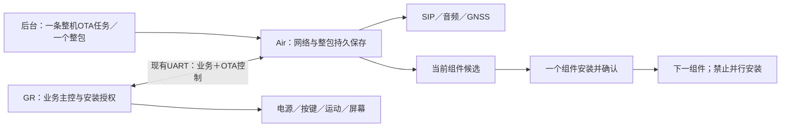

# YP001：整包双端 OTA、SIP 与 GNSS 保热启动业务总体规划

SAM | 2026-10-14 +08:00 | 根据用户最新整包OTA要求统一业务、电源、音频和升级规划；本轮仅编写规划，未修改或烧录固件。

## 1. 本轮明确的需求与总体结论

四个主要目标：

1. **OTA：后台一次管控，只提供一个包含 Air780EGH 和 GR5526 固件的整包；设备自动完成两个模块升级，最后形成整机结果。**
2. **SIP：活动态可接听、SOS单次呼出、双向挂断，通话与报警状态分开，屏幕反映真实事件。**
3. **保热启动：GR控制策略，Air执行内部GNSS备电及休眠操作，待机可选择保备电或原硬断电策略。**
4. **SIM热插拔恢复：模块供电运行时拔卡、插卡不需要用户重启整机；插卡后自动重新识别、注册并恢复MQTT/SIP，OTA任务与用户数据保持。**

SAM | 2026-10-14 +08:00 | 用户追加SIM卡插拔热启动要求，提升为独立业务目标并补充与SIP、OTA、休眠的协作及验收。

实施原则：先验证共享基础，再一个功能一个功能完成。推荐顺序为：当前基线/通信复核 → 网络上线及SIM热插拔恢复 → SIP基本通话 → 最小业务占用互斥 → 可控保热启动及唤醒 → 整包接收/真实存储 → GR OTA → CAT OTA → 整机串行与失败恢复。

这里的保热启动指内置GNSS保存星历后再次定位，不代表蜂窝注册、SIP注册或MQTT会话不用重新建立。SIM“热插拔恢复”则指卡更换后的重新识别和通信恢复，两者独立，不能用GNSS备电脚完成SIM识别。

### 1.1 新整包要求对旧方案的调整

用户已明确后台只提供一个含两端固件的整包。后续设计以此为准，不要求后台改成两次指令或两个独立下载地址。

- 后台管控：一条整机任务、一个包地址、一个整机目标。
- 下载：一次共同整包下载，会取得两端镜像；因此旧“两个组件的下载阶段也不得同时取得”的严格定义不能原样保留。
- 执行：整包收齐/验真后，只允许一个组件传输、写候选区、安装、试运行和确认；完成后才开始另一组件的这些阶段。
- 第二组件只可作为包内静态数据保留，第一组件确认前不得预写第二组件的升级区、触发第二组件FOTA或提前激活。
- 此变化只调整整包承载与共同下载；不放宽70%、充电/静止/无报警提交、两端安装互斥、用户数据保护。

原有双端OTA文档中“后台提供两端独立包”及“组件下载全阶段严格串行”内容，涉及本项目新整包任务时按本文件调整。旧文档保留用于追溯，不代表已实现新方案。

### 1.2 本轮范围

这是总体实施规划和验收顺序，不是完成报告。没有平台发包、联网验证、Flash写入、硬件修改、Git分支/提交/推送。业务端与平台契约未冻结项明确列出；未实现端口继续拒绝，不用常量true冒充能力。

## 2. 当前基础与证据分层

| 项目 | 当前证据 | 尚未证明 |
|---|---|---|
| SDK | 项目唯一活动SDK为1.0.4；同日迁移记录有主/交付独立编译及实板启动版本 | 不等于完整业务通过 |
| UART | 同日记录50次状态命令正确ACK；DL32摘要为20条14字节命令全部正确；本轮查看对应日志 | 长时间、低电、睡眠唤醒、OTA大包/业务混合压力未验收 |
| SIM/网络 | Lua已装载网络观察模块及SIP/MQTT；最新迁移记录网络尚未确认注册成功 | 有效SIM→注册→IP→MQTT→SIP及拔插恢复 |
| SIP | 有命令、音频及真实事件绑定；接听/挂断ERROR反馈和重复hello电量补同步有既有回归记录 | 实板双向语音、起呼、来电、挂断、音频争用及平台闭环 |
| GR业务 | 当前活动链路为yp001_business；旧Cat1Svr AO启动仍在#if 0 | 不能依靠修改未启用AO完成产品功能 |
| OTA | 有事务、Range/校验、持久模型、GR仲裁及Boot核心 | 产品端口仍不可用；无独立可启动Boot及两端真实升级闭环 |
| 保热启动 | 已核对GPIO23内部备电、GPIO24功放占用、电源链及详细设计 | 可控模式、GPIO6睡眠保持、PIN99电压、真实休眠、唤醒/TTFF未验收 |
| 其他业务 | 屏显/参数/电量及报警接口有源码 | BLE扫描历史INVSTATE保护、传感器有效静止、缓存/平台未决字段须各自验收 |

以2026-10-14的SDK迁移与实板复测记录覆盖旧UART问题结论：目前短样本未复现此前错误，不能继续写成“当前UART必然损坏”，也不能据此开放未验收OTA。

## 3. 两端职责与最小共享管理

| 能力 | GR5526 | Air780EGH |
|---|---|---|
| 业务主控 | 按键/SOS、运动、屏幕、电量/充电、供电策略 | 网络/SIM/MQTT/SIP、音频、GNSS及业务回报 |
| 通话 | 发业务请求、显示真实事件，不伪造接通/挂断 | SIP单次拨号、白名单接听控制、语音链及真实事件 |
| 保热启动 | 决定desired策略；GPIO6保持VBAT；管理运动/按键唤醒 | GPIO23备电、GNSS主电源、GPIO20/24音频关闭、WORK_MODE |
| OTA | 唯一安装资格/owner授权者；保存整机进度摘要与组件事务；GR Boot安装/回退 | 整包接收/保存/验真；提取当前组件；传GR候选；执行厂商CAT FOTA |
| 恢复 | 启动前核查任务/安装journal，保留用户数据 | 启动恢复整包及进度，版本对账、网络恢复、结果补报 |

不建立庞大通用框架。只收口三个会冲突的动作：**电源变化、共享UART传输、音频使用**。沿当前business/OTA模块增加最小接口，保护各功能现有边界。



### 3.1 不混用三个状态

- 业务状态：alarm、call、position、network、battery/charging、motion、用户活动；未知是未知。
- 电源状态：ACTIVE/PREPARING/STANDBY/RESUMING/UNKNOWN；GPIO请求不代表实测VBAT。
- OTA状态：整机bundle阶段＋当前组件owner/epoch＋组件健康结果；待报结果不长期占安装锁。

暂存包或待报结果不代表正在安装，不得因此强迫CAT1常开。保热启动常供电也不代表OTA提交资格满足。

### 3.2 并发与抢占规则

| 场景 | 允许行为 | 必须避免 |
|---|---|---|
| SOS/持续报警 | 定位与单次起呼并行；暂停OTA可暂停阶段；取消待机 | 等GPS fix/普通上线/OTA下载完成才呼叫；自动重拨 |
| 通话/来电 | 保留音频和供电；OTA后台任务暂停；拒绝待机 | TTS覆盖语音，GPIO24/20被待机关闭 |
| 普通在线待机 | 保热启动策略可开启；网络可达用低功耗1验证 | 把可达态直接切断网PSM+ |
| 静止离线待机 | 完成flush/offline与持久补报，再选保备电或硬断电 | 清未投递数据；每5秒hello反复唤醒；为OTA周期唤醒 |
| OTA共同下载/候选传输 | 有界块、暂停、保留offset；业务帧及时通行 | 一整块长阻塞或全程DFU独占导致SOS无响应 |
| OTA准备完成 | 保留候选，等合法提交窗口 | PREPARED即重启；保备电即获得提交权 |
| 不可中断的安装写入 | 禁止普通关电/模式切换；限定不可用窗口并实测 | 将SOS优先解释为强行断电破坏安装；以无法暂停为由无限安装阻塞 |

OTA安装期间紧急事件策略必须在GR Boot/厂商能力及不可用窗口测试后明确。正常业务不应人为选择正在报警/通话时提交，不能承诺所有ROM安装阶段均可抢占。

## 4. SIP业务规划

### 4.1 第一条闭环

有效SIM/注册/IP → SIP初始化 → GPIO20/24音频供电 → GR发单次呼出 → Air返回受理/错误 → 真实SIP连接事件 → 双向语音 → 任一方挂断 → 真实结束事件 → 释放音频占用。

先验收本地基本呼出/挂断，再接SOS和平台完整链；失败保持可见，不用命令OK代替接通。合法测试号码由现有受控配置提供，文档不复制凭据或号码。

### 4.2 第二条闭环

来电真实事件 → 白名单判断 → GR屏显 → 接听/拒绝/挂断命令 → 同步/异步错误处理 → 真实状态结束。保留CallInList最多5个、空表允许所有来电规则。

### 4.3 SOS与音频

F-001/F-002/F-003/F-004/F-025：双键按既有客户时序触发，呼出只一次、不主动重拨；通话结束不等于解除报警。报警位置和通话并行，日常不启GPS。提示音/TTS在基本SIP通过后单独接入，确定抢占/排队规则；SIP与VoLTE不得运行时同时占音频，不擅自增加自动切VoLTE重拨。

修改位置：GR business模块和显示状态入口；Air business_runtime/business_core、sip.lua、audio_drv.lua及真实事件适配。保留已修复的ERROR反馈和hello后电量补同步。

## 5. 保热启动业务规划

完整细节见[两端实施方案](2026-10-14_GNSS保热启动可控模式_两端实施详细方案.md)。

业务入口由GR控制，采用拟新增BUS_CMD/BUS_EVT内部op；不是合宙标准AT。分开“选择HOT_RETAIN策略”和“现在进入待机”。正式按键/BLE/平台入口及默认策略待冻结；不新增云端字段或把SOS键复用作模式切换。

进入待机：GR检测安全业务窗口 → Air复核自身占用 → 关闭GNSS主电源、保GPIO23 → 关闭音频 → ready → GR保持GPIO6并commit → Air物理发完accept后请求休眠 → GR暂停计划心跳并睡眠。

唤醒：GR保持GPIO6、发合法唤醒动作 → hello/resume同步 → 恢复业务 → 按业务需要启GNSS。PSM+唤醒可能重启程序，不能只保留RAM事务或认为原网络连接有效。

验收重点：GPIO6在GR睡眠/复位时保持、VBAT/PIN99无间断、GPIO20/24休眠实际状态、UART首包、TTFF及整机电流。模式1先通过，PSM+后做。原静止真断电与新保热启动作为不同可选供电策略记录；不假称同时成立。

## 5A. SIM卡热插拔恢复业务规划

### 5A.1 成功口径与硬件边界

正常运行且Air有供电时，拔卡应识别不可用，插入有效卡后自动完成SIM就绪 → 网络注册 → IP → MQTT重连/订阅 → SIP服务恢复；不需要用户手动重启GR或重新上电CAT。服务恢复不等于重拨此前通话。

当前原理图第2页未见卡座检测信号引到Air PIN79 USIM_DET/WAKEUP2，因此不能宣称现板已有机械插卡中断。先验证当前底包的SIM自动检测/恢复；不是增加GPIO23控制，也不直接由GR开关SIM_VDD。

若客户要求卡片插入瞬间的机械检测，或休眠时立即由插卡唤醒，需要另外核对卡座独立检测触点、PIN79合法输入/电压域/上拉、去抖及休眠唤醒能力；现板是否需加检测线由BOM/PCB和底包实测决定，不能直接给现有触点飞线。

CAT真正硬断电时不能依靠CAT内部SIM事件即时检测。默认在下次自然唤醒时识别当前卡；如果要求硬断电状态插卡立即唤醒，需要独立检测并连接GR可唤醒输入或改变供电策略，是额外硬件/产品要求。

### 5A.2 当前已有入口与缺口

- `netdrv_device.lua`已处理SIM_IND的RDY/NORDY/SIM_PIN，NORDY清旧注册状态并发布SIM_LOST；存在mobile.setAuto自动恢复配置调用。
- `mqtts_main.lua`已订阅SIM_LOST；`sip.lua`向现有SIP任务发送错误事件；`ota_runtime.lua`在SIM_LOST/IP_LOSE时暂停下载。
- 这些是已核对源码入口，不是当前样机热插拔实测成功证据。需确认底包支持API、调用实际返回、无卡/换卡行为以及部署版本。
- 检查GR是否实际消费SIM/网络状态并更新屏幕，不能把UART原始字符串已发出当作界面和业务已完成处理。

### 5A.3 两端配合流程

1. **拔卡**：Air检测SIM不可用，立刻使旧网络注册/IP/会话状态失效；通知GR无SIM/网络不可用，不能保留旧“在线”显示。
2. **业务暂停**：停止新网络下载/起呼，退休旧MQTT/SIP会话及音频占用；失败通话由真实事件反馈。持续报警不清除，已执行的一次拨号不因换卡自动再拨。
3. **数据保持**：保留整机OTA任务、整包已下载checkpoint、组件安装journal、outbox及全部用户参数；不要清身份/绑定/号码或格式化存储。
4. **插卡识别**：Air使用已验证自动恢复能力检测有效SIM；SIM_PIN、坏卡、无卡仍为失败/待处理，不伪报RDY。不重复创建多个SIM观察器。
5. **注册与数据恢复**：逐层确认注册、IP、MQTT订阅及SIP就绪；每层有有限重试和状态回报。普通云端上线/校时恢复沿原链路，SOS不等待GPS定位完成才呼叫。
6. **GR同步**：更新真实网络/通话状态，必要时hello重同步电量及策略；不把SIM恢复当成GR或Air必然重启。
7. **OTA续作**：恢复原整包任务，先核对URL对象、强ETag/hash/长度及checkpoint，再续传；对象变化拒绝接旧尾。单纯IP_READY不授权安装，下一组件仍重新检查安全窗。

状态建议：SIM_UNKNOWN/ABSENT/PIN_REQUIRED/READY与REGISTERING/IP_READY/MQTT_READY/SIP_READY分别记录。插卡不等于已联网，MQTT在线不等于SIP可通话。

### 5A.4 特殊场景

| 场景 | 处理规则 |
|---|---|
| 通话中拔卡 | 通话失败/结束，释放音频；报警仍持续，重新插卡不自动重拨 |
| 整包下载中拔卡 | 停止网络读取，持久checkpoint；有效网络恢复后校验同一对象再续传 |
| 本地候选/安装中拔卡 | SIM丢失不自动断电/复位；按原安装journal处理，联网结果延后补报 |
| 保热启动低功耗1/PSM+ | 验证自动检测、合法唤醒及恢复；未证明插卡可唤醒时，只承诺自然唤醒后识别 |
| 同卡/换卡/快速反复插拔 | 去抖和会话代次隔离，旧回调/旧PUBACK不更新或清新任务 |
| 换SIM | 保留基于模组身份的设备绑定和用户参数；APN/运营商能力依真实配置重新确认，不把新IMSI当作自动重绑授权 |
| 长期无卡/无信号 | 有限退避，状态可见；不循环重启、不断切电，也不误报恢复成功 |

### 5A.5 实施与验收

T02分两片：先完成拔卡识别/会话失效/GR状态显示，再完成插卡识别/注册/MQTT/SIP恢复。其后在整包下载和待机阶段做交叉回归。

至少覆盖：开机无卡后插卡、在线拔插同卡、换有效卡、SIM_PIN/坏卡、快速插拔、通话中拔卡、下载中拔卡、安装中拔卡、模式1/PSM+及硬断电自然唤醒。记录每层耗时、事件代次、实际注册/IP/MQTT/SIP和任务/数据保持；无可靠基准前不承诺固定恢复秒数。

不需要把SIM热插拔实现为每次插卡都重启模块。若底包自动恢复不足，应先定位SIM接触/检测与API能力，任何模块复位救援必须受OTA保护、有限次数且报告会破坏网络/可能影响GNSS备电，不把复位作为默认成功路径。

## 6. 一个整包升级两个模块：目标架构

### 6.1 后台和设备的共同流程

```text
后台一次推送：整机版本、一个包地址、外层校验及任务关联
    ↓
Air校验可信来源与适配条件 → GR持久接受整机任务 → 回受理结果
    ↓
下载一个整包，可暂停/Range续传，不触发厂商自动安装
    ↓
整包验真；校验两端镜像、版本与兼容组合
    ↓
只提取并执行当前组件 → 受控候选/安装 → 重启 → 实际版本/健康确认
    ↓
整机进度持久提交 → 切换下一组件，重新检查安装资格
    ↓
两端目标实际版本均确认 → 整机success持久结果 → QoS1补报
```

后台无需再次发指令才升级第二模块。正常暂停/重启后，设备从原整机任务继续，而不是重新创建无关联任务。

### 6.2 整包格式与校验建议

建议一个容器包含：签名manifest、GR镜像、CAT镜像，以及确有需要的资源文件。文件格式可以是受控容器或已验证解包格式，**不预设当前底包有ZIP/tar解包能力**；格式在空间、签名和厂商激活能力验证后冻结。

manifest至少描述：包格式版本、产品/板版、整机目标版本、每端源/目标版本、镜像offset或文件名/长度/hash、顺序、兼容组合、数据兼容声明及签名覆盖范围。

这些是包内元数据提案，不等于可以直接给现有otaMsg增加字段。旧Address可指整包，旧Md5仍只作外层传输校验；可信签名须覆盖清单与每个镜像身份，MD5不能替代验签。整包异常路径应拒绝目录穿越、重名/重叠镜像、越界长度、压缩膨胀、型号不符及空间不足。

共同下载保存普通候选文件，先不调用可能自动生成pending安装的厂商FOTA入口。提取只按有界块进行，不能把两份固件全部加载RAM。

### 6.3 空间与存储是先决条件

CAT必须容纳整包、当前需提取的镜像、厂商升级所需空间、journal和已有用户数据。先测实际LFS/升级区容量、最大包大小及临时峰值；不能从.soc名称推导可用容量。

下载临时文件独立命名和擦写白名单；只清经确认失效的本任务候选，不清用户目录。CAT FOTA后LFS、整包、任务journal能否保留是厂商/实板必验项。不能假设底包升级天然保留Lua文件和包，若不可保留，须设计升级前后可恢复的受控存储路径并验收；未证明则不开放整包自动升级。

### 6.4 升级顺序与版本兼容

建议首轮评估 **GR先、CAT后**：整包接收及编排在CAT，可减少CAT自身升级发生在GR尚未完成时对编排环境的扰动。但顺序不是固定承诺：

- 新GR必须能继续与旧CAT协议协作，并识别原整机事务；新Boot/应用不能清掉owner。
- 新CAT必须与新GR兼容，并恢复整包任务和持久结果。
- 若某个发布只能CAT先，必须证明新CAT兼容旧GR且FOTA后仍可完成GR阶段。
- 必测组合：旧GR/旧CAT、新GR/旧CAT、旧GR/新CAT、新GR/新CAT及GR回退组合。

顺序由签名清单和经过验证的兼容矩阵约束，不由未认证下行任意修改。不能为了串行而接受不可运行的中间组合。

### 6.5 整机任务与组件事务分层

现有OTA核心按单job/target管理，不足以直接代表整机两个组件。增加薄的整机bundle编排层，复用单组件核心，避免改成同时持有两端安装授权。

整机journal记录：bundle身份/hash、整机目标、manifest身份、执行顺序、当前组件索引、两个组件实际版本/结果、共同下载checkpoint、当前owner关联、最终结果outbox。两端独立保留自身关键摘要，启动对账；冲突/损坏状态拒绝继续激活，不重置默认。

组件journal仍负责其包身份、target、epoch、PREPARED/INSTALL_PENDING、试运行和健康。bundle session/req与持久OTA epoch不同，不能因UART重连更换session就释放安装锁。

建议整机阶段：RECEIVED → DOWNLOADING → VERIFIED → COMPONENT_1 → COMPONENT_2 → COMPLETE；同时可标PAUSED/FAILED/RECOVERY_REQUIRED。名称是设计提案，未存在当前产品。

### 6.6 两阶段提交资格与业务协作

共同下载和候选处理在活动态空闲执行，SOS/通话/定位/运动时暂停。每个组件实际安装前均重新检查：稳定静止、真实充电、电量≥70%、无报警/通话/按键运动、包已验真、数据兼容、对端状态可信。

第一组件安装成功不能自动为第二组件沿用一次性资格。充电拔出、69%或运动出现时，第二组件保留等待下一自然安全窗。HOT_RETAIN只影响待机供电，不改变资格，不为完成整机任务周期唤醒CAT。

### 6.7 失败、部分成功与回报

| 情况 | 处理 |
|---|---|
| 整包下载/验真失败 | 不安装任何组件；保留必要失败计数/可恢复checkpoint，按可信包对象有限重试 |
| 第一组件失败 | 不启动第二组件；GR按已验证Boot回退；CAT按厂商能力处理，不能宣称CAT自建A/B |
| 第一成功、第二暂不可提交 | 记录进度/实际版本，自动等待条件，不报整机成功 |
| 第一成功、第二失败 | 记录部分成功和第二失败；不自动把已成功组件降级；在兼容状态下自动限次恢复/等待平台修复 |
| 重启/掉电 | 对账journal、实际版本及pending状态；从未确认步骤恢复，不重复触发已确认安装 |
| 已有组件版本满足目标 | 根据可信清单执行跳过/无安装终态；不清另一组件任务或用户数据，低版本处理须冻结 |
| 结果断网/重复任务 | 持久outbox按QoS1补报，重复包任务幂等；旧ACK不清新结果 |

**整机success必须两端实际目标版本及必要健康检查都通过。**设备只升级完一个模块，或只把整包下载完，都不能返回最终success。受理回执只表示任务被可靠记录。

现有平台otaResultMsg只描述Version/Status，不能充分表达部分成功和两端实际版本。需冻结整机Version含义、阶段可见性、失败回报及重推语义；扩展字段是待联调设计，不假称后台已支持。一次管控可以包含多次进度/结果回报，不等于只能发送一条消息。

### 6.8 健康与用户数据

GR健康包含本地启动、基本业务、UART协议及必要电源状态；CAT健康包含启动、包/任务恢复、基本业务能力。网络服务暂时不可达不应未经策略就触发无限回退，需区分本地固件故障与外部网络故障。

OTA、GR回退、CAT厂商升级及救援均不能改/清/丢用户数据；回退程序不能以旧快照覆盖最新参数、号码、绑定、居民资料、报警/待报记录。策略存储也是用户数据；数据格式不兼容且无法安全保持则拒绝升级。

## 7. 文件级工作分配

| 领域 | GR | Air |
|---|---|---|
| 业务互斥/真实状态 | business/yp001_business.c,h；bsp服务入口 | business_runtime/core；sip/audio/GNSS状态只读适配 |
| 可控待机 | 板级电源调用、GPIO6保持、hello暂停、resume | 拟新增power_mode；main/uart/gnss/audio/watchdog任务协调 |
| 整机OTA编排 | OTA journal扩展/整机摘要、唯一owner、资格、启动对账 | 拟新增ota_bundle或同等薄编排；store/manager/runtime适配 |
| 整包下载验真 | 授权共同任务；不下载两端包 | ota_download、ota_platform真实HTTP/文件/签名端口 |
| GR升级 | 独立Boot、真实Flash/NV边界、候选及健康/回退 | stage_gr、业务共存的有界UART传输 |
| CAT升级 | 每次授权与不越窗保护 | 厂商文件输入/延迟激活/pending/健康恢复适配 |
| 平台结果 | 对实际GR版本及健康负责 | MQTT回执/进度/整机结果outbox与PUBACK关联 |

GR主/交付同时维护，SDK1.0.4和已验证Keil6/下载配置保留。CAT唯一入口Air780EGH；部署及交付副本逐文件确认差异，不从旧CAT目录回填。

## 8. 分阶段任务与准入

任务清单见[执行检查表](../tasks/todo.md)，索引见[规划入口](../tasks/plan.md)。本轮所有实现任务未完成，不按文档数量计完成度。

| 阶段 | 可交付功能 | 进入下一阶段条件 |
|---|---|---|
| P0 基线 | 当前部署身份、网络/电源/串口证据完整 | SDK与包一致，正常通信可复核，真实未知项已列出 |
| P1 网络与SIP | 上网、SIM热插拔恢复、SIP基本呼出/挂断、来电控制、SOS接入 | 拔插无须人工重启，注册/IP/MQTT/SIP逐层恢复；实板双向语音与事件正确；报警不被挂断误清 |
| P2 互斥与待机 | 基本占用门控、保备电策略、模式1握手/唤醒 | 通话/报警/OTA保护不被电源策略破坏；电流/波形与协议一致 |
| P3 整包准备 | 一个整机任务、整包下载验真、持久进度 | 空间、签名、Range、掉电、重复任务/数据保护通过；不自动安装 |
| P4 单组件OTA | GR独立Boot与GR真实升级；CAT受控厂商升级 | 两端各自通过安装/恢复/数据保持；第二端不并行执行 |
| P5 整机OTA | 后台一次任务自动完成两端，失败/部分成功闭环 | 整机结果与真实版本一致；断电/业务抢占/重推用例通过 |
| P6 组合发布 | SIP＋待机＋OTA同版本组合回归与交付 | 双Keil独立重编译，部署身份和实板/平台证据齐全 |

每阶段允许先完成确定的薄切片，硬件或平台依赖未解决的部分保持明确未开放；不一次性改全部模块。没有可靠工时依据，不以固定日期或百分比代替验收结果。

## 9. 需要冻结的产品/平台事项

| 项目 | 建议口径 | 冻结前可继续的工作 |
|---|---|---|
| 后台包数量/管控次数 | 已确认：一次任务、一个两端整包 | 基线、SIP、包格式/空间评估可继续 |
| 包格式/可信签名/任务关联 | 签名清单＋两端镜像，外层传输校验 | 本地静态样包及拒绝测试，不生成假生产签名 |
| 整机/组件Version和部分成功回报 | 整机发布映射两端实际版本，后台可区分部分成功 | 内部日志/journal模型，暂不改云端JSON |
| 包执行顺序/兼容矩阵 | 首轮评估GR先CAT后；由已验签清单约束 | 读源码/协议兼容测试，不给未验证组合激活权 |
| 保热启动默认及选择入口 | GR单一权威，正式入口另定 | 本地显式调试；模式1实板验证 |
| 稳定静止时长/充电口径 | 沿客户要求核对，状态未知拒绝提交 | 真实传感器/电量/充电状态采集 |
| CAT FOTA保留整包和任务 | 必须实测；不能假设 | 厂商能力验证、空间模型和可恢复路径设计 |

本表是实施依赖，不要求用户重复确认已经明确的整包需求。已明确部分直接纳入规划；后续具体接口与发布仍需对应证据。

## 10. 证据与本轮核查

- [SDK1.0.4迁移与UART实板复测](2026-10-14_SDK104迁移与UART实板复测.md)；本轮查看`logs/sdk104_migration/antstatus50.txt`及`dl32_decode.txt`，摘要`ANT14 20 GOOD 20 BAD []`。
- [业务逐项修复](2026-10-13_业务逐项修复记录.md)，当前business_runtime保留ERROR识别，GR业务保留hello电量补同步。
- [OTA理解与实现差异](2026-10-13_客户OTA流程与当前理解实现差异对照.md)、[代码整合清单](2026-10-12_双端OTA代码整合清单与开放条件.md)。本轮直接核对GR `yp001_ota_port_provisioned=false`、存储/包就绪缺能力，以及Air `ota_platform`映射/验签/激活缺能力。
- [保热启动详细设计](2026-10-14_GNSS保热启动可控模式_两端实施详细方案.md)；其中旧UART未验收描述按本文件第2节最新短样本证据补充，睡眠/长压力/升级仍单独待测。
- 项目AGENTS、客户requirements/conflicts/ota-contract；用户最新整包要求优先于此前独立包提案。

本轮验证为文档结构、引用/文件路径及当前源码/日志核对。没有执行固件测试或重新编译，既有测试记录不冒充本轮新测试。后续代码修改执行项目强制检查项，SAM/+08:00注释、主/交付差异确认、独立双构建和实板证据分开记录。
