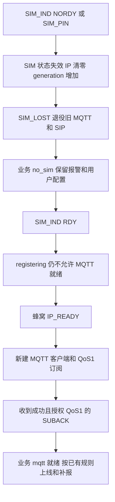

# SIM 热插拔软件恢复流程检查

SAM | 2026-10-20 17:05 +08:00

**17:15 后续更新：** 本文所述看门狗失败已在后续修复中处理，新增喂狗取消、原会话超时与 OTA 门槛测试后，恢复测试为17项全部通过。详见 [SIM恢复期看门狗误重启修复](2026-10-20_SIM恢复期看门狗误重启修复.md)。以下保留原检查时的失败证据；新包尚未烧录，真实热插拔仍未验收。

本轮按用户要求先检查软件，不拔卡、不执行实机断网、重启或烧录。唯一 CAT1 源码入口为 Air780EGH。依据客户 F-012、F-017、F-022、F-029、F-033；不变更平台协议或降低数据保护要求。

## 结论

既有软件具备 SIM 丢失后退役网络会话、插回取得 IP 后重连并重新订阅的路径。新补的两轮完整恢复模拟通过。**新增看门狗边界测试失败：旧网络超时会重启刚恢复的新网络会话。** 因此不能写为 SIM 热插拔软件全部通过，也不能替代真实拔插验收。

本轮未改固件，只补回归用例和本文，未发布新脚本集合。当前烧写集合仍为此前版本。

## 当前流程

| 阶段 | 源码入口与实际处理 |
|---|---|
| 初始化 | main.lua 加载 network_watchdog、netdrv_device、mqtts_main、sip、business_runtime；observer 被 require 缓存复用，不创建两套 SIM 状态 |
| 自动恢复配置 | netdrv_device.lua 启动任务调用 mobile.setAuto，参数为 10000、0、5、nil、60000；API 缺失或抛错记日志，不伪造 RDY。此调用本身不证明实物能检测热插拔，也不保证恢复总耗时 |
| SIM 丢失/锁卡 | report_sim 清 registration/IP 标记、增加 generation；发布 SIM_STATE 和 SIM_LOST，信号接口回 99；无卡期间拒绝 IP_READY 及 MQTT 就绪 |
| MQTT 退役 | mqtts_main.lua / retire_network_session 先清 current_mqtt_client 和订阅标记，再 disconnect；旧客户端回调因身份不匹配被忽略。主任务清理后等 5 秒，仍需 SIM/IP 就绪才新建连接 |
| SIP/音频 | sip.lua 的 SIM_LOST/IP_LOSE 触发清理，停止 SIP 和音频；会话 generation 拦截旧通话回调、旧拨号请求。恢复注册不等于恢复原通话，不自动重拨旧报警电话 |
| 插回 | RDY 只进入 registering，不直接宣布网络可用；随后蜂窝 IP_READY 才放行连接，其他网卡的 IP 事件不放行 |
| MQTT 订阅 | 成功连接后先订阅业务 QoS1；成功 SUBACK 且授权 QoS1 才 mqtt_ready。拒绝、降级及订阅超时继续失败处理；使用当前实机布尔 SUBACK 格式 |
| GR 状态 | CAT1 通过 BUS_EVT 上报 no_sim/registering/ip/mqtt 等状态；UART 链路是否在线与网络状态独立，拔 SIM 不应简单当作 GR↔CAT UART 断开 |
| 时间 | SIM/IP 丢失清 time_synced；IP 恢复请求 NTP，完成后才放行需要有效时间的业务消息，不编造时间 |
| 补报 | business_core 恢复 MQTT 后按已有策略发送 onlineMsg、未确认报警、待发绑定回复和低电消息；断线不清报警、号码绑定和用户参数。发送器普通 RAM 队列失败通知并清队列，不能声称所有类型都具备持久补报 |

## 新发现：恢复窗口仍可能误重启

文件：Air780EGH/network_watchdog.lua，network_watchdog_task_func。

复现时序：

1. 原会话连续 300000ms 没有 FEED_NETWORK_WATCHDOG，且 IP 标记有效，进入超时处理。
2. 代码等待 3000ms。
3. 此期间发生 IP_LOSE → 新 IP_READY，observer generation 已变化，新会话开始恢复。
4. 等待结束只检查当前 ip_ready 和 OTA 是否允许重启，没有确认超时属于哪一代会话，仍执行 rtos.reboot。

主机实际运行当前 Lua 模块复现：断言 `old watchdog timeout reset the newly recovered network` 失败。测试中的 reboot 是计数桩，不会重启任何实机。

建议下一项修复仅针对这处：超时时保存网络 generation，3 秒后 generation 必须仍相同才允许旧超时重启；并验证恢复/喂狗是否应取消延迟重启。保留无 SIM 不重启及 OTA 重启保护。本文只是检查结论，该修复尚未实施。

## 测试证据

| 检查 | 结果 |
|---|---|
| tools/business/test_sim_recovery.py | 15 项：14 项通过、1 项失败（上述新发现）；不能标记全部通过 |
| 新增两轮 MQTT 恢复测试 | 通过：每轮移除旧客户端、未获 IP 前不新建、重建后重新 SUBACK、旧客户端不能接收或恢复业务 |
| 既有 SIM/信号测试 | 无卡、锁卡、错误网卡、缺 API、旧回调、旧拨号、SIP 音频清理、旧看门狗无卡路径等通过 |
| tools/ota/test_mqtt_ack.py | 通过，保留当前 SUBACK/PUBACK 身份、超时、QoS1 门槛 |
| tools/business/test_cat_business.py | 18 项通过，含报警/通话独立、持久状态和旧确认隔离 |

执行使用项目现有 Python/Lupa 环境。新增用例位于 tools/business/test_sim_recovery.py，含 SAM 时间和原因；没有删除或跳过失败用例。

## 本轮检查项与尚未验证

| 检查项 | 结果 |
|---|---|
| 修改范围 | 主机测试和中文说明；未改 Air780EGH 固件和两份 GR 固件 |
| 两份 Keil 编译 | 不适用，本轮无 GR 源码改动 |
| 发布/烧录/用户数据 | 未发布新集合、未烧录、未擦除、未改用户数据 |
| 真实热插拔 | 用户明确暂不拔卡，未执行 |
| 模块检测能力 | 实际是否发 NORDY/RDY、底包恢复时序、卡座检测和重新注册耗时仍需实物证据 |
| 事件先后/缓存 | 模拟覆盖指定顺序；SIM 重新 RDY 后到达的无 generation 标签底层 IP 事件，无法仅凭当前软件证明全部来自新会话。不能把模拟测试扩大成底层事件可靠性证明 |
| 平台与语音 | 未实际拨号或验证真实平台下行；网络注册不代表 SIP 注册/双向音频已通过 |
