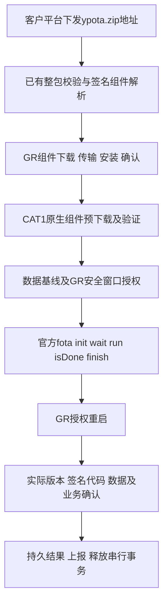

# 合宙官网现成OTA流程与本项目采用路径

SAM | 2026-10-24 +08:00 | 按用户要求补查官网及同型号官方Demo，不依据AI问答摘要。纠正把CSDK/只读KV接口视作标准OTA必要条件的表述；本轮不修改或烧录固件。

## 结论与选择

采用**现有V2052 Air780EGH_113底包、仅脚本升级、官方fota核心库分块接口**。保留本项目已有ZIP验签/组件分发和GR串行编排，不重新开发CAT1 Boot或A/B。普通单模组自建平台项目可以直接采用libfota2，但本产品包含GR升级、签名ZIP和严格提交条件，不能把完整ZIP直接交给libfota2。

标准OTA不需要CSDK，不要求初始化KV，也不要求专用pending查询接口。官方已经明确正常FOTA保留LFS/KV、重启后用实际版本确认安装。因此此前“没有CSDK或只读KV就无法做任何OTA”的笼统方向应纠正；**当前本项目完整数据取证还缺KV读能力**是另一项事实，不能把官方支持说明写成实板保持已通过，更不能将当前data_ok/激活门直接置true。

## 官方方案比较

| 方案 | 官方支持范围 | 对本项目的判断 |
|---|---|---|
| libfota2 | 合宙平台或自建HTTP服务器；request(callback, opts)，回调0后应用决定重启 | 自建平台的标准高层入口；适合单CAT1，不能直接处理自定义双端ZIP或替代GR owner |
| libfota3 | 仅合宙IoT平台；自动检测、过程回调、确认交互、重启后结果上报 | 当前客户平台不适合直接换用；不要为使用库更换后台或引入周期唤醒 |
| fota核心库 | init、wait、run/file、isDone、finish，提供原生升级接口 | 本项目采用分块run，复用已存在ota_native_fota.lua，保留逐块业务/授权检查 |
| CSDK自建升级底层 | Air780EGH官方型号页明确不支持CSDK开发 | 不是标准OTA实施路径；无需继续寻找其他型号CSDK来替换底包 |

## 官网现成流程

1. 基线安装正确底包与脚本，在main.lua定义PROJECT和VERSION；记录core版本/固件编号和实际脚本版本。
2. 修改业务并提高脚本版本，用Luatools生成对应升级包。仅脚本是全量脚本包；4G core+script是基于真实旧、新版本制作的差分包。
3. 将原生包放在合宙平台或可达的自建HTTP服务器。自建服务器需要升级时返回HTTP200和包二进制；libfota2的无需升级响应按文档使用300以上状态码，不能返回200加一个普通JSON网页冒充包。
4. 联网后执行升级。libfota2会在HTTP接收时走FOTA写入；核心库路径则由应用调用init→wait→逐块run→isDone→finish。
5. 成功准备后由应用调用rtos.reboot。官方示例允许应用自行决定重启时机，但不能据此推断所有中间状态遇到其他复位都不会安装。
6. 启动后比较实际脚本/core版本；回调0或isDone成功不等于新程序已经安装运行。业务健康和平台结果上报由产品逻辑补齐。

### 文件后缀不要混淆

官网教程将Luatools生成的仅脚本OTA文件称作`.bin`；本项目生成器固定使用`.sota`和同名生成记录，内部通过厂商soc_tools生成原生容器，再解压读回验证。**不按后缀判断字节格式，也不要求把普通烧写BIN改名。**

本项目外层`.ypota.zip`是自定义发布归档，含GR组件、CAT1原生组件、元数据与签名。官方单模组Demo不会自动认识这个外层格式；必须继续由本项目的包解析器提取CAT1原生组件后交给fota，不能把整个ZIP直接传入fota.run/file或libfota2。

本轮1.5.0的原生组件已经生成，不因查到官方教程重新打同一版本或替换底包。

## 新查实的关键细节

### fota.file不是无副作用的暂存接口

固定官方仓库提交下的luat/modules/luat_lib_fota.c，l_fota_file在读完文件后会调用luat_fota_done，成功后继续调用luat_fota_end(1)。这说明公开实现不只是复制字节；不能等到后续显式finish(true)才开始检查安全条件。

本项目当前ota_native_fota使用run而非file，应保留。**整个原生阶段init→run→isDone→finish均在GR授权的安全窗口内进行**，不是只拦最后一次reboot。提交前检查、逐块让出业务以及故障取消继续沿用。公开当前源码不能替代V2052所有掉电点的实测。

libfota2源码设置opts.fota=true，HTTP请求直接进入原生FOTA路径；它也不应在尚未满足安装条件时当作普通预下载器使用。本项目的签名候选预下载与原生写入必须继续分开。

### 自建完整下载URL不能擅加参数

官方libfota2文档明确：完整URL且无需附加IMEI、版本等参数时，传入`###`前缀，库去掉前缀后请求原URL。这对带鉴权参数的地址尤其重要。

本项目已有直接HTTP/Range实现，不走libfota2，因此不会为套用此规则向客户地址直接添加`###`，也不需要更换下载器。只有采用libfota2的路径才使用该约定。

### 官方数据保护范围和异常边界

官方课程§5.4.1、§8.5说明仅脚本升级不影响LFS/KV，用户文件保留；core差分升级也有分区兼容要求。由脚本主动调用format/clear、错误的USB擦除选项、新固件自身迁移/覆盖数据，都不能归因于标准FOTA自动保护。

因此维持现底包/编号、只更新脚本，可以减少本轮变量。未知历史KV不能自行初始化；不需要为了运行FOTA而初始化它。未知KV字节保持取证可另查工具原始读回，不应让数据取证演变成重写固件底层。

当前底包的KV状态仍不可读，生产数据证据门仍拒绝。要完成该门，可使用已验证的无格式化读取，或在专用板对已建立KV样本取证。未有样本的现有板不能冒险初始化；本轮不取消该门来迎合官方Demo。

### 官方版本与故障信息

官网Air780EGH版本页列出V2052及相关FOTA修改。按具体型号/版本标题归属解释，不能把EGG或其他历史版本条目当作本机修复证明；本轮不下载新底包、不做core差分、不改变固件编号。

官方还说明错误匹配core/script旧新组合会引起循环升级。此前已准备的实际1.0.2基线记录和1.5.0目标身份应继续保留，不能只修改ZIP名称或后台版本号。

## 本项目落地时复用什么

上述图是采用路径，不表示本轮端到端运行通过。已有模块和结果协议保留，不再重复写下载器、版本比较、安装结果查询或日志。

| 项目 | 状态及下一步 |
|---|---|
| 官方原生安装接口和正常保留规则 | 文档已确认，不再等待CSDK或专用pending接口 |
| 1.5.0组件产物 | 已生成，沿用；本轮不重新编译/签名/打包 |
| 当前默认原生激活门 | 仍关闭；不能由文档正常流程外推全部异常时序已验收 |
| KV前后取证 | 当前不可读仍是项目取证缺口；与官方OTA功能支持分开登记 |
| flashread备选路径 | 本地工具帮助已证实命令存在；地址语义及进入读回模式副作用未验，不执行设备命令 |
| 实板与备用板 | 本轮不操作现有板；用户暂无备用板，实际升级/断电用例仍未执行 |

## 官方来源和本地证据

1. [libfota2官方说明及方案比较](https://docs.openluat.com/osapi/ext/libfota2/)
2. [fota核心库接口及包制作](https://docs.openluat.com/osapi/core/fota/)
3. [官方课程009：流程、分区与数据保留](https://docs.openluat.com/luatos_lesson/009_luatos_fota/)
4. [libfota3官方说明](https://docs.openluat.com/osapi/ext/libfota3/)
5. [Air780EGH/EGG固件版本页](https://docs.openluat.com/air780egh/luatos/firmware/780egg&780egh_version/)
6. [官方FSKV说明](https://docs.openluat.com/osapi/core/fskv/)
7. 官方LuatOS仓库同型号demo/fota及script/libs/libfota2.lua、libfota3.lua、luat/modules/luat_lib_fota.c，已固定提交下载。精确URL、提交和SHA256见下面索引。

原文下载目录：`logs/ota_official_workflow_20261024`。网页来源及SHA256：sources.json、additional_sources.json；官方Demo固定提交及源码SHA256：official_demo_paths.json、official_demo_sources.json。均未作为本项目构建输入或执行，不混入Air780EGH源码。

本轮仅官网研究、源码对照及文档更新；没有操作实板、初始化KV、打开门禁、修改固件或重编已生成目标。官方示例是技术参考，不是运行其中定时升级、平台请求或自动重启代码的授权。
