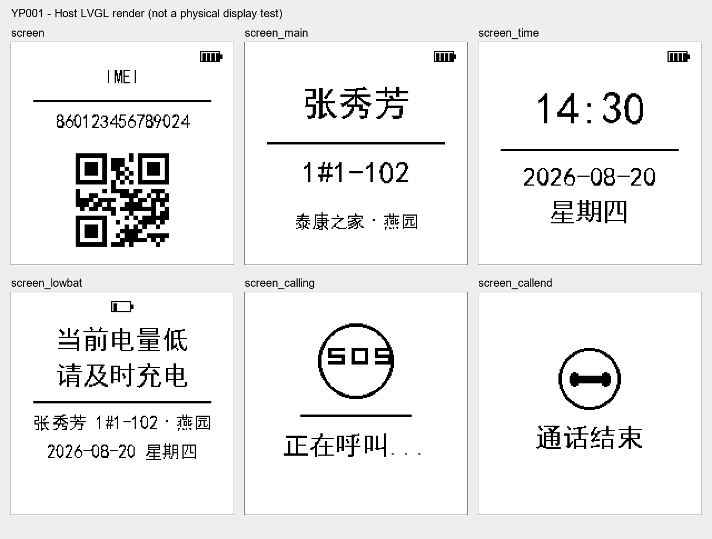

# YP001 GUI Guider 六页面导入记录

SAM | 2026-10-11 +08:00

## 目标与实施顺序

源工程：`LVGL/YP001/YP001.guiguider`。目标为主工程及交付副本的 `Src/user/gui`，保持 LVGL 8.3.1、1bpp、24KB 内存池以及已有显示驱动、flush、引脚和下载配置。

- [x] 核对源文件和当前显示调用链；备份工程、导出资源、GUI 和 Keil 项目到 `tmp/gui_guider_import_20261011_before`。
- [x] 通过 GUI Guider 的 Ctrl+G 执行生成；五张图片已产生，页面代码生成尚未完成。
- [x] 检查字体配置：56 处 `font_family` 引用了未注册的 `simhei_16/24/28/32/40`；改为已注册的 `simhei`，保留各自字号。JSON 不支持注释，修改人、时间、原因记录于本文。
- [x] 重新加载工程，取得六个页面、公共头文件和事件代码；GUI Guider 日志确认生成完成，六个 setup_scr 文件存在。
- [x] 新页面接入现有刷新链路；按需创建页面，加载后删除上一页，避免六页常驻。保留源设计；姓名、时间、IMEI、QR 和状态图标仍为原设计的示例值，不是实机业务数据。
- [x] 检查并转换 1bpp 字体位图：逐字形逐像素校验连续位图与按字节对齐的目标位图相同，保持字形度量和字符映射。
- [x] 更新两份 Keil 文件清单及必要包含路径，逐文件同步并检查一致性。
- [x] 执行针对页面切换、内存和资源的检查，以及两份 Keil 独立编译；记录新 AXF/HEX。

## 已发现的差异

请求所列 `setup_scr_*.c`、`gui_guider.c/h` 在首次检查时不存在；`images` 最初仅有 mk 文件。字体源码已存在。

当前启动和周期显示由 `bsp.c` 调用 `epaper_lvgl_show_home()`，旧 LVGL 控件实际在 `epaper_lvgl.c` 内；`epaper_home.c` 是另一条直接帧缓冲绘制路径。因此接入需要修改页面创建/更新逻辑，保持驱动注册和 flush 算法。

GUI Guider 1.10.1 用户手册第 35–36 页确认 Ctrl+O 打开工程、Ctrl+I 导入工程、Ctrl+G 生成 C 代码。窗口截图/定位多次超时，文本树和部分键盘操作可用。第一次生成完成了五张图片，但日志停在 `Generating C code...`。字体引用修正后的导出尚待验证，不能宣称已经解决生成停顿。

## 强制检查项

| 检查项 | 结果/证据 |
|---|---|
| 修改前工作区和目标文件检查 | 存在大量既有改动；未重置、提交或覆盖无关文件；修改前备份已保留 |
| 主工程/交付副本差异检查 | 修改前再次确认 epaper_lvgl.c/h、epaper_home.c/h、uvprojx 一致；修改后所有 GUI C/H 及 uvprojx 一致，全部工程文件引用存在 |
| 代码时间/修改人/原因注释 | 新文件、页面入口、二维码位置和字形转换均有 SAM / 北京时间 / 原因注释；JSON 配置变更记录于本文 |
| 本轮中文修改说明 | 本文件 |
| 主工程 Keil 6 编译 | AC6.14，0 Error(s), 0 Warning(s)，退出码 0；日志 `logs/gui_guider_main_20261011.log` |
| 交付工程 Keil 6 编译 | AC6.14，0 Error(s), 0 Warning(s)，退出码 0；日志 `logs/gui_guider_delivery_20261011.log` |
| 实板测试及未完成项目 | 未下载或连接设备；六页面、中文、QR 扫描、内存、刷新和业务联动待实板验证 |

清理脚本未修改、未运行；CAT1 源码未访问或修改。

## 窗口控制问题及恢复

用户恢复窗口后，再次捕获及重置 Computer Use JavaScript 会话仍返回 `window capture timed out` / `FrameArrived timed out`；控件点击返回 `coordinate input geometry is unavailable`。因此没有继续盲目操作，也没有把不完整页面输入接入 Keil。

需在 GUI Guider 重新打开已修正的 `LVGL/YP001/YP001.guiguider`，再执行 Ctrl+G。此前窗口内仍可能缓存旧配置，不应先保存旧缓存覆盖磁盘修正。字体引用错误已经静态确认，但是否为生成停顿唯一原因尚未验证。

用户重新打开工程并确认生成成功后，文件检查取得全部六个 `setup_scr_*.c`，继续导入。此前的停止点已解除；窗口截图本身仍存在工具超时，不作为任何显示验收证据。

## 修改文件与行为

| 文件 / 函数 | 修改前 | 修改后与原因 |
|---|---|---|
| `LVGL/YP001/YP001.guiguider` 字体配置 | 引用未注册的带字号字体族 | 引用已注册 simhei，字号独立保留；成功重新导出 |
| `Src/user/gui/guider/` | 不存在 | 导入六页、公共代码、custom、五张图片和两套各五档 1bpp 字体源码，共 31 个 C/H 文件 |
| `guider_fonts/font_cn_*.c`、`guider_customer_fonts/*.c` | 连续位存储 | 导入副本按行补齐字节并重建 bitmap_index，逐像素验证；不修改 LVGL 字体绘制库 |
| `guider/gui_guider.h`、六页 setup 文件 | 使用 GUI Guider 新生成的 4bpp simhei 字体符号 | 映射到现有五档 font_cn 1bpp；仅空文字分隔线的 Montserrat 引用使用 font_cn_16，不改变可见文字字体 |
| `setup_scr_screen.c` 二维码 | `(42,88)` + `116×116`，底部越界 4 像素 | `(42,84)`，避免裁切；不改变 QR 图片内容 |
| `epaper_ui.c/h` | 不存在 | 单页管理及 `epaper_ui_select_page()`；默认 screen，不添加自动通话/低电业务判定 |
| `epaper_lvgl.c` 页面创建及 `epaper_lvgl_show_home()` | 创建、更新旧英文状态和 XYZ 控件 | 在相同启动/轮询入口渲染所选 GUI Guider 页面，保持 NULL 入参失败和 flush 失败返回；原 flush 函数体、驱动注册参数、帧缓冲清白和刷新过程保持一致 |
| 两份 `Keil_6/YP001_GR5526.uvprojx` | 仅旧 GUI 文件 | 增加 21 个编译单元、generated/custom 包含路径和 `LV_LVGL_H_INCLUDE_SIMPLE`；不改变 scatter、Flash、下载算法 |
| `tools/import_guider_ui.py` | 不存在 | 可重复导入并保存 SHA256 清单；源 GUI 导出保留，变换只发生在导入副本 |
| `tools/test_guider_ui.c/.py` | 不存在 | 使用当前项目的 LVGL、页面适配和 flush，替代物理传输做主机渲染、切换与堆检查 |

`epaper_lvgl.h`、`epaper_home.c/h` 保持原样：旧纯帧缓冲绘制入口仍被 `epaper_depg0150_display_home()` 引用，保留兼容性；当前 BSP 正常显示入口已由新六页替代。BSP 电池/XYZ 采样、CAT1、BLE、按键业务、电子纸硬件驱动和清理脚本未改。

仅将五份 `font_cn_*.c` 加入 Keil 编译；customer 字体副本作为兼容源资源保留，不重复占用固件字库空间。生成器默认 4bpp 字体没有替换目标工程的 LVGL 库，也没有改为链接 GUI Guider 自带库。

## 使用及验收边界

默认打开 `screen`（IMEI/QR 模板页）。串口命令选择页面，下一次已有显示轮询应用，既有轮询间隔仍由 BSP 控制：

```text
epd_page screen
epd_page screen_main
epd_page screen_time
epd_page screen_lowbat
epd_page screen_calling
epd_page screen_callend
```

本轮是界面模板移植，未把模板 IMEI、QR、姓名、房间、时钟、低电和呼叫文案绑定至真实状态。`epd_page` 仅切换显示，不发起或挂断电话，不改变充电和报警行为。原旧页实时 BLE/电池/XYZ 文案不再显示，但原采样流程保持。实机业务绑定属于后续工作。

实板仍需逐页检查中文、QR 扫描、显示方向、完整/局部刷新残影、持续切页、失败恢复，以及后续真实数据绑定。没有下载/烧录，本轮不能标记这些项目通过。

## 验证记录

- 修改前五个既有目标文件一致，未覆盖交付副本独立差异。
- `import_guider_ui.py`：31 文件导入双副本，每个字形源/目标像素一致。
- 静态脚本：flush 函数体与备份完全相同，显示注册参数相同，双 GUI 目录 C/H 与工程文件相同，Keil 所有源文件路径存在。
- 两份 `验证Keil6交付.ps1` 均返回 `Keil 6 delivery files OK`。
- 两份 AC6.14 编译均为 0 错误 / 0 告警，退出码 0。Program Size 均为 Code=281872、RO-data=172244、RW-data=3492、ZI-data=131580。
- 初次主机编译成功但运行测试的页面数断言失败。核对 `lv_hal_disp.c`，LVGL 将 top_layer / sys_layer 同样计入 screen_cnt；已修正测试为排除两个系统层后检查仅有一个应用页面。
- 第二次测试发现 free_size 在循环之间相差 8–16 字节。完整 40 轮诊断确认这是分配器块布局交替，live allocation 数保持相同，空闲内存没有累积减少。测试改为断言相同 live allocation 数和不低于暖机基线的空闲内存；未放宽 24KB 内存池，未修改固件来绕过测试。
- 最终主机编译/运行退出码 0：六页 240 次切换、单应用页、堆完整性、无空闲内存损失、live allocation 数稳定、非法页码/NULL 参数、flush 失败及重试均通过。最低稳态空闲 **17792 / 24576 字节**。仅替换物理发送函数来捕获帧缓冲和模拟失败，其余使用目标工程 LVGL、UI 与 flush 源码。
- 六页主机预览人工检查：中文、文字排布与图像可见；QR 在 `(42,84)` 的 116×116 输出区域与源 `import/image/qr_imei.png` **逐像素完全相同**。这不等同于实板扫码通过。
- 所有模板标签共 103 个字符均在 280 字符的目标字库字符集中；五档字库保持相同字符映射。

### 主机复测命令及预览

```powershell
& 'C:\Users\SamLi\.cache\codex-runtimes\codex-primary-runtime\dependencies\python\python.exe' tools\test_guider_ui.py
```

测试使用本机已安装的 GUI Guider MinGW GCC；对象缓存按编译选项、编译器时间、源文件和全部相关头文件内容校验。结果保存在 `tmp/guider_host/build.log` / `run.log`，最终日志另存至 `logs/gui_guider_host_20261011.log`。



### 新构建产物（北京时间）

| 副本 / 产物 | 时间 | 字节数 | SHA256 |
|---|---|---:|---|
| 主工程 `Objects/YP001_GR5526.axf` | 2026-10-11 01:11:09 | 5664692 | `5F8E638226B98BDE1E574F0A113FAECC5E6ED7E2E3792A17CB15ECD9443DF6B4` |
| 主工程 `Objects/YP001_GR5526.hex` | 2026-10-11 01:11:11 | 1285100 | `FBB0DD21BADDA1C2F71F0BA81558B6E0BDE320C1DB39AE6A2A2FC957BF60E3A4` |
| 交付副本 `Objects/YP001_GR5526.axf` | 2026-10-11 01:11:16 | 5670160 | `1EBE21DDF89879278DF070065A13F45CE81A3969CE9C9733ABBD94C7A5AB4194` |
| 交付副本 `Objects/YP001_GR5526.hex` | 2026-10-11 01:11:18 | 1285100 | `BFC396F9927D0010048EDA1551EACF1ADC8ADA49D930917574BCE5F795576B76` |

Intel HEX 逐记录校验和、地址与加载字节比较：仅 3 个加载字节不同，位于 `0x26E6E4`、`0x26E6E6–0x26E6E7`，对应既有编译时间字符串 `01:00:41` 与 `01:01:04`；其余加载字节相同。没有通过复制主工程产物冒充交付副本编译。
